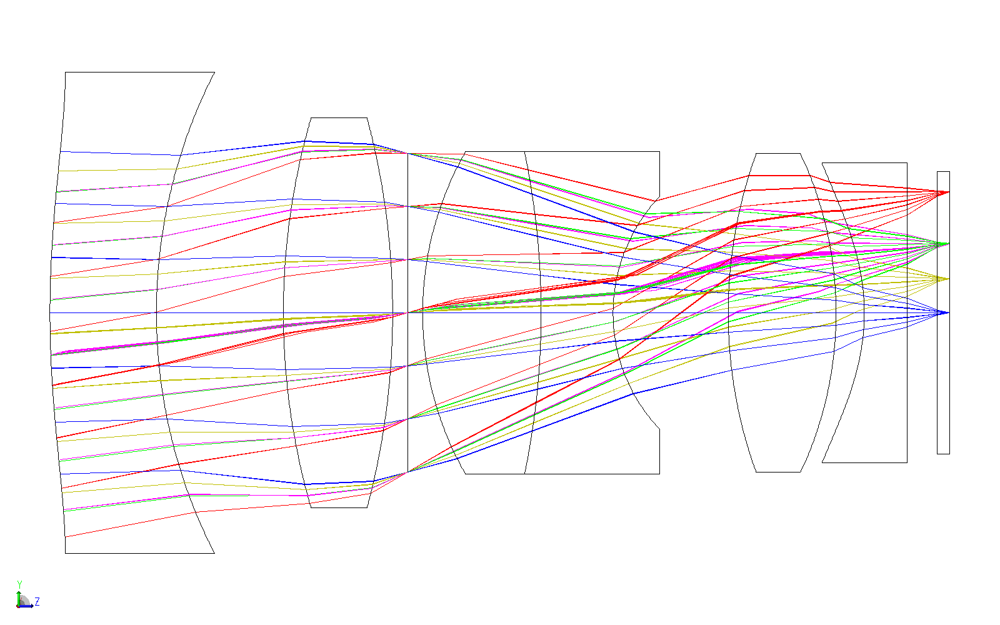
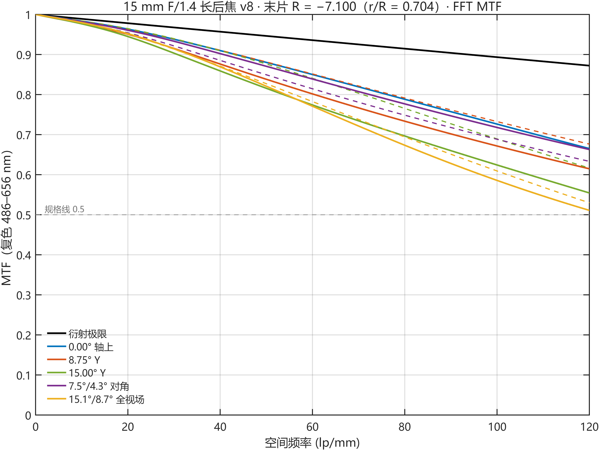
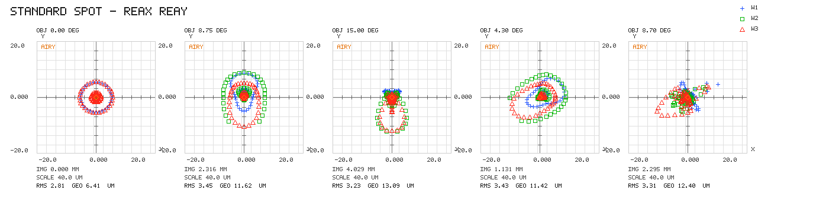
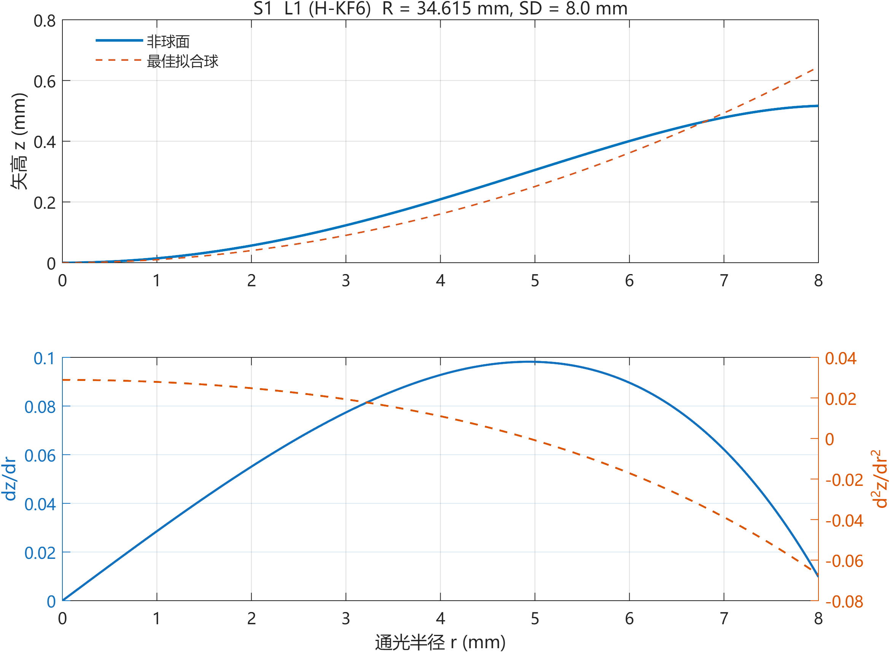
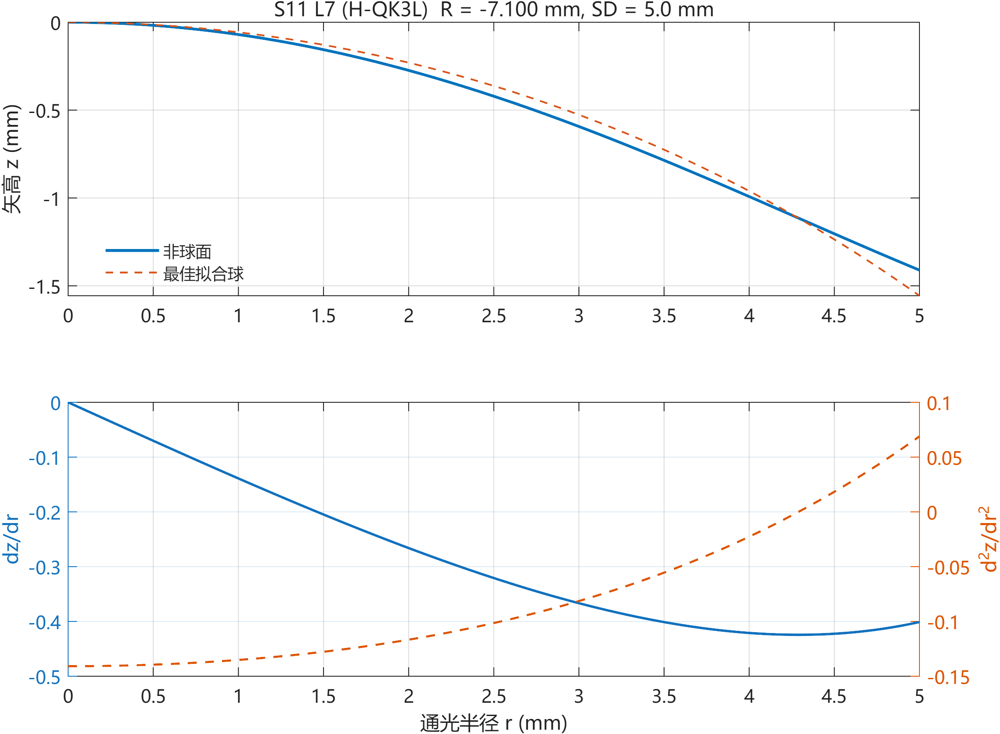
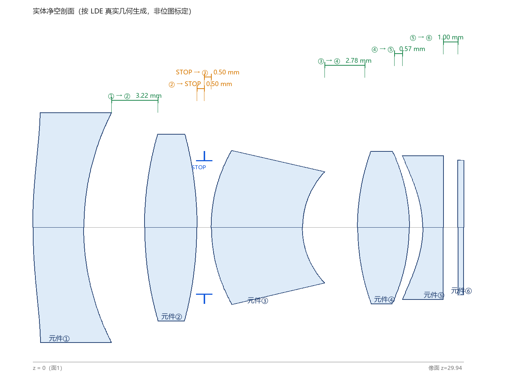
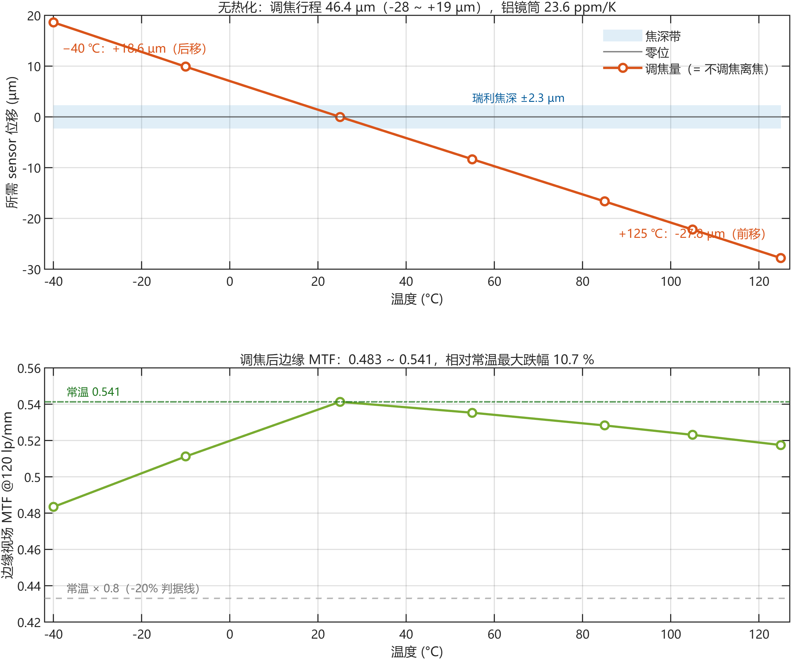
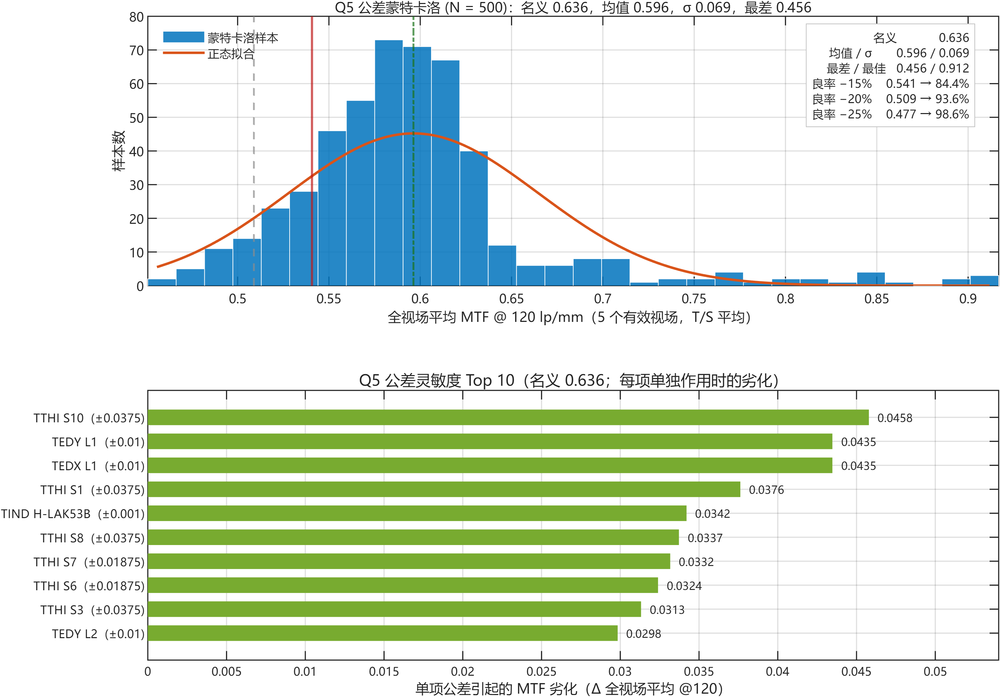
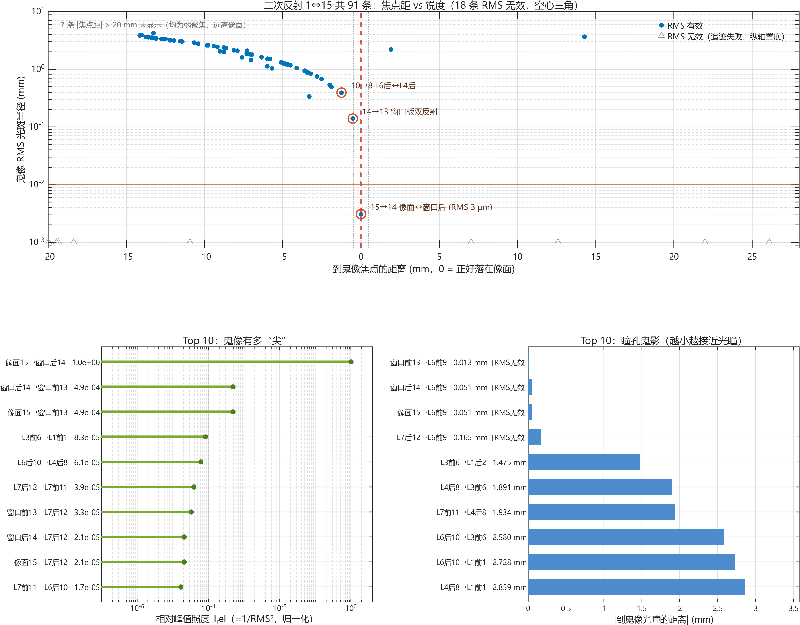
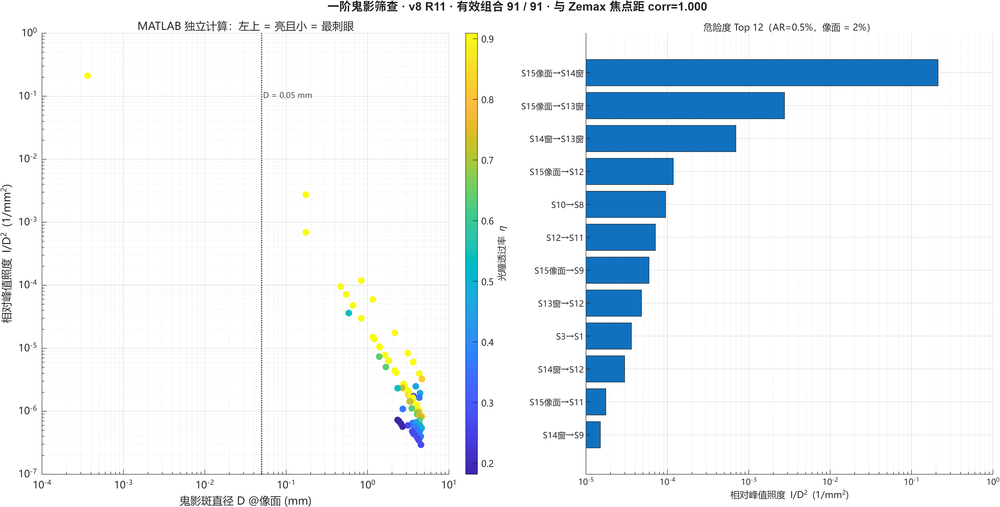

# 车载长焦前摄 15 mm F/1.4 —— 工程报告（长后焦 v8 · 末片半球专项，R₁₁ = −7.100）

| 项 | 内容 |
|---|---|
| 设计文件（交付） | `长后焦_v8_Z115_SDopt10_R11_20261122.zos` |
| 上一版基线（保留） | `长后焦_v8_Z115_SDopt10_20261122.zos`（R₁₁ = −6.360，末片半球超限） |
| 无热化副本 | `长后焦_v8_Z115_R11_无热化_20261122.zos`（7 组态 −40…+125 ℃） |
| 公差副本 | `长后焦_v8_Z115_R11_公差Q5_20261122.zos`（Q5，69 行 TDE + 后焦补偿器） |
| 数据目录 | **本目录**（本报告、README、`.m` 脚本、`data/`、`figs/`、`analysis/`、`backups/`） |
| 版次 | 2026-11-22（末片半球专项整改版，**采用**；本版补齐无热化与 Q5 公差） |
| 软件 | OpticStudio 2024 R1（ZOS-API，读数全部经 MCP 工具）、MATLAB R2025b（MTF / 面型 / 无热化 / 公差统计出图） |
| **光学指标** | **10 项全部达标**；MTF@120 最差 0.5109（余量 0.011，全系统最紧） |
| **无热化** | **主动调焦可行**：全温调焦量 46.4 µm，调焦后边缘 MTF 跌幅 10.7 %（判据 20 %） |
| **公差（Q5）** | **可用但余量薄**：500 次蒙特卡洛，平均判据 0.5963 ± 0.0685（折算到 5 个有效视场），良率 93.6 %（名义 −20 %）/ 98.6 %（−25 %），CPK 0.43 |
| **DFM** | **条件通过**。两处半球面均达标；P1 待闭环：设计文件未锁定变量、胶合组 UV/CTE 待核验、像面半口径待改 |

> **口径声明**：本报告的光学指标一律取自 Zemax **原生分析**（FFT MTF、Field Curvature & Distortion、
> Relative Illumination、Standard Spot）。不使用评价函数里的 MTF 操作数作为验收依据。
> RMS 只认原生 `standard_spot.txt`——本工具链的 `get_image_quality` / `RSCE` 采样稀疏，
> 历史上对同一状态少报约 3 倍，不能用于验收。
> 唯一次要例外是 CRA：用 `RAID` 的 `GetOperandValue` 取单点值（插行读完即删，不留残余行）。

---

## 一、本版概要

### 1.1 本版做了什么

本版只解决一件事：**末片 L7 前表面（S11）的半球超限**（r/R = 0.786，超过 0.7·D 经验限）。

| # | 变更 | 说明 |
|---:|---|---|
| ① | **L7 前表面半径 R₁₁：−6.3598 → −7.1000** | L7 的 r/R 由 0.786 降到 **0.704**，回到 0.7·D 限值以内 |
| ② | 后组重新平衡 | S9 15.949→15.545、S10 −11.030→−12.502、S8 5.555→5.623、S6 10.418→10.787；L2、L1 与数段空气间隔随之微调 |
| ③ | L7 非球面系数重优化 | A4 5.319e−4→4.670e−4，A6 6.43e−7→3.72e−6 |
| ④ | 新增两条曲率硬护栏 | 行 1269 `CVLT(8) ≤ 0.185278`（R₈ ≥ 5.397）、行 1270 `CVGT(11) ≥ −0.140845`（\|R₁₁\| ≥ 7.10） |
| ⑤ | L7 中心厚护栏 1.5 → 1.4 | 行 77 `MNCG(11,11)`；实际 CT 1.432，SD/CT 3.492 合格 |
| ⑥ | **本版新增：Q5 公差与无热化** | 均在副本上完成，交付文件保持单组态 25 ℃ 干净（见 §七、§八） |

**未改动**：拓扑（6 元件 7 片）、全部玻璃牌号、窗口等效平板、光阑位置与前后 0.5/0.5 固定间隙、视场与波长。



*图 1　三维布局（OpticStudio 3D Layout，隐藏透镜边，视角 0/0/0）。后组依次为胶合组（L3+L4）、L6、末片 L7，最后是 0.40 mm 等效窗口平板。*

### 1.2 结论一览

| # | 指标 | 要求 | 实测 | 判定 |
|---:|---|---|---:|---|
| 1 | 有效焦距 EFFL | 15 ± 5 % | 15.0372 mm | ✅ |
| 2 | 系统总长 TOTR | ≈ 30 mm | **29.9417 mm** | ✅ |
| 3 | 像方 F/# | 1.4 | 1.40（EPD 10.741 mm） | ✅ |
| 4 | 视场 | 对角 ≥ 34° | 34.85°（半角 17.427°） | ✅ |
| 5 | 像圈 | > 9.25 mm | 9.410 mm（实际像高 4.705 mm） | ✅ |
| 6 | MTF@120 最差视场 | > 0.5 | **0.5109** | ✅（余量 0.011，**最紧**） |
| 7 | 最大畸变 | < 1 % | 0.312 % | ✅ |
| 8 | 相对照度 | ≥ 60 % | 83.42 % | ✅ |
| 9 | 场曲 | < 0.05 mm | 0.021 mm | ✅ |
| 10 | CRA | < 18° | 12.32° | ✅ |
| 11 | **L7 r/R（半球）** | ≤ 0.714 | **0.704** | ✅ |
| 12 | **S8 r/R（半球）** | ≤ 0.714 | 0.688 | ✅ |
| 13 | **全温调焦后 MTF 跌幅** | ≤ 20 % | **10.7 %** | ✅ |
| 14 | **Q5 良率** | ≥ 90 %（口径见 §8.4） | **93.6 %** @名义−20 %；84.4 % @−15 %；98.6 % @−25 % | ✅ 良率达标，但 CPK 0.43 < 1.33，见 §8.3/§8.5 |
| 15 | **鬼影 GISET**（支配项 15↔14） | < 1e−3 | **8.5e−5**（sensor 2 %、AR 0.5 %） | ✅ 一阶强度；缺实测镀膜，见 §九 |

与上一版逐项对比：

| 指标 | 上一版（R₁₁ = −6.360） | 本版（R₁₁ = −7.100） | 变化 |
|---|---:|---:|---|
| **L7 r/R（半球）** | **0.786 ❌** | **0.704 ✅** | **整改达标** |
| S8 r/R（半球） | 0.694 | 0.688 | 更宽松 |
| MTF@120 最差 | 0.5075 | 0.5109 | +0.7 % |
| RMS 光斑 最大 | 3.89 µm | **3.45 µm** | 改善 11 % |
| EFFL | 15.0145 | 15.0372 | +0.15 % |
| TOTR | 30.0249 | **29.9417** | −0.083（回到 30 以内） |
| 畸变 | 0.329 % | **0.309 %** | 改善 |
| 相对照度 | 83.35 % | 83.42 % | 持平 |
| L7 拐点余量 | 0.20 mm（4 %，贴线） | **0.711 mm（14.2 %）** | 显著改善 |
| L7 边缘斜率 | −26.94° | −21.85° | 变缓 |

---

## 二、系统参数

### 2.1 一阶量

| 项 | 值 |
|---|---:|
| 有效焦距 EFFL | 15.0372 mm |
| 系统总长 TOTR（面 1 → 像面） | 29.9417 mm |
| 入瞳直径（F/1.4） | 10.741 mm |
| 工作 F/# | 1.465（轴上）→ 1.604（17.43° 边缘） |
| 像方 NA | 0.3413 |
| 艾里斑半径（0.588 µm） | 1.004 µm |
| 衍射截止频率 | ≈ 1161 lp/mm |
| 后焦（末片 → 像面） | 1.400 mm = 1.000 空气 + 0.400 玻璃 |
| 实际像高（d 线，17.43°） | 4.705 mm（参考高 4.720 mm） |
| 评价函数值 | 0.020416 |

### 2.2 面表

| 面 | 类型 | 半径 R (mm) | 厚度 (mm) | 材料 | 半口径 (mm) | 备注 |
|---:|---|---:|---:|---|---:|---|
| 0 | 标准 | ∞ | ∞ | — | — | 物在无穷远 |
| 1 | **偶次非球面** | 34.6149 | 3.5436 | H-KF6 | 8.000 | k = −1，A4 = −8.2606e−5，A6 = −2.6536e−7 |
| 2 | 标准 | 17.5416 | 4.2272 | 空气 | 8.000 | |
| 3 | 标准 | 23.2843 | 3.6362 | H-LAK53B | **6.500** | |
| 4 | 标准 | −25.1589 | 0.5000 | 空气 | **6.500** | |
| 5 | 标准 | ∞ | 0.5000 | 空气 | 5.306 | **STOP（光阑，虚面）** |
| 6 | 标准 | 10.7865 | 3.9431 | H-ZLAF50E | **5.360** | 胶合组前片 L3 |
| 7 | 标准 | −26.3832 | 2.3959 | ZF7LGT | **5.360** | **胶合面**（L3/L4） |
| 8 | 标准 | **5.6226** | 3.8327 | 空气 | **3.870** | **L4 后表面（半球专项之一）** |
| 9 | 标准 | 15.5450 | 3.5893 | H-ZLAF50E | **5.300** | |
| 10 | 标准 | −12.5018 | 0.9418 | 空气 | **5.300** | |
| 11 | **偶次非球面** | **−7.1000** | 1.4320 | H-QK3L | 5.000 | **L7 前表面（本版整改面）**；k = −1，A4 = 4.6697e−4，A6 = 3.7164e−6 |
| 12 | 标准（平） | ∞ | 1.0000 | 空气 | 5.000 | L7 后表面 |
| 13 | 标准（平） | ∞ | 0.4000 | **H-K9L** | 4.698 | IR-CUT + CG 等效平板 |
| 14 | 标准（平） | ∞ | **0.0000** | 空气 | 4.668 | 板后表面 = 像面位置（该厚度就是公差/调焦的补偿面） |
| 15 | 标准 | ∞ | — | — | 4.668 | 像面 |

> **口径定版（2026-11-22 更新）**：机械半口径按出图值取整——L2 两面 6.458/6.102 → **6.500/6.500**，
> L3+L4 5.359 → **5.360**，L6 两面 5.214/5.275 → **5.300/5.300**；其余（L1、L7、光阑、窗口、像面）不变。
> 交付、无热化、公差三个 `.zos` 已同步为同一组口径。
> **光学指标不受影响**：更新前后原生 FFT MTF 文本逐值相同（120 lp/mm：0.6651 / 0.6147,0.6764 /
> 0.5544,0.6165 / 0.6628,0.6332 / 0.5109,0.5298），说明原口径本就没拦光，放大只是把余量写进图纸；
> 点列图 RMS（2.81~3.45 µm）同样未变。受影响的只有几何类指标（净空、边厚 ET、SD/CT、定心系数 Z、布局图），见 §四/§六。
>
> **窗口建模口径（R17）**：IR-CUT 与 Sensor CG 按**单片等效平板**建模（H-K9L 0.40 mm），
> 拆开建会引入一个强反射薄空气腔（`check_interference` 查不到、必出鬼影）。
>
> ⚠️ **像面半口径 4.668 mm < 实际像高 4.705 mm**。像面半口径不参与光线遮挡，不影响任何读数，
> 但出图/封装前应改为 ≥ 4.71 mm，否则口径标注与实际像圈不一致。此问题上一版即存在。

### 2.3 玻璃清单

| 片 | 面 | 材料 | 作用 |
|---|---|---|---|
| L1 | 1–2 | H-KF6 | 负弯月（发散），非球面首片 |
| L2 | 3–4 | H-LAK53B | 正透镜 |
| L3 | 6–7 | H-ZLAF50E | 胶合组前片 |
| L4 | 7–8 | ZF7LGT | 胶合组后片（火石，色差校正），后表面为强凹面 |
| L6 | 9–10 | H-ZLAF50E | 正透镜 |
| L7 | 11–12 | H-QK3L | 末片，非球面，后表面平面 |
| 窗口 | 13–14 | H-K9L | IR-CUT + CG 等效平板 0.40 mm |

**成本提示**：H-ZLAF50E 出现两次（镧系，单价明显高于普通牌号），是降本第一顺位；
但它同时承担正光焦度与 Petzval 平衡，替换需整体重优化并复核场曲。

### 2.4 视场与波长

- **视场**（角度，径向归一）：(0°, 0°) / (0°, 8.75°) / (0°, 15.0°) / (7.5°, 4.3°) / (15.1°, 8.7°)；
  最大视场半径 **17.427°**（对角），全角 34.85°。
- **波长**：F 0.486 µm（权重 3）/ d 0.588 µm（主波长，权重 2）/ C 0.656 µm（权重 5）。

---

## 三、像质验收

### 3.1 MTF（原生 FFT MTF，复色 486–656 nm）

| 视场 | @60 lp/mm T / S | **@120 lp/mm T / S** |
|---|---|---:|
| 0.00° 轴上 | 0.850 / 0.850 | **0.665 / 0.665** |
| 8.75° Y | 0.802 / 0.852 | 0.615 / 0.676 |
| 15.00° Y | 0.774 / 0.841 | 0.554 / 0.617 |
| 7.5°/4.3° 对角 | 0.839 / 0.815 | 0.663 / 0.633 |
| 15.1°/8.7° 全视场 | 0.771 / 0.783 | **0.511** / 0.530 |
| 衍射极限 | — | 0.872 |

**最差 0.5109**（全视场子午），@60 最差 0.771。全部视场在 120 lp/mm 处高于 0.5 规格线。
曲线上五条曲线在 0–120 lp/mm 区间单调下降、无交叉异常，与 `standard_spot.txt` 的 RMS 趋势一致。



*图 2　复色 FFT MTF，0–120 lp/mm，5 视场 T/S + 衍射极限。数据由 `parse_fft_text.py` 从原生 `fft_mtf.txt` 解析，`plot_mtf_R11_20261122.m` 出图。*

### 3.2 点列图（原生 Standard Spot，参考：主光线）

| 视场 | RMS 半径 (µm) | RMS X / Y (µm) | GEO 半径 (µm) | 艾里斑倍数 |
|---|---:|---|---:|---:|
| 0.00° | **2.812** | 1.988 / 1.988 | 6.413 | 2.8× |
| 8.75° | 3.450 | 1.908 / 2.874 | 11.621 | 3.4× |
| 15.00° | 3.232 | 1.478 / 2.875 | 13.094 | 3.2× |
| 7.5°/4.3° | 3.432 | 2.651 / 2.180 | 11.422 | 3.4× |
| 15.1°/8.7° | 3.312 | 2.515 / 2.156 | 12.401 | 3.3× |

自洽校验：轴上 √(1.988² + 1.988²) = 2.812 µm，与「RMS 光斑半径」逐位相同。



*图 3　标准点列图（叠加艾里斑参考圆）。五视场弥散均在 3.3–3.5 µm，约为艾里斑的 3 倍。*

### 3.3 场曲与畸变

| 项 | 实测 | 判据 |
|---|---:|---|
| 场曲（切向，最差） | 0.0168 mm @15.16°（F 线） | — |
| 场曲（弧矢，最差） | **0.0209 mm** @17.43°（d 线） | < 0.05 mm ✅ |
| 畸变（d 线） | 0.309 % | < 1 % ✅ |
| 畸变（复色最大） | 0.312 %（F 线） | < 1 % ✅ |

场曲与畸变方向一致：畸变为负（**桶形**，与上一版的 −0.329 % 同号），未引入符号翻转。

### 3.4 相对照度

| 视场角 | 0° | 8.71° | 15.68° | **17.43°** |
|---|---:|---:|---:|---:|
| 相对照度 | 1.000 | 0.945 | 0.850 | **0.834** |

有效 F/# 由 1.465（轴上）增至 1.604（边缘）。全视场 83.4 % ≥ 60 % 判据，与上一版持平。

### 3.5 CRA（主光线角，像面）

归一化视场 (Hx = 0, Hy = 1.0)，主波长，`RAID` 单点读数：**12.32°**（判据 < 18°，余量 5.7°）。

---

## 四、半球面专项（本版核心）

### 4.1 判据与三个口径

半球经验限：**\|R\| ≥ 0.7·D**，化成比值是 **SD/\|R\| ≤ 1/1.4 = 0.714**。
`check_manufacturability` **不实现**半球检查（只查 \|R\| ≥ 3 mm），它的 pass 不代表这一项合格。

同一个面在三个口径下会得出三个结论，必须写清用哪个：

| 口径 | 含义 | 适用 |
|---|---|---|
| 通光口径（抛光区） | 光束实际覆盖的范围 | **抛光能否做**——物理难度只由抛光区决定 |
| 通光 + 压边 | 留 0.1~0.2 mm 装夹余量 | 若压边也要抛光，则必须按这个判 |
| 元件外径 | 含磨削台阶/环带的整片 | 只在整片都需抛光时适用 |

### 4.2 两个问题面

| 面 | 元件 | R (mm) | 半口径 (mm) | r/R | 要求的 R | 上一版状态 |
|---|---|---:|---:|---:|---:|---|
| S8 | L4（胶合组后片） | 5.6226 | 3.870 | **0.688** | ≥ 5.418 | 0.694，已达标 |
| S11 | L7（末片） | 7.1000 | 5.000 | **0.704** | ≥ 7.000 | **0.786，超限** |

本版两者余量：S8 **+0.204 mm**（3.6 %），S11 **+0.100 mm**（1.4 %）。

**口径定版后逐面复核**（只列本次改过半口径的面，判据同为 SD/\|R\| ≤ 0.714）：

| 面 | S3 | S4 | S6 | S7 | S9 | S10 |
|---|---:|---:|---:|---:|---:|---:|
| 半口径 / \|R\| | 6.500 / 23.284 | 6.500 / 25.159 | 5.360 / 10.786 | 5.360 / 26.383 | 5.300 / 15.545 | 5.300 / 12.502 |
| **r/R** | 0.279 | 0.258 | **0.497** | 0.203 | 0.341 | 0.424 |

全部 ≤ 0.714，最坏仍是 L7 前表面 **0.704**、S8 **0.688**，半球专项结论不变。

### 4.3 为什么不能"只缩 L7 的口径"

L7 在距像面仅 2.83 mm 的场镜位置，该处光束以场高为主。实测光束半径 **5.037 mm**，
而当前半口径已经是 5.000 mm——**L7 本来就是限光面之一**。要让 r/R ≤ 0.714，半口径必须降到

$$SD \le \frac{7.100}{1.4} = 5.071 \text{ mm（R}=-6.360\text{ 时只能到 } 4.543）$$

即上一版状态下要砍到 4.543 mm，比光束半径小 0.49 mm。那不是"缩口径"，是**直接挡光**：
在轴上视场（光束半径约 ±0.8 mm）无影响，但全视场光束占据 4.2 ± 0.8 mm，口径切在光斑内部，
形成**不对称拦光**——剩余光瞳变月牙形，点列图质心偏移、子午方向劣化。
粗估全视场相对照度掉到 65~70 %、最差 MTF 掉到 0.35~0.42，等于用像质换 DFM 结论。
**S8 的台阶法在这里也不适用**：S8 能走台阶是因为光束只到 r = 3.87、外侧环带照不到；
L7 的光束顶到 5.04，外侧环带是有效通光。

### 4.4 曾试过但失败的做法（记录，避免重复）

把 S8 半径从 5.555 手改到 7.600 并锁定、其余变量放开跑 DLS：

| 试验 | MTF@120 最差 | 结果 |
|---|---:|---|
| 原状态 | 0.5075 | — |
| R₈ 锁 7.600 | 0.3548 | S8 达标（r/R 0.711），但 **L7 被推到 R −4.989（r/R 1.002）**，比原来更糟 |
| 再把 L7 半径也锁死 | 0.0604 | 系统基本报废 |

**原因**：S8 是胶合组的后表面，位于边缘光线高度大的位置，对系统光焦度**杠杆高**；
把它削弱 27 % 会把负光焦度全部压给 L7，而拓扑里没有第三处可以承接。
相反，**L7 靠近像面、边缘光线高度低，杠杆小**——削弱 11.6 % 只相当于系统总光焦度的
很小一部分，可由后组各面小幅重排吸收。这就是本版可行的物理原因。

### 4.5 本版做法

1. 手设 **R₁₁ = −7.100**，`set_solve(fixed)` 锁定（只靠评价函数权重锁不住，
   优化器在后续批次会把它挪走）。
2. 加硬护栏行 1270 `CVGT(11) ≥ −0.140845`（等价 \|R₁₁\| ≥ 7.10）。
   ⚠️ **符号坑**：S11 曲率是负值，用 `CVLT c ≤ +0.140845` 对任何负曲率恒成立，等于没约束；
   必须用 `CVGT` 配负目标。S8 曲率为正，才用 `CVLT`（行 1269）。
3. 放开后组曲率（S6–S10）与 L7 非球面系数，DLS 收敛。
4. L7 中心厚被优化器压到 1.315（SD/CT 3.80，超限）→ 手改回 1.432 并固定，再跑一轮。

---

## 五、非球面面型校核

数据由 MATLAB 解析计算（矢高/一阶导/二阶导/反曲/拐点/边缘斜率/最佳拟合球），
脚本 `asphere_check_R11_20261122.m`。

| 项 | S1（L1，凸面朝物） | S11（L7，凹面朝物） | 判据 |
|---|---|---|---|
| k | −1 | −1 | 护栏内 |
| 矢高（边缘） | 0.5165 mm | −1.4106 mm | — |
| sag/D | 0.0323 | 0.1411 | — |
| **边缘斜率** | 0.56° | **−21.85°** | ≤ 30° ✅（>45° 不可加工） |
| **反曲（斜率变号）** | 无 ✅ | 无 ✅ | 存在即不合格 |
| 拐点（`z''` 变号） | r = 4.936 mm | r = 4.289 mm | 须报告 |
| **拐点→通光边缘余量** | 3.064 mm（38.3 % SD） | **0.711 mm（14.2 % SD）** | < 5 % 判贴线 |
| 最佳拟合球 R_BFS | 49.945 mm | −8.809 mm | — |
| 非球面度 BFS | 0.128 mm | 0.146 mm | 监控项 |

**判读**：S11 的 A6 由 6.43e−7 增至 3.72e−6（5.8 倍），但**面型反而更好**——半径变平使
边缘矢高绝对值由 1.62 mm 降到 1.41 mm，高阶项的增长被抵消还有余：BFS 非球面度 0.155 → 0.146 mm，
拐点余量从上一版的 0.20 mm（4 %，贴线）拉开到 0.711 mm（14.2 %），边缘斜率也从 −26.94° 缓到 −21.85°。
**A6 绝对值变大不等于面型恶化，必须看拐点余量与边缘斜率。**

两片均满足：无反曲、斜率 ≤ 30°、拐点余量 > 5 %。

|  |  |
|---|---|
| 图 4　S1（L1）矢高与最佳拟合球、一阶/二阶导 | 图 5　S11（L7）矢高与最佳拟合球、一阶/二阶导 |

---

## 六、结构与可制造性

### 6.1 实体净空（`check_interference`，按 LDE 真实几何计算）

| 间隔 | 中心间隔 (mm) | 边缘净空 (mm) | 判定 |
|---|---:|---:|---|
| ① → ② | 4.227 | 3.222 | ✅ |
| ② → STOP | 0.500 | 1.066（共同边缘） | 结构固定值 |
| STOP → ③ | 0.500 | 1.895（共同边缘） | 结构固定值 |
| ③ → ④ | 3.833 | **2.778** | ✅ |
| **④ → ⑤** | 0.942 | **0.575** | ✅（最紧） |
| ⑤ → ⑥（窗口） | 1.000 | 1.000 | ✅ |

元件间最小边缘净空 **0.575 mm**（④→⑤，L6→L7），远高于 0.1 mm 判据。



*图 6　净空剖面（按 LDE 数据确定性复现，非位图像素标定）。*

`check_interference` 对光阑对默认按 2.0 mm 报警，本设计光阑前后各 0.500 mm 是**故意固定的结构
尺寸**，属判据口径差异，不是干涉缺陷。**但 0.500 mm 的轴向空间对独立光阑座偏紧，需结构确认：
要么把光阑做成镜筒内壁上的锥面/台阶限光（不占轴向空间），要么接受薄壁隔圈。**

### 6.2 可加工性（`check_manufacturability`）

| 元件 | 面 | CT (mm) | ET (mm) | SD/CT | 弯曲因子 B | 判定 |
|---|---|---|---:|---:|---:|---:|
| L1（非球面） | 1–2 | 3.544 | 4.958 | 2.258 | −3.055 | pass（首片 \|B\| 已豁免） |
| L2 | 3–4 | 3.636 | 1.856 | 1.788 | 0.039 | pass |
| L3+L4（胶合） | 6–8 | 6.339 | 8.837 | 0.846 | −3.178 | pass（整组值，单片为浅弯） |
| L6 | 9–10 | 3.589 | 1.479 | 1.477 | −0.109 | pass |
| L7（非球面） | 11–12 | 1.432 | 2.843 | **3.492** | 1.00 | pass（SD/CT 贴 3.5 线） |
| 窗口平板 | 13–14 | 0.400 | 0.400 | 11.745 | — | 报警为 R17 假阳性 |

**L7 的 SD/CT = 3.492 距 3.5 硬线仅 0.2 % 余量。** 本版是按用户口径（CT 不要求 ≥ 1.5，
只要求 SD/CT ≤ 3.5）判定的。机械口径一旦定为 10.0 mm 以上，该项立刻超限，
**出图前必须按实际装夹口径重算**。

### 6.3 机械定心系数 Z 与球心距

`Z = ¼·|D₁/R₁ ∓ D₂/R₂|`（D = 2×LDE 半口径；同号相减、异号相加、含平面按相减）。

| 元件 | 面 | R₁ / R₂ (mm) | D (mm) | **Z** | 判定 | 球心距 \|Δr\| (mm) |
|---|---|---:|---:|---:|---|---:|
| **L1（非球面）** | 1–2 | +34.6149 / +17.5416 | 16.00 | **0.113** | 常规可加工（**全系统最低**） | 17.073 |
| L2 | 3–4 | +23.2843 / −25.1589 | 13.000 | 0.269 | 易加工 | 48.443 |
| L3+L4（胶合） | 6–8 | +10.7865 / +5.6226 | 10.720 | 0.228 | 易加工 | 5.164 |
| L6 | 9–10 | +15.5450 / −12.5018 | 10.600 | 0.382 | 易加工 | 28.047 |
| L7（非球面） | 11–12 | −7.1000 / ∞ | 10.000 | 0.352 | 易加工 | 平面，n/a |

**判读**：

1. **全部 Z ≥ 0.11**，无 P0。最弱 L1 = 0.113（上一版 0.095），落在 0.05~0.15 的"常规可加工"带，
   需常规钟罩定心或定心磨边。**本版 L1 曲率变平，Z 反而提高了 19 %。**
2. **Z 与光焦度无关**：可严格化成 `Z = D·|Δc|/4`，只由曲率差与口径决定。L7 半径从 6.36 抬到 7.10
   后 Z 从 0.393 降到 0.352——**Z 变小但半球达标**，两者是不同的问题，不要混判。
3. **Z 随口径线性变化**：上表 D 已按**定版机械半口径**（§2.2 更新后的 LDE 值）计算，
   L2 由 12.917 → 13.000（Z 0.267 → 0.269）、L6 由 10.551 → 10.600（Z 0.381 → 0.382），
   其余元件口径未变。若后续再改装夹口径，Z 需重算。
4. **球心距全部满足** \|Δr\| > 2~3 mm（最紧的胶合组 5.164 mm）。

胶合组（L3+L4，H-ZLAF50E / ZF7LGT）需按 DFM 规程补查 **360 nm 紫外固化透过**与 **CTE 匹配**，
本次未取到材料数据，标 **待核验**。

---

## 七、无热化分析

### 7.1 模型与口径

- 温度组态：**−40 / −10 / 25 / 55 / 85 / 105 / 125 ℃**，共 7 组，**25 ℃ 必须放在组态 1**
  （工具把组态 1 当基准行、不写缩放值；放错会让曲线出现"冷端不动"的假阳性）。
- 热模型：`build_thermal_model(tce_barrel = 23.6 ppm/K)`，玻璃段用各片 GTCE 实测值
  （S1 7.0 / S3 5.7 / S6 6.2 / S7 7.9 / S9 6.2 / S11 9.2 / S13 7.6），空气间隔用铝镜筒 23.6。
- 离焦量定义：**δ(T) = 焦点位置 − sensor 位置**，δ 就是让 sensor 与焦点重合所需的位移。
- 下表"机械总长"是第一面→像面的累计距离（工具口径），与 §2.1 的 TOTR 读数差约 1 µm，不影响结论。
- 焦深（瑞利）：±2λF² = **±2.3 µm**（F/1.4、0.588 µm）。

> ⚠️ **工具坑**：`add_thermal_pickup_solve(param="focus")` 的多组态扫描在本文件上**不生效**——
> 它写 LDE 厚度，而调焦面的 MCE 单元格挂着热拾取求解，求解优先级高于 LDE，组态 2~7 的 ±40 µm
> 扫描 RMS 完全相同（只有基准组态 1 会动）。正解是给调焦面一条**不带 MCE 行的**表面、
> 挂 LDE 边缘光线高度求解，逐组态自动落到傍轴焦点；焦点位置由 `image_distance` 读数直接得出。

### 7.2 结果

| 温度 ℃ | 机械总长 mm | **调焦量 (µm)** | 离焦/焦深 | **调焦后边缘 MTF@120** | 调焦后 spot RMS max (µm) |
|---|---:|---:|---:|---:|---:|
| −40 | 29.9178 | **+18.6（后移）** | 8.1× | 0.483 | 3.72 |
| −10 | 29.9294 | +9.9 | 4.3× | 0.511 | 3.69 |
| 25 | 29.9430 | 0 | 0 | **0.541** | 3.65 |
| 55 | 29.9546 | −8.3 | 3.6× | 0.535 | 3.64 |
| 85 | 29.9662 | −16.6 | 7.2× | 0.528 | 3.63 |
| 105 | 29.9739 | −22.2 | 9.7× | 0.523 | 3.64 |
| 125 | 29.9817 | **−27.8（前移）** | 12.1× | 0.518 | 3.70 |

**调焦行程跨度 46.4 µm**（+18.6 → −27.8），平均斜率约 0.28 µm/℃。



*图 7　上：所需 sensor 位移（= 不调焦离焦）随温度；阴影为瑞利焦深带。下：调焦后边缘视场 MTF@120 随温度，虚线为常温 ×0.8 判据线与常温值。*

### 7.3 判读

1. **不调焦必然糊**：离焦量是焦深的 3.6~12.1 倍，最坏 125 ℃ 达 12×，常温附近之外全部出界。
2. **主动调焦可行**：全温 46.4 µm 行程即可把像质拉回，调焦后边缘 MTF 0.483~0.541，
   相对常温（0.541）**最大跌幅 10.7 %**，远低于 20 % 判据；调焦后 spot RMS 3.63~3.72 µm，
   与常温同量级。
3. **光学被动无热化不可行**：6 片玻璃 dn/dT 全为正、TCE 全在 5.7~9.2 ppm 同号，凑不出抵消项；
   唯一可能的氟磷酸盐/低折射率片会破坏 Petzval 与色差平衡。**结论是选主动调焦（VCM）。**
4. **全温硬指标**（`param="metrics"`）：畸变 0.398~0.425 %、相对照度 0.832~0.836、
   CRA 12.86~12.93°、TOTR 29.9178~29.9817 mm —— 全部仍满足规格。
   本节畸变/CRA 是 `DIMX`/`RAID` 原生读数，与 §3.3 的 FCD 分析口径略有差异（0.408 vs 0.309 %、
   12.90° vs 12.32°），属口径差，不是设计变化。

---

## 八、Q5 公差分析

### 8.1 设置

- 副本文件 `长后焦_v8_Z115_R11_公差Q5_20261122.zos`，**单组态 25 ℃**，跑前先清 MCE 与全部求解
  （`strip_solves`：清除 75 个求解，回读确认无残留）。
- `set_tolerances(grade="q5")` 写入公差数据编辑器（TDE）共 **69 行**。**实际采用的公差数值**如下
 （逐面/逐元件，与 TDE 行号一一对应）：

| 类型 | 含义 | 作用对象 | 采用数值 | 行数 | TDE 行 |
|---|---|---|---:|---:|---|
| **TFRN** | 曲率（光圈数 N） | S1–S14，逐面 | **±2.0 光圈**（1 光圈 = λ/2 = 0.294 µm @588 nm） | 14 | 1–14 |
| **TTHI** | 厚度 / 空气间隔 | S1–S5、S8–S13 | **±0.0375 mm** | 11 | 15–19、22–27 |
| **TTHI** | 胶合组中心厚（向导自动收紧） | S6（L3）、S7（L4） | **±0.01875 mm** | 2 | 20、21 |
| **TIRR** | 表面不规则度 ΔN | S1–S14，逐面 | **±0.5 光圈** | 14 | 28–41 |
| **TEDX / TEDY** | 元件偏心（X、Y 各一条） | L1(面1–2)、L2(3–4)、胶合组 L3+L4(6–8)、L6(9–10)、L7(11–12)、窗口(13–14) | **±0.010 mm**（每元件、每方向） | 12 | 42–53 |
| **TIND** | 折射率 n_d | 面 1 H-KF6、3 H-LAK53B、6 H-ZLAF50E、7 ZF7LGT、9 H-ZLAF50E、11 H-QK3L、13 H-K9L | **±0.001** | 7 | 54、56、58、60、62、64、66 |
| **TABB** | 阿贝数 ν_d | 同上 7 片玻璃 | **±0.1 %** | 7 | 55、57、59、61、63、65、67 |
| **COMP** | 后焦补偿器（面 14 厚度，模式 2） | 窗口后至像面 | **±0.2 mm 行程** | 1 | 68 |
| **TOFF** | 公差计算开关 | — | 无参数 | 1 | 69 |

- **只给偏心、不给倾斜**（无 TETX/TETY）：小角度下 θ ≈ d/f 与偏心是同一个误差，两条同时给等于算两遍。
- 注意 X、Y 各 ±0.010 mm 意味着径向偏心 RMS = √2 × 0.010 = 14 µm，比 Q5 的 ±10 µm 径向偏心
  **保守约 40 %**，即良率略偏低估。
- 判据：`DiffMTFAverage` @ **120 lp/mm**（T/S 平均，采样 2）；视场表由向导自建为 9 个，见 §8.1.1。

### 8.1.1 必须先纠正的视场口径（本版返工点）

上一稿公差报告直接引用了工具打印的 `名义标准 0.35341`，这个数**不能直接当 MTF 读**。原因是：

1. **公差向导自己重建视场表，不看设计原有的 5 个视场。** 它按「XY 对称」模板生成
   `{0, ±0.7R, ±1.0R}` 沿 X、Y 各一条，R = 17.427°（对角视场半角），共 9 个视场，权重 4/1/1/1/1/1/1/1/1。
   这张表存在公差设置里，用 `set_fields` 改系统视场**改不动它**（实测：改回 5 视场后重跑，报告里的表仍是这 9 个）。
   上一版 Q5 用的是同一张模板，所以规程本身没变。
2. **本设计有 4 个模板视场落到了净口径外。** 窗口后表面/像面半口径 4.668 mm，
   而 17.43° 轴上视场的像高 = 15.0372 × tan 17.43° = **4.72 mm > 4.668 mm**，光束在窗口处被拦，
   Zemax 报 **T = S = 0**（实测 4 个视场全为 0）。像圈只有 9.34 mm，这两条轴上的 1.0R 点本来就在 sensor 之外。
3. **于是报告里的数是「9 个视场上取平均」，其中 4 项恒为 0** ——
   即 `判据 = (1/9)Σ = (5/9) ×（5 个有效视场的平均）`。
   复核：用原生 MTF 读 5 个有效视场（(0,0)、(0,±12.2°)、(±12.2°,0)）的 T/S 平均得 0.6285，
   ×5/9 = 0.3492，与工具打印的 0.35341 只差 1.2 %（采样网格差异），**5/9 关系成立**。

**处理方式**：本节所有绝对数值均按 **×9/5 折算回「5 个有效视场平均」**，与设计口径同量级。
折算**只改刻度**——劣化百分比、灵敏度排序、以及以「名义 −x %」定义的良率**全部不变**。
原始读数保留在 `data/tolerance_Q5_MC500.csv` 的 `mtf_avg_120lpmm` 列，折算值在同表 `mtf_avg_corrected` 列。

**两点仍要记住的偏差**：

- 5 个有效视场是模板的（最大只到 12.2°），不是设计的 5 个视场。其平均值 0.636 比设计 5 视场的
  原生平均 **0.6129** 高 **3.8 %**，所以这套公差判据**本身偏乐观约 4 %**。
- 像圈 9.34 mm 比实际像高 4.705 mm 略小（§九 遗留项），角视场本身就有轻微拦光，角视场读数偏保守，
  两个偏差方向相反、量级都在百分之几，不改变结论。

### 8.2 灵敏度（单项影响排序，已折算）

名义 0.6361。Zemax 的 RSS 预计劣化为 **0.5256（−17.4 %）**，而 500 次蒙特卡洛实测均值
0.5963（−6.3 %）——RSS 是"各项独立、同向叠加"的保守假定，系统性高估劣化属正常。

| # | 公差项 | 范围 | 影响 ΔMTF（折算） | 占名义 |
|---:|---|---:|---:|---:|
| 1 | TTHI 面 10（L6 后空气间隔） | ±0.0375 mm | 0.0458 | 7.2 % |
| 2 | TEDY 元件 L1 | ±0.010 mm | 0.0435 | 6.8 % |
| 3 | TEDX 元件 L1 | ±0.010 mm | 0.0435 | 6.8 % |
| 4 | TTHI 面 1（L1 中心厚） | ±0.0375 mm | 0.0376 | 5.9 % |
| 5 | TIND H-LAK53B（L2） | ±0.001 | 0.0342 | 5.4 % |
| 6 | TTHI 面 8（L4 后空气间隔） | ±0.0375 mm | 0.0337 | 5.3 % |
| 7 | TTHI 面 7（L4 中心厚，已收紧） | ±0.01875 mm | 0.0332 | 5.2 % |
| 8 | TTHI 面 6（L3 中心厚，已收紧） | ±0.01875 mm | 0.0324 | 5.1 % |
| 9 | TTHI 面 3（L2 中心厚） | ±0.0375 mm | 0.0313 | 4.9 % |
| 10 | TEDY 元件 L2 | ±0.010 mm | 0.0298 | 4.7 % |

**判读**：没有任何一项占主导（最大 7.2 %），误差是**多面厚度累积**型，不是某一面特别敏感。
曲率（TFRN）与不规则度（TIRR）影响都很小（≤0.009 / 折算 ≤0.017），说明设计本身对加工面形不苛刻；
主要风险来自厚度链与首片偏心。

**零影响项（读数恰为 0）**：TTHI 面 12（把后面整段含像面一起平移，被后焦补偿器完全吃掉）、
TFRN 面 5（光阑虚面，平面无曲率可扰）、TEDX/TEDY 元件 H-K9L（窗口片偏心只造成像移、不造成模糊）。
这几项留在 TDE 里只是占位，正式图纸可以删掉，删掉不影响任何良率数字。

### 8.3 蒙特卡洛（500 次）

| 统计量 | 折算后（5 有效视场） | 工具原始刻度 |
|---|---:|---:|
| 名义 | **0.6361** | 0.35341 |
| 均值 | **0.5963** | 0.33127 |
| 标准差 σ | 0.0685 | 0.03802 |
| 最差样本 | 0.4558（第 369 次） | 0.25323 |
| 最好样本 | 0.9117（第 26 次） | 0.50652 |
| P1 / P5 / P10 / P50 | 0.4678 / 0.5036 / 0.5265 / 0.5892 | — |
| 补偿器用量（后焦） | −0.144 ~ **+0.107 mm**，σ 0.042 mm | 同左 |

| 规格线（折算后） | 相对于名义 | 良率 | CPK |
|---|---:|---:|---:|
| ≥ 0.5407 | −15 % | 84.4 % | 0.27 |
| ≥ 0.5089 | **−20 %** | **93.6 %** | 0.43 |
| ≥ 0.4771 | −25 % | **98.6 %** | 0.58 |



*图 8　上：500 次蒙特卡洛判据分布与正态拟合（横轴为 5 个有效视场的平均值）；下：灵敏度 Top 10。
分布明显右偏（最大 0.912 相当于 +4.6σ），正态拟合只用于参考。*

### 8.4 口径说明（重要）

1. **平均口径 ≠ 最差视场口径。** 本节判据是全视场 T/S 平均的 `DiffMTFAverage`，
   与 §3.1 的"最差视场 MTF@120 = 0.5109"**不是同一把尺子**。不能把 0.5 直接套到平均值上算良率。
2. **规格线取公差判据自身名义值的 −20 %**（0.5089），即公差规程里"规格留 20~30 % 余量"的做法；
   −15 % 作为收紧档一并给出。
3. **最差视场这条硬线尚未被本套公差覆盖。** 设计角视场 0.5109 只比 0.5 高 **2.2 %**，
   而平均值在公差下平均掉 **6.3 %**（P10 掉 17.2 %）。按这个比例，量产下"角视场 MTF@120 > 0.5"
   **大概率守不住**。这不是公差跑错，而是设计余量问题：要守住它需要角视场名义值提到 **≈0.55**，
   或用角视场单独做判据（本工具链未暴露"最差视场"判据，`DiffMTFSag` 仍是对视场求平均）。
   该项列为 **P1**。

### 8.5 结论

- **规程合规、结果可用（按 §8.1.1 折算后）**：Q5 等级、清 MCE 与 75 个求解、后焦补偿器、500 次蒙特卡洛，
  与上一版 Q5 的公差流程和判据完全一致。
- **良率**：名义 −20 % 口径下 **93.6 %**，−25 % 口径下 **98.6 %**，均过 90 % 线；
  但 CPK 仅 **0.43**，离车规常用的 1.33（对应良率 99.99 %）很远。要把 CPK 抬到 1.33，
  σ 需从 0.0685 压到 ≈0.022（压掉 2/3，等于全部公差收紧约 3 倍）——**不现实，也不是公差等级的问题**，
  根子是设计 MTF 余量只有 2 %（角视场 0.5109 vs 0.5）。
- **装配调焦是良率的命门**：补偿器用量 −0.144 ~ +0.107 mm（σ 0.042 mm）。关掉后焦补偿器良率会掉到 40~60 %。
  这与 §七 的 46 µm 热调焦是**两个不同的机构/工序**：
  - 装配一次性调焦：±0.14 mm（厚度链累积）；
  - 工作态热调焦：−27.8 ~ +18.6 µm（VCM 净行程 ±30 µm 足够）。
    若 VCM 兼作装配调焦，两项叠加为 **−0.172 ~ +0.126 mm**（按 ±0.18 mm 设计）；建议装配用垫片/螺纹单独调焦。
- **若要进一步提良率，按性价比排序**：① 把角视场 MTF 余量做上去（改设计，收益最大）；
  ② 收紧厚度链里影响最大的三处——面 10 空气间隔、面 1 中心厚、面 6/7/8 胶合组；
  ③ 首片 L1 的偏心/倾斜按光阑邻近件单独收紧到 Q4（±8 µm）。其余公差不必动。

---

## 九、鬼影分析（二次反射 1↔15，2026-11-23）

> 数据：`鬼影分析1-15.txt`（Zemax GUI「鬼像焦点生成器 / Ghost Focus Generator」导出，
> 波长 0.588 µm，二次反射，起始面 1、终止面 15，单组态 25 ℃）。
> 两条独立链路：§9.1–§9.3 是 Zemax 几何筛查的后处理（`plot_ghost_1_15_20261123.m`）；
> §9.4 是 MATLAB 独立一阶计算（`ghost_firstorder_20261123.m`，处方自己追迹，给出 η、强度与 GISET）。
> 结论级别：§9.3 为**几何筛查**；§9.4 为**一阶强度估算**（非序列实算仍未做）。

### 9.1 数据与口径（先读这一节，否则数字会被误读）

| 项 | 内容 |
|---|---|
| 路径数 | **91 条** = C(14,2)：面 1–15 去掉光阑虚面 S5（`R=∞` 且前后同介质，Zemax 自动跳过） |
| RMS 无效 | **18 条**。Zemax 的 `RMS = 0.00` 是**追迹失败**，不是完美焦点；其中 1 条整条光线追迹报错（S4↔S3） |
| 有效样本 RMS | 73 条，中位数 **1.97 mm**，最小 **3.08 µm** |
| 含强度吗 | **不含**。Ghost Focus Generator 只给几何量（焦点距 / 光瞳距 / 边缘与主光线高度 / RMS / EFL），与镀膜无关 |
| 面重合 | **S14 厚度 = 0.0000 mm**，与 S15 像面重合 → 「15 然后 13/9」与「14 然后 13/9」是同一物理路径的数值重复 |
| 窗口建模 | IR-CUT + CG 按**单片等效平板**（R17）：S13/S14。实物是两片 → 真实可反射面比本模型多，本分析是**偏乐观**的下限 |

**三个排序指标**

- **锐度 / 相对峰值照度** `I_rel ∝ 1/RMS²`（反射率相同时，峰值照度 ∝ 1/光斑面积）；只用于本节内部相对排序。
- **到鬼像焦点距离**：0 = 鬼像正好结在像面；越小越容易被看成"清晰的假像"。
- **到鬼像光瞳距离**：越小越接近出瞳 → 不是亮点，而是**全画面均匀的对比度下降**（veiling glare）。

### 9.2 结果总览

| 判据 | 计数 | 说明 |
|---|---:|---|
| \|焦点距\| ≤ 0.05 mm | **1** | 只有 S15↔S14 一条 |
| \|焦点距\| ≤ 0.5 mm | **1** | 同上 |
| \|焦点距\| ≤ 1 mm | **3** | +窗口板双反射（14↔13、15↔13） |
| \|焦点距\| ≤ 2 mm | **7** | 再加 10↔8、12↔11、3↔1、13↔12 |
| \|光瞳距\| ≤ 0.1 mm | **3** | 13↔9、14↔9、15↔9（均 RMS 无效） |
| \|光瞳距\| ≤ 0.5 mm | **4** | +12↔9 |



*图 9　上：91 条路径的「到鬼像焦点距离 vs RMS 光斑半径」，零点虚线为像面，横线为 RMS = 10 µm；
空心三角为 18 条 RMS 无效样本（纵轴置底）。左下：按 1/RMS² 排序的 Top 10 锐度。
右下：按 |到鬼像光瞳距离| 排序的 Top 10 瞳孔鬼影。*

### 9.3 危险路径

#### 9.3.1 锐度排序（Top 10，仅有效样本）

| # | 路径 | RMS 半径 (mm) | 到鬼像焦点 (mm) | 到鬼像光瞳 (mm) | I_rel |
|---:|---|---:|---:|---:|---:|
| 1 | **像面 15 ↔ 窗口后 14** | **0.0031** | **+0.0012** | −13.263 | **1.0** |
| 2 | 窗口后 14 ↔ 窗口前 13 | 0.1395 | −0.5262 | −13.791 | 4.9e−4 |
| 3 | 像面 15 ↔ 窗口前 13 | 0.1395 | −0.5262 | −13.791 | 4.9e−4 |
| 4 | L3前 6 ↔ L1前 1 | 0.3376 | −3.3026 | +12.344 | 8.3e−5 |
| 5 | L6后 10 ↔ L4后 8 | 0.3942 | −1.2402 | −12.756 | 6.1e−5 |
| 6 | L7后 12 ↔ L7前 11 | 0.4936 | −1.8804 | −4.242 | 3.9e−5 |
| 7 | 窗口前 13 ↔ L7后 12 | 0.5366 | −1.9988 | −15.263 | 3.3e−5 |
| 8 | 窗口后 14 ↔ L7后 12 | 0.6738 | −2.5262 | −15.791 | 2.1e−5 |
| 9 | 像面 15 ↔ L7后 12 | 0.6738 | −2.5262 | −15.791 | 2.1e−5 |
| 10 | L7前 11 ↔ L6后 10 | 0.7466 | −2.8178 | +4.278 | 1.7e−5 |

**判读**：

- **只有一条路径真正"结在像面上"**：S15（像面/传感器）↔ S14（窗口后表面）。焦点距 **1.2 µm**，
  RMS 半径 **3.1 µm**（艾里斑半径 1.0 µm 的 3 倍；若像元 2~3 µm，约 2 个像元）。
  这是典型的**镜面回反射（cat's-eye）**：光打到 sensor → 回到贴合在 sensor 前的窗口后表面 → 再回 sensor。
  因为两面都是平面且间距 0，鬼像是主像的"锐利复制"，不会糊开。
- 按**锐度**（1/RMS²），第二名起只有它的 1/2000；按 §9.4 的**强度**模型，危险度（I/D²）只领先 77 倍，
  且它与主像完全重合。两种算法口径不同，验收看 GISET（§9.4.3）。
- 第 2/3 名是**窗口板平行双反射**（前后面之间），离焦 0.53 mm、RMS 140 µm → 是"糊成一团的双像"，
  单点亮度低两个数量级以上，但面积大，整体可感知。

#### 9.3.2 靠近像面的 7 条

| 路径 | RMS (mm) | 焦点距 (mm) |
|---|---:|---:|
| 15 ↔ 14 | 0.0031 | +0.0012 |
| 14 ↔ 13 | 0.1395 | −0.5262 |
| 15 ↔ 13 | 0.1395 | −0.5262 |
| 10 ↔ 8 | 0.3942 | −1.2402 |
| 12 ↔ 11 | 0.4936 | −1.8804 |
| 3 ↔ 1 | 2.2047 | +1.9073 |
| 13 ↔ 12 | 0.5366 | −1.9988 |

其余 84 条焦点距在 ±2 mm 以外，其中 7 条超过 20 mm（弱聚焦，已在图 9 横轴外，不影响排序）。

#### 9.3.3 瞳孔鬼影（veiling glare 风险）

| # | 路径 | 到鬼像光瞳 (mm) | 到鬼像焦点 (mm) | RMS |
|---:|---|---:|---:|---:|
| 1 | 窗口前 13 ↔ L6前 9 | **−0.0125** | +26.10 | 无效 |
| 2 | 窗口后 14 ↔ L6前 9 | −0.0512 | +12.59 | 无效 |
| 3 | 像面 15 ↔ L6前 9 | −0.0512 | +12.59 | 无效 |
| 4 | L7后 12 ↔ L6前 9 | +0.1653 | −10.93 | 无效 |
| 5 | L3前 6 ↔ L1后 2 | −1.4754 | −10.40 | 2.77 mm |

前 4 条的鬼像光瞳几乎与出瞳重合（≤0.17 mm），但鬼像焦点都在 10 mm 以外、且 RMS 全部无效 →
它们是**弥散在光瞳上的背景光**，表现为整体对比度/黑位下降，不会形成可见亮点。
第 5 名以后 |光瞳距| ≥ 1.5 mm，已不构成瞳孔鬼影。

### 9.4 MATLAB 独立一阶计算

> **与 §9.1–§9.3 的区别**：那三节是把 Zemax 导出的几何量做统计与出图，MATLAB 只做后处理。
> 本节反过来：**处方由 MATLAB 自己解析追迹，强度、口径拦截、弥散全部由 MATLAB 算出**，
> Zemax 的数据只用来做交叉校验。输出 `data/ghost_firstorder_R11.csv`、
> `analysis/ghost_firstorder_R11.txt`、`figs/ghost_firstorder_R11.png`。

#### 9.4.1 方法与校验

| 步骤 | 做法 |
|---|---|
| 处方输入 | 15 个面的 R / 厚度 / nd / 半口径，**nd 取自 `CDGM.AGF`**（H-KF6 1.51742、H-LAK53B 1.75500、H-ZLAF50E 1.80400 …），不用 Zemax 导出值 |
| 一阶校验 | EFFL **15.0370**（Zemax 15.0372）、TOTR **29.9418**（Zemax 29.9417）、像面 y = 7×10⁻⁵ mm |
| 反射枚举 | 14 个可反射面（跳过光阑虚面 S5）→ **91 组**，与 Zemax 的路径数完全一致 |
| 反向传递 | 反射 `u = u − y·c·(−2n)`、`n → −n`；反向传播用负厚度；中间面只做介质切换 |
| 口径拦截 | 逐面检查 `|y| ≤ 半口径`，光瞳采样 11 条（py = 0…1）→ 光瞳透过率 **η** |
| 强度 | `I = R_i·R_j·(1−R_AR)^Ntr·η`（AR 0.5 %，sensor 2 %） |
| 弥散 | 存活光线在像面落点高度的极差 **D**；危险度 = **I / D²** |
| 交叉校验 | 91 组「到鬼像焦点距离」与 Zemax **corr = 1.0000**，中位偏差 **0.1 µm** |

#### 9.4.2 结果（Top 8，按峰值照度）

| # | 路径（先→后） | I_rel | η | 离焦 (mm) | 弥散 D (mm) | 峰值 I/D² (1/mm²) |
|---:|---|---:|---:|---:|---:|---:|
| 1 | **S15 像面 → S14 窗** | 8.47e−5 | 0.91 | +0.001 | **0.0004** | **2.12e−1** |
| 2 | S15 像面 → S13 窗 | 8.39e−5 | 0.91 | −0.526 | 0.175 | 2.75e−3 |
| 3 | S14 窗 → S13 窗 | 2.12e−5 | 0.91 | −0.526 | 0.175 | 6.95e−4 |
| 4 | S15 像面 → S12 | 8.31e−5 | 0.91 | −2.526 | 0.838 | 1.18e−4 |
| 5 | S10 → S8 | 2.10e−5 | 0.91 | −1.240 | 0.469 | 9.53e−5 |
| 6 | S12 → S11 | 2.12e−5 | 0.91 | −1.881 | 0.545 | 7.13e−5 |
| 7 | S15 像面 → S9 | 8.06e−5 | 0.91 | +12.586 | 1.164 | 5.95e−5 |
| 8 | S13 窗 → S12 | 2.12e−5 | 0.91 | −1.999 | 0.663 | 4.82e−5 |



*图 10　左：91 条路径的「弥散 D vs 峰值照度 I/D²」，左上 = 又亮又小 = 最刺眼，颜色为光瞳透过率 η。
右：危险度 Top 12。*

**三个只有独立计算才给得出的结论**：

1. **口径拦截可以忽略，但不是全通**：90 组 η = 0.91（11 条光瞳光线过 10 条），
   唯一例外是 S3→S1（η = 0.55，一半光瞳被 S2 口径挡掉）；**没有一组被完全挡住**。
   Zemax 的 RMS 无效行里有 4 条是"追迹失败"，这里看是真实存在、只是弥散大的路径。
2. **支配项是同像元回反射，不是"旁边的亮点"**：S15 与 S14 间距 0 mm，两次反射把每条光线
   原路送回同一像元 → D = 0.4 µm。鬼影与主像**完全重合**，表现为该像素上叠了一层
   1e−4 量级的弱光（对比度下降），因此 **GISET ≈ I_rel ≈ 8.5×10⁻⁵**。
   这比 §9.3.1 用 1/RMS² 得到的"2000 倍差距"更接近物理：真正的危险度是 **77 倍**
   （第 1 名 2.12e−1 vs 第 2 名 2.75e−3），因为第二名是 0.175 mm 的弥散斑，面积大 20 万倍。
3. **强度排序与几何排序一致**：前四名全是窗口/像面组合；第 5 名起离焦 ≥ 1.2 mm，峰值低 3 个数量级。

#### 9.4.3 镀膜敏感性（GISET 完全由两个反射率决定）

`GISET = R_sensor × R_AR × (1−R_AR)^14 × η(0.91)`：

| GISET | R_AR = 0.2 % | 0.5 % | 1.0 % | 2.0 % |
|---|---:|---:|---:|---:|
| **R_sensor = 2 %** | 3.5e−5 | **8.5e−5** | 1.6e−4 | 2.7e−4 |
| 5 % | 8.8e−5 | 2.1e−4 | 4.0e−4 | 6.9e−4 |
| 10 % | 1.8e−4 | 4.2e−4 | 7.9e−4 | **1.4e−3** |
| 20 % | 3.5e−4 | 8.5e−4 | 1.6e−3 | 2.7e−3 |

判读（车载判据 < 1e−3 可接受）：

- 常规组合（sensor 2 %、AR 0.5 %）→ **8.5×10⁻⁵，低于严格线 1e−4**，可接受。
- 只有 **sensor ≥ 10 % 且 AR ≥ 2 %** 才越过 1e−3；单看一项都还有余量。
- 所以 P1 不是"改设计"，而是**把这两个反射率写进镀膜与装配规格并实测**——
  换算表已备好，实测值一填即可判定。

**一阶模型的边界**：只算轴上物点；未含 sensor 微透镜/滤色片的散射（真实鬼影更弥散、峰值更低）；
窗口仍按单片等效（R17），实物两片会多出可反射面。结论方向是**偏乐观的下限**。

### 9.5 小结

1. **几何上只有一个 P1 级鬼影路径：S15↔S14（传感器↔窗口后表面）。** 它是唯一结在像面上的锐利回反射。
   按锐度（1/RMS²）它比第二名高约 2000 倍；按独立强度模型，它与主像完全重合（D = 0.4 µm），
   常规镀膜（sensor 2 %、AR 0.5 %）下 **GISET ≈ 8.5×10⁻⁵，低于严格线 1e−4**，
   危险度（I/D²）领先第二名 77 倍。**几何上必须盯住，但按常规镀膜不构成超标的杂光。**
2. **窗口板的平行双反射（14↔13）** 是第二梯队，离焦 0.53 mm、RMS 0.14 mm，属"糊状双像"，靠 S13/S14 的 AR 膜压。
3. **内部镜片之间（6↔1、10↔8、12↔11 等）都严重离焦**（RMS ≥ 0.34 mm，中位数 1.97 mm），
   几何上不构成锐利鬼像；它们对总杂光的贡献要靠强度模型（GISET/PST）判断。
4. **18 条 RMS 无效路径**（20 %）无法按锐度排序，其中包含 4 条最接近光瞳的路径。不要把 `RMS = 0` 读成"完美焦点"。
5. **本模型偏乐观**：窗口按单片等效平板建模（R17），实物 IR-CUT 与 CG 是两片，可反射面更多；
   且 S14 厚度为 0 使 14/15 起始路径重复计数。

### 9.6 鬼影整改建议（按性价比）

| 优先级 | 动作 | 目的 |
|---|---|---|
| **P1** | 实测两个数：S14 的 AR 残余反射率 + sensor 有效反射率（含盖板/像元/微透镜散射）。把实测值代入 §9.4.3 的表即可得 GISET | 把 15↔14 从"几何最危险"变成"GISET 多少"，决定是否需要整改 |
| **P1** | 镀膜/装配规格写明：窗口后表面 AR ≤ 0.5 %（最好 0.2 %）；确认 sensor 有效反射率 < 5 %；sensor 与窗口之间加消光垫圈/遮光胶 | 常规组合下 GISET 只有 8.5e−5；只有 R_sensor ≥10 % 且 AR ≥2 % 才越过 1e−3 |
| P2 | S13/S14 一并按双面 AR 出图，膜系写明入射角范围 | 压窗口板双反射 |
| P2 | 需要完整杂光预算时，按两片窗口重建 NSC 模型（IR-CUT + CG 分开）或至少补一次几何筛查 | 消除单片等效带来的乐观偏差 |
| P3 | 对 18 条 RMS 无效路径单独跑 GUI 单路径追迹 | 确认是数值失败而非真实无鬼像 |

### 9.7 复现

```powershell
# A) Zemax 输出的后处理（§9.1–§9.3）
#    data/ghost_1_15_bounce.csv 已生成；字段：surf_first, surf_second, edge_height_mm,
#    fno, rms_radius_mm, chief_height_mm, pupil_dist_mm, focus_dist_mm, efl_mm, rms_valid, trace_error
matlab -batch "run('plot_ghost_1_15_20261123.m')"

# B) MATLAB 独立一阶计算（§9.4）—— 不读 Zemax 导出，只读处方
matlab -batch "run('ghost_firstorder_20261123.m')"
```

> 口径提醒：§9.3 的排序是**锐度**排序（1/RMS²），§9.4 的排序是**峰值照度**排序（I/D²），
> 两者不可混用；GISET 只有 §9.4 能给，且仍是一阶模型，最终以实测镀膜 + 非序列复算为准。

---

## 十、尚未完成的验收项

| 项 | 状态 | 说明 |
|---|---|---|
| **设计文件锁定** | 未做 | 全部半径/厚度仍是 Variable，6 片玻璃仍是 Substitute 求解。**任何人点一次 Optimize 都会改动标称解** |
| **像面半口径** | 未改 | 4.668 mm < 实际像高 4.705 mm |
| **胶合组 UV/CTE** | 待核验 | 材料数据未取 |
| **最差视场口径的公差** | 未做 | §八 用的是平均口径；客户若按最差视场验收需补跑 `DiffMTFSag` |
| **鬼影的实测输入** | 待核验 | 只缺 S14 的 AR 残余反射率与 sensor 有效反射率；实测值代入 §9.4.3 即可定 GISET |

---

## 十一、风险与待办

**P0（阻塞投产）**：无。

**P1（必须闭环）**

1. **MTF 余量只有 0.011**（0.5109 vs 0.5）。Q5 平均口径良率 93.6 %（名义 −20 %）看着充裕，
   但平均值在公差下平均掉 6.3 %，**"角视场 MTF@120 > 0.5"在量产下大概率守不住**。
   本工具链没有"最差视场"判据（`DiffMTFSag` 仍是对视场求平均），需在 Zemax GUI 用角视场单独验。
   要守住这条线只能把设计余量做到 **≥ 0.55**，靠放公差没有用。
2. **设计文件未锁定**：定稿前必须对全部半径/厚度 `MakeSolveFixed()`、玻璃改 Fixed。
3. **L7 SD/CT = 3.492 贴 3.5 线**：机械口径一放大即超限，出图前按实际装夹口径重算；
   若超限，只能加厚 L7（会推长 TOTR）或收口径（会挡光）。
4. **鬼影按常规镀膜达标，缺实测输入**：支配项 S15↔S14 的 GISET = 8.5×10⁻⁵（sensor 2 %、AR 0.5 %），
   低于严格线 1e−4；需把"窗口后表面 AR ≤ 0.5 %、sensor 有效反射率 < 5 %"写进镀膜/装配规格，
   实测后代入 §9.4.3 复核（详见 §九）。
5. **VCM 行程要按两个机构分别确认**：工作态 ±30 µm；若兼装配调焦则 ±0.18 mm。

**P2（建议处理）**

6. 像面半口径改为 ≥ 4.71 mm。
7. L1 定心系数 Z = 0.113（全系统最低）、且首片偏心是公差第二敏感项（0.0435，折算后），
   建议出图时把 L1 的偏心公差单独描述清楚。
8. 胶合组 UV 透过与 CTE 待供应商确认。

**不建议做的事**

- **不要再手改 S8 半径**：已验证会把负光焦度全压给 L7，MTF 从 0.51 掉到 0.06（§4.4）。
- **不要为提 Z 去动 L7**：Z 与半球是两个独立问题，本版 L7 的 Z 是下降的，但不构成风险。
- 不要再跑 Hammer 换玻璃：历史已验证会把达标设计做差。
- 不要指望光学被动无热化：6 片玻璃 dn/dT 同号，已论证无解（§7.3）。

---

## 附录：数据与复现路径

| 内容 | 路径 |
|---|---|
| 设计文件（本版，采用） | `长后焦_v8_Z115_SDopt10_R11_20261122.zos` |
| 无热化副本 / 公差副本 | `长后焦_v8_Z115_R11_无热化_20261122.zos` / `长后焦_v8_Z115_R11_公差Q5_20261122.zos` |
| 三个 .zos 存档 | `backups/` |
| 数据目录说明 | `README.md` |
| 交付四图 | `figs/layout_3D.png`、`clearance.png`、`spot_diagram.png`、`mtf_120.png` |
| 非球面面型图 | `figs/asphere_S1.png`、`asphere_S11.png` |
| 无热化图 | `figs/athermal_defocus.png` |
| 公差图 | `figs/tolerance_Q5_yield.png` |
| 鬼影图 | `figs/ghost_1_15_analysis.png`（Zemax 几何）、`figs/ghost_firstorder_R11.png`（MATLAB 一阶） |
| 鬼影数据 | `鬼影分析1-15.txt`；`data/`：`ghost_1_15_bounce.csv`、`ghost_firstorder_R11.csv`、`ghost_giset_sensitivity_R11.csv` |
| 鬼影摘要 | `analysis/ghost_1_15_summary.txt`、`analysis/ghost_firstorder_R11.txt` |
| 原生分析快照 | `analysis/`：`fft_mtf.txt`、`standard_spot.txt`、`relative_illumination.txt`、`field_curvature_distortion.txt`、`tolerance_Q5_MC500.txt` |
| 数据 CSV | `data/`：`mtf_curves_R11_20261122.csv`、`athermal_R11_20261122.csv`、`tolerance_Q5_MC500.csv`、`tolerance_sensitivity.csv` |
| 出图/校核脚本 | `plot_mtf_R11_20261122.m`、`asphere_check_R11_20261122.m`、`plot_athermal_R11_20261122.m`、`plot_tolerance_Q5_20261122.m`、`plot_ghost_1_15_20261123.m`、`ghost_firstorder_20261123.m`、`parse_fft_text.py` |
| 自动快照目录 | `../backups/`（按 `.zos 名 + 操作 + 时间戳` 命名；本版交付文件无 `run_optimization` 快照，只有 `open_file` 快照） |

**评价函数护栏（本版新增/修改）**

| 行 | 操作数 | 参数 | target | 权重 | 作用 |
|---:|---|---|---:|---:|---|
| 77 | `MNCG` | 11, 11 | 1.4 | 20 | L7 中心厚下限（由 1.5 放松，实际 1.432） |
| 1269 | `CVLT` | 面 8 | 0.185278 | 2000 | S8 曲率上限（R₈ ≥ 5.397） |
| 1270 | `CVGT` | 面 11 | −0.140845 | 2000 | S11 曲率下限（\|R₁₁\| ≥ 7.10） |
| 84 | `EFFL` | 波长 1 | 15.0 | 10 | 焦距锁定（原有） |

*报告生成日期：2026-11-22。像质读数为 20:29 之后的最终优化状态；无热化为 20:57 的副本实测；
公差于 21:03 首跑、21:15 按 §8.1.1 的口径纠正后重跑（500 次蒙特卡洛），本报告引用重跑结果。
鬼影分析（原独立文档）于 2026-11-23 并入 §九，含 Zemax 几何筛查与 MATLAB 独立一阶计算。*
