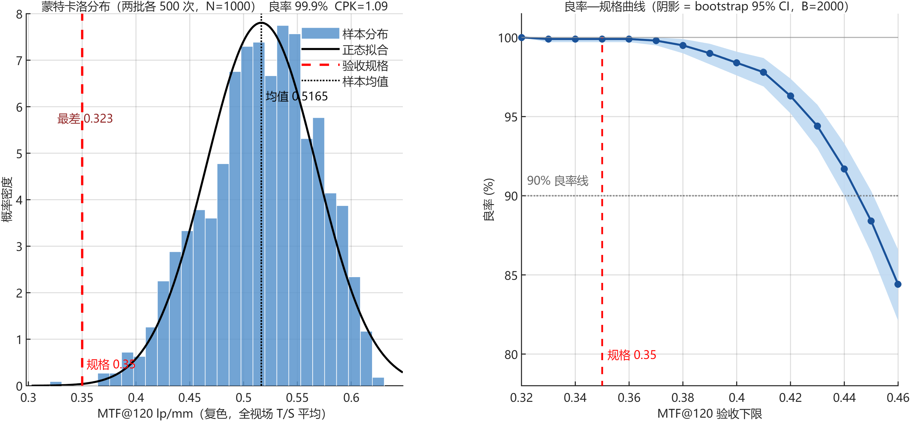

# 车载长焦前摄 15 mm F/1.4 —— 公差分析报告（Q5）

| 项目 | 内容 |
|---|---|
| 光学系统 | 车载长焦前摄 15 mm F/1.4，6 片 5 组（含 1 组双胶合），2 面偶次非球面 |
| 设计文件 | `车载长焦前摄15mmF1.4_定心系数-手动优化收尾.zos`（单组态，25 ℃） |
| 公差副本 | `车载长焦前摄15mmF1.4_定心系数-公差Q5_v2.zos` |
| 公差等级 | Q5；胶合组中心厚单独收紧到 ±0.01875 mm（介于 Q4 与 Q3 之间的定制值） |
| 判据 | 复色衍射 MTF 平均值 @120 lp/mm（`DiffMTFAverage`，采样 2） |
| 补偿器 | 后焦（近轴焦点补偿） |
| 样本量 | 2 × 500 次蒙特卡洛（不同随机种子） |
| 软件 | OpticStudio 2024 R1.00 |
| 分析日期 | 2026-11-19 |

---

## 1. 系统概要

| 项 | 值 |
|---|---:|
| 有效焦距 EFFL | 15.002 mm |
| 入瞳 F/# | 1.4 |
| 总长 TOTR（第一面→像面） | 30.50 mm |
| 视场 | (0°, 0°)、(0°, 8.75°)、(0°, 15.0°)、(7.5°, 4.3°)、(15.1°, 8.7°) |
| 波长 | g 0.486 µm（w3）· d 0.588 µm（w2，主）· C 0.656 µm（w5） |
| 光阑 | 面 5（独立光阑面，半口径 5.206 mm） |

面表与公差项编号对应关系：

| 面 | 说明 | 玻璃 | 中心厚 / 间隔 (mm) |
|---:|---|---|---:|
| 1 / 2 | L1（前非球面 S1） | H-QF50A | 3.501 |
| 2 | L1→L2 空气 | — | 4.010 |
| 3 / 4 | L2 | D-LAF50-25 | 4.692 |
| 4 | L2→光阑 空气 | — | 0.488 |
| 5 | 光阑 | — | 0.462 |
| 6 / 7 | L3（胶合组前片） | D-LAF50 | 3.833 |
| 7 / 8 | L4（胶合组后片，与 L3 胶合） | H-ZF7LA | 2.539 |
| 8 | L4→L5 空气 | — | 3.320 |
| 9 / 10 | L5 | D-LAF50-25 | 4.211 |
| **10** | **L5→L6 空气（最敏感项）** | — | **1.232** |
| 11 / 12 | L6（后非球面 S12） | H-QK3L | 1.310 |
| 12 | L6→像面（后焦） | — | 0.901 |

---

## 2. 公差设定（Q5）

共 **58 条**公差项，均按 Q5 等级取值：

| 公差项 | TDE 操作数 | 取值 | 条数 |
|---|---|---:|---:|
| 曲率（光圈） | TFRN | ±2 光圈 | 12 |
| 厚度 / 间隔 | TTHI | ±0.0375 mm | 12 |
| ↳ 胶合组中心厚（面 6、7） | TTHI | **±0.01875 mm** | 2 |
| 不规则度 | TIRR | ±0.5 光圈 | 12 |
| 元件偏心 X / Y | TEDX / TEDY | ±0.010 mm | 5 + 5 |
| 折射率 | TIND | ±0.001 | 6 |
| 阿贝数 | TABB | ±0.10 % | 6 |

说明：

- **胶合组两片中心厚单独收紧到 ±0.01875 mm**，其余厚度保持 Q5（±0.0375）。该值不属于任何标准等级：Q4 厚度为 ±0.025、Q3 为 ±0.0125，±0.01875 恰为 Q5 的一半，落在 Q4 与 Q3 之间。选它的理由是双胶合配对厚度的产线实际能力就在 0.019 附近，按 Q4 给不出来、按 Q3 要加精密研磨成本；因此这是"用现有能力、不加钱"的一档，对良率贡献也最大。
- 偏心按**元件范围**给定（首面→末面），胶合组作为一个整体（面 6→8）参与，不与倾斜同时施加（避免同一误差重复计入）。
- 折射率按**熔炼批**抽样，不按单片抽样。
- 补偿器：后焦（像面前空气间隔），近轴焦点补偿；TDE 内未设置硬边界。

---

## 3. 判据与口径

| 项 | 设定 |
|---|---|
| 判据 | 在 120 lp/mm 处的衍射 MTF，子午/弧矢平均 |
| 采样 | 2 |
| 视场 | XY 对称展开为 9 个视场（含对角 17.43°） |
| 波长 | 复色加权（g/d/C） |
| 模式 | 灵敏度 + 蒙特卡洛（`SetupMode = SkipSensitivity`，避免 MTF 判据下反敏感度求解中止） |
| 名义值 | **MTF@120 = 0.63255** |

**口径提醒**：`DiffMTFAverage` 是**全视场、子午/弧矢平均**，不是"最差视场"。若客户规格写的是"全视场最差方向 MTF > 0.35"，本报告的平均口径会偏乐观，需另用弧矢 `DiffMTFSag` 复算后再判定（见 §7）。

---

## 4. 灵敏度分析

### 4.1 最坏偏离（Top 10，按 MTF 劣化量排序）

| 排名 | 公差项 | 释义 | 取值 | 判据值 | ΔMTF |
|---|---|---|---:|---:|---:|
| 1 | TTHI 10 10 | L5→L6 空气间隔 | −0.0375 | 0.5116 | **−0.1210** |
| 2 | TTHI 1 1 | L1 中心厚 | −0.0375 | 0.5507 | −0.0818 |
| 3 | TEDX 1 2 | L1 偏心 X | −0.010 | 0.5614 | −0.0711 |
| 4 | TEDY 1 2 | L1 偏心 Y | −0.010 | 0.5614 | −0.0711 |
| 5 | TEDX 1 2 | L1 偏心 X | +0.010 | 0.5617 | −0.0709 |
| 6 | TEDY 1 2 | L1 偏心 Y | +0.010 | 0.5618 | −0.0708 |
| 7 | TTHI 10 10 | L5→L6 空气间隔 | +0.0375 | 0.5667 | −0.0659 |
| 8 | TTHI 3 3 | L2 中心厚 | −0.0375 | 0.5677 | −0.0648 |
| 9 | TIND 3 | L2（D-LAF50-25）折射率 | +0.001 | 0.5822 | −0.0503 |
| 10 | TTHI 1 1 | L1 中心厚 | +0.0375 | 0.5845 | −0.0480 |

**读法**：

- 前四项就吃掉 RSS 预算的 60 % 以上，**问题高度集中在"前组 + 第一片"**。
- L5→L6 的 1.232 mm 空气间隔是唯一超过 0.1 的单项，且正负不对称（−0.121 / −0.066）——该空气层是大孔径光线高度转折处，任何离焦都会被放大。
- L1 同时占住"厚度"和"偏心"两项，是全系统最敏感元件；它同时是前非球面，加工与装配都要按关键件管控。

### 4.2 RSS 合成

```
名义 MTF          0.63255
预计变化         −0.19651
预计 MTF（RSS）   0.43604
```

### 4.3 分类预算（方差占比）

按各类公差的最大单项偏离做平方和分解：

| 类别 | 条数 | 最大单项 ΔMTF | 方差占比 |
|---|---:|---:|---:|
| 厚度 / 间隔 (TTHI) | 12 | 0.1210 | **63.1 %** |
| 偏心 X (TEDX) | 5 | 0.0711 | 14.5 % |
| 偏心 Y (TEDY) | 5 | 0.0711 | 14.5 % |
| 折射率 (TIND) | 6 | 0.0503 | 7.1 % |
| 阿贝数 (TABB) | 6 | 0.0145 | 0.5 % |
| 曲率 (TFRN) | 12 | 0.0105 | 0.3 % |
| 不规则度 (TIRR) | 12 | 0.0039 | 0.1 % |

**结论：厚度类占 63 %，其中 L5→L6 空气间隔一项独占 28 %；曲率与不规则度合计不足 0.5 %。**

### 4.4 补偿器统计（灵敏度）

| 项 | 值 (mm) |
|---|---:|
| 最小 | −0.0473 |
| 最大 | +0.0475 |
| 平均 | 0.000005 |
| 标准差 | 0.0123 |

---

## 5. 蒙特卡洛分析

### 5.1 两个独立样本

同一份公差表、同一名义值，两次 500 次抽样（随机种子不同）：

| 样本 | N | 均值 | σ | 最差 | <0.35 的样本 |
|---|---:|---:|---:|---:|---:|
| 批 A（导出表 `tol_q5_mc.txt`） | 500 | 0.51682 | 0.05080 | 0.37668 | 0 |
| 批 B（报告 `tol_q5_总结.txt`） | 500 | 0.51617 | 0.05136 | **0.32300**（第 452 次） | **1** |
| **合并** | **1000** | **0.51650** | **0.05108** | **0.32300** | **1** |

两批均值相差 0.0007、σ 相差 0.0006，属抽样波动；但**尾部差异显著**——批 A 一次都没跌破 0.35，批 B 有一次跌到 0.323。单批 500 次不足以看到真实尾部，合并 1000 次后才捕获到失效样本。这一点直接决定了下面的判定。

### 5.2 分布统计（合并 N=1000）

| 指标 | 值 |
|---|---:|
| 名义 MTF@120 | 0.63255 |
| 均值 | 0.51650 |
| σ | 0.05108 |
| 最差 | 0.32300 |
| P1 / P2 / P5 | 0.3908 / 0.4063 / 0.4284 |
| P10 / P50 / P90 | 0.4456 / 0.5194 / 0.5825 |
| P95 / P98 / P99 | 0.5942 / 0.6056 / 0.6100 |
| **良率（≥0.35）** | **99.90 %（999/1000）** |
| 良率 95 % 置信区间 | [99.70 %, 100.00 %] |
| **CPK（对 0.35）** | **1.09（3.26σ）** |

### 5.3 良率—规格曲线

| 规格 | 良率 | 95 % CI |
|---|---:|---|
| ≥0.33 | 99.90 % | [99.70, 100.00] |
| ≥0.37 | 99.80 % | [99.50, 100.00] |
| ≥0.38 | 99.50 % | [99.00, 99.90] |
| ≥0.40 | 98.40 % | [97.60, 99.10] |
| ≥0.42 | 96.30 % | [95.20, 97.40] |
| ≥0.44 | 91.70 % | [90.00, 93.30] |

**拐点在 0.38～0.42**：规格每上抬 0.02，良率掉约 1.5～2 个百分点。

### 5.4 补偿器统计（蒙特卡洛）

| 项 | 值 (mm) |
|---|---:|
| 最小 | −0.1383 |
| 最大 | +0.1124 |
| 平均 | 0.0017 |
| 标准差 | 0.0411 |

**注意**：蒙特卡洛下的后焦补偿量是**灵敏度预测值（±0.047）的 2～3 倍**。原因是多公差同时叠加后，最佳焦面位置随机漂移远大于单项灵敏度。调焦机构行程必须按 **±0.15 mm** 设计（留 10 % 余量），不能按灵敏度值的 ±0.05 mm。

### 5.5 图



左：1000 次抽样分布 + 正态拟合 + 规格线；右：良率—规格曲线（阴影为 bootstrap 95 % CI，B = 2000）。
出图脚本：`matlab/mc_yield_q5_20261119.m`（MATLAB R2025b，`exportgraphics` 300 dpi）。

---

## 6. 判定

| 判据 | 要求 | 实测 | 判定 |
|---|---|---:|---|
| 良率 @MTF≥0.35 | ≥90 % | 99.90 % | **通过** |
| 良率 @MTF≥0.35（车规安全件） | ≥97.7 % | 99.90 %（CI 下界 99.70 %） | **通过** |
| CPK | ≥1.33 | 1.09 | **不通过** |
| RSS 预计 MTF | — | 0.436 | 参考 |
| 最差样本 | ≥0.35 | 0.323 | **单点超标** |

**结论：以 MTF 平均口径、规格 0.35 计，本设计满足量产良率要求（99.9 %）；但过程能力不足（CPK 1.09 < 1.33），分布左尾距规格仅 3.26σ，1000 次抽样中已出现 1 次失效。属于"能过、但余量不足以承诺 CPK 合规"的状态。**

---

## 7. 风险与改进建议

按"投入产出比"排序：

1. **收紧 L5→L6 空气间隔的隔圈公差到 ±0.02 mm（首选）**
   该项占方差 28 %、单项劣化 0.121（第二名的 1.5 倍）。隔圈车削精度从 ±0.0375 收到 ±0.02 成本几乎不变，预计可把 CPK 提到 1.3 以上。这是唯一一处能靠工艺而非光学改动换来的收益。

2. **L1 按关键件管控：厚度 ±0.02、偏心 ≤0.005 mm**
   L1 同时占据厚度（−0.082）与偏心（−0.071×2）三项前十。它是前非球面，本身就要定心磨边，把偏心从 0.010 收到 0.005 属常规能力。

3. **调焦机构行程按 ±0.15 mm 设计**
   蒙特卡洛实测后焦漂移 −0.138 ～ +0.112 mm，远大于灵敏度的 ±0.05 mm。

4. **确认客户 MTF 口径**
   本报告用"全视场 T/S 平均"。若客户按"最差视场最差方向"验收，需用 `DiffMTFSag` 复算；历史上同口径差值可达 0.1 以上，届时 0.35 的良率不会是 99.9 %。

5. **可放宽项（降本空间，但不建议先动）**
   曲率（方差 0.3 %）、不规则度（0.1 %）、阿贝数（0.5 %）几乎不贡献良率损失，可放到 Q6 档；但这几项单价占比低，省不下多少钱，且一旦动公差就必须全部重跑。

---

## 8. 复现与文件清单

| 文件 | 用途 |
|---|---|
| `车载长焦前摄15mmF1.4_定心系数-公差Q5_v2.zos` | 公差副本（单组态，58 条 TDE，补偿器已设） |
| `tol_q5_总结.txt` | 灵敏度 + 蒙特卡洛报告（OpticStudio 原生导出，UTF-16） |
| `tol_q5_mc.txt` | 蒙特卡洛逐次明细导出（批 A） |
| `tol_q5_sensitivity.ztd` | 公差数据文件（QuickSensitivity 导出） |
| `matlab/data/mc_q5_pooled.csv` | 合并后的 1000 组判据值（source, trial, mtf120） |
| `matlab/mc_yield_q5_20261119.m` | 良率统计与出图脚本 |
| `layouts/no_ir_cut/mc_yield_q5.png` | 良率图（300 dpi） |

复现步骤：

1. 打开 `..._公差Q5_v2.zos`，确认 TDE 中面 6/7 的 TTHI 为 ±0.01875、其余 ±0.0375；
2. 公差分析 → 判据选"衍射 MTF 平均值"，频率 120，采样 2，补偿器=后焦；
3. 灵敏度跑一遍，蒙特卡洛跑 500 次（建议换种子再跑一次，用于观察尾部）；
4. 导出报告为 UTF-16 文本，交给 `matlab/mc_yield_q5_20261119.m` 统计出图。

---

## 9. 局限性

1. **单温度**：本分析在 25 ℃ 下进行。全温（−40～+85 ℃）下的公差与热离焦需在无热化组态下重跑，两者不能互相替代。
2. **口径**：判据为全视场平均 MTF，非最差视场；见 §7 第 4 条。
3. **补偿器**：报告固定输出"将会忽略补偿器上的边界约束"警告，该警告恒在，不代表补偿失效；但本设计未在 TDE 中设硬限位，量产需在机构上限定行程。
4. **样本量**：1000 次抽样对 99.9 % 量级的良率只能给出约 ±0.3 个百分点的分辨率；若需承诺 CPK ≥1.33，应先把 §7 第 1、2 条落实后重跑。
