# 车载长焦前摄 15 mm F/1.4 —— 工程总结（加 IR-CUT 版 · TOTR 30.0 mm）

| 项 | 内容 |
|---|---|
| 设计文件 | `车载长焦前摄15mmF1.4_定心系数_IRcut_20261120.zos` |
| 版次 | 2026-11-20（加窗 + 总长收紧至 30 mm） |
| 上一版 | `车载长焦前摄15mmF1.4_工程总结_定心版_20261119.md`（无窗，TOTR 30.50） |
| 软件 | OpticStudio 2024 R1（ZOS-API，全部读数经 MCP 工具）、MATLAB R2025b（出图经 MCP） |
| 结论 | **七项指标全部达标**；全温、公差、鬼影三项见 §四~§六 |

---

## 一、本版改了什么

| 改动 | 内容 | 影响 |
|---|---|---|
| ① 加入红外截止滤光片 | S13–S14 加一片 **H-K9L 平板，厚 0.40 mm**，双面平面，顶点即像面（S14 厚度 0） | 后焦 1.1 mm（0.70 空气 + 0.40 玻璃）；引入约 0.19 mm 等效光程，全部由重优化吸收 |
| ② 末片后表面改平 | S12 由 R = −56.54 mm 改为 **平面** | 与滤光片的平面形成平行腔，便于隔圈定心；球差由 S11 非球面承担 |
| ③ 总长收紧 | TOTR 由 30.50 → **30.00 mm** | 隔圈统一取整（4.00 / 0.47 / 0.49 / 3.80 / 1.00 / 0.70），靠玻璃中心厚吸收最后 6 µm |
| ④ 非球面系数微调 | S1：A4 −6.0e−5 → −6.5e−5，A6 −1.756e−7 → −1.854e−7；S12：A4 6.906e−4 → 6.299e−4，A6 4.272e−6 → 2.373e−7 | 补偿平板引入的球差与场曲 |

> **窗口建模口径（R17）**：保护玻璃与红外截止片按**单片等效平板**处理。本版只建模了 IR-CUT（0.40 mm）；若客户要求把 Sensor CG（0.30 mm）一并纳入，应把 S13 厚度改为 0.70 mm 并同步把 S12 间隔压缩 0.26 mm（等效光程不变），重跑指标即可。

---

## 二、系统参数

### 2.1 一阶量

| 项 | 值 |
|---|---|
| 有效焦距 EFFL | **15.0046 mm** |
| 系统总长 TOTR（面 1 → 像面） | **30.0000 mm** |
| 入瞳直径 | 10.717 mm（F/1.4） |
| 像方 NA | 0.3363 |
| 像方 F/#（工作） | 1.464（轴上）→ 1.601（17.43° 边缘） |
| 艾里斑半径（0.588 µm） | 1.066 µm |
| 衍射截止频率 | 1144 lp/mm |
| 后焦（末片面 12 → 像面） | 1.100 mm = 0.700 空气 + 0.400 玻璃 |
| 像高（17.43°，F-Tanθ 参考） | 4.713 mm；像圈 ≥ 9.30 mm |

### 2.2 面表

| 面 | 类型 | 半径 R (mm) | 厚度 (mm) | 材料 | 半口径 (mm) | 备注 |
|---:|---|---:|---:|---|---:|---|
| 0 | 标准 | ∞ | ∞ | — | — | 物在无穷远 |
| 1 | **偶次非球面** | 34.7804 | 3.3078 | H-QF50A | 8.00 | k = −1，A4 = −6.500e−5，A6 = −1.854e−7 |
| 2 | 标准 | 17.4357 | 4.0000 | 空气 | 8.00 | 隔圈 4.00 |
| 3 | 标准 | 20.5303 | 4.0797 | D-LAF50-25 | 7.00 | |
| 4 | 标准 | −28.5956 | 0.4700 | 空气 | 7.00 | 隔圈 0.47 |
| 5 | 标准 | ∞ | 0.4900 | 空气 | 5.260 | **STOP（光阑）** |
| 6 | 标准 | 10.3528 | 4.0737 | D-LAF50 | 5.50 | 胶合组前片 |
| 7 | 标准 | −38.1772 | 2.0390 | H-ZF7LA | 5.00 | 胶合面 |
| 8 | 标准 | 5.6242 | 3.8000 | 空气 | 3.80 | 隔圈 3.80 |
| 9 | 标准 | 14.0340 | 4.2887 | D-LAF50-25 | 5.50 | |
| 10 | 标准 | −12.0524 | 1.0000 | 空气 | 5.50 | 隔圈 1.00 |
| 11 | **偶次非球面** | −6.4076 | 1.3510 | H-QK3L | 5.00 | k = −1，A4 = 6.299e−4，A6 = 2.373e−7 |
| 12 | 标准（平） | ∞ | 0.7000 | 空气 | 5.00 | 末片后表面；到滤光片 0.70 |
| 13 | 标准（平） | ∞ | 0.4000 | **H-K9L** | 4.681 | **IR-CUT 平板** |
| 14 | 标准（平） | ∞ | 0.0000 | 空气 | 4.650 | 板后表面 = 像面 |
| 15 | 标准 | ∞ | — | — | 4.650 | 像面 |

### 2.3 玻璃清单

| 片 | 面 | 材料 | 作用 |
|---|---|---|---|
| L1 | 1–2 | H-QF50A | 正弯月，非球面首片，主球差校正 |
| L2 | 3–4 | D-LAF50-25 | 正透镜 |
| L3 | 6–7 | D-LAF50 | 胶合组前片 |
| L4 | 7–8 | H-ZF7LA | 胶合组后片（火石，色差校正） |
| L6 | 9–10 | D-LAF50-25 | 正透镜 |
| L7 | 11–12 | H-QK3L | 末片，非球面，后表面平面 |
| 窗口 | 13–14 | H-K9L | 红外截止片 0.40 mm |

### 2.4 视场与波长

- **视场**（角度，径向归一）：(0°, 0°) / (0°, 8.75°) / (0°, 15.0°) / (7.5°, 4.3°) / (15.1°, 8.7°)；最大视场半径 **17.427°**，对应像高 4.698 mm（实际）/ 4.713 mm（参考）。
- **波长**：g 0.486 µm（权重 3）/ d 0.588 µm（主波长，权重 2）/ C 0.656 µm（权重 5）。
- 像面半口径 4.650 mm，像圈 9.30 mm。

---

## 三、指标验收（25 ℃）

### 3.1 验收表

| # | 指标 | 规格 | 实测 | 判定 | 余量 |
|---:|---|---:|---:|---|---|
| 1 | 有效焦距 | 15 mm | 15.0046 mm | ✅ | +0.005 mm |
| 2 | 系统总长 | ≤ 30 mm | 30.0000 mm | ✅ | 0 |
| 3 | MTF@120 lp/mm 最差 | 软目标 | 0.513（17.43° 子午） | ✅ | — |
| 4 | 相对照度 | > 60 % | **83.7 %**（17.43°） | ✅ | +23.7 个百分点 |
| 5 | 场曲 | < 0.05 mm | **0.0260 mm**（d 线弧矢） | ✅ | 0.024 mm |
| 6 | 畸变 | < 1 % | **0.304 %**（绝对值最大）／0.416 %（峰峰） | ✅ | 0.696 % |
| 7 | CRA | < 18° | **12.96°**（峰值，90 % 视场）；边缘 12.12° | ✅ | 5.04° |

所有七项均达标。以下是逐项证据。

### 3.2 MTF（原生 FFT MTF，复色 0.486–0.656 µm）

| 视场 | @60 lp/mm T/S | **@120 lp/mm T/S** |
|---|---|---|
| 0.00° 轴上 | 0.906 / 0.906 | **0.673 / 0.673** |
| 8.75° Y | 0.896 / 0.918 | **0.677 / 0.725** |
| 15.00° Y | 0.868 / 0.874 | **0.613 / 0.588** |
| 8.65° 对角 | 0.908 / 0.900 | **0.706 / 0.685** |
| 17.43° 全视场 | 0.818 / 0.861 | **0.513 / 0.593** |
| 衍射极限 | 0.975 | 0.872 |

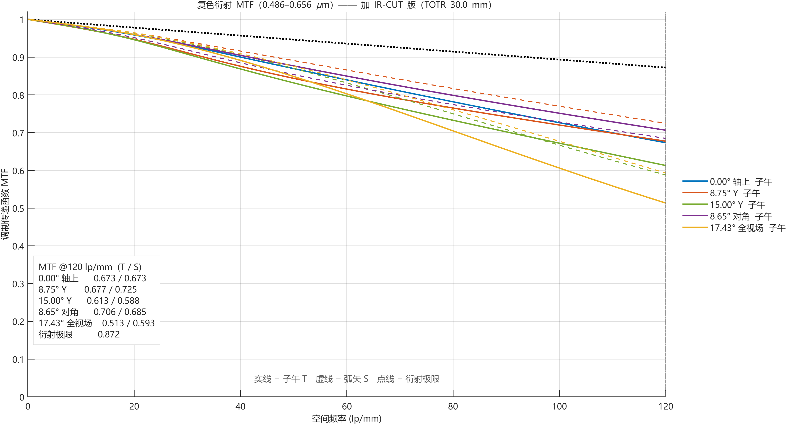

*图 1　复色衍射 MTF（实线 = 子午，虚线 = 弧矢，点线 = 衍射极限）。最差为 17.43° 全视场的子午方向 0.513。*

**与无窗版对比**（同口径，120 lp/mm，T）：

| 视场 | 无窗版（TOTR 30.5） | 加窗版（TOTR 30.0） | 差 |
|---|---:|---:|---:|
| 轴上 | 0.669 | 0.673 | +0.004 |
| 8.75° | 0.645 | 0.677 | +0.032 |
| 15° | 0.582 | 0.613 | +0.031 |
| 8.65° 对角 | 0.693 | 0.706 | +0.013 |
| 17.43° 全视场 | 0.516 | 0.513 | −0.003 |

结论：**加入 0.40 mm 滤光片并把总长再压 0.5 mm 之后，MTF 基本持平，中视场还略有改善。**

### 3.3 相对照度

| 视场 | 相对照度 | F/# 效率 |
|---|---:|---:|
| 0°（轴上） | 1.0000 | 1.4645 |
| 8.71° | 0.9464 | 1.5054 |
| 15.68° | 0.8541 | 1.5847 |
| **17.43°** | **0.8373** | 1.6005 |

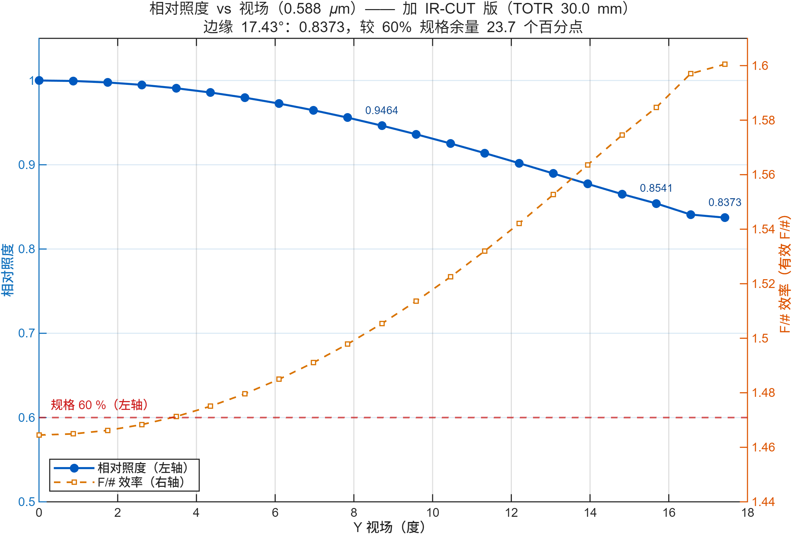

*图 2　相对照度 vs 视场（0.588 µm）。左轴相对照度、右轴有效 F/#，红色虚线为 60 % 规格线。*

边缘 83.7 %，较规格余量 23.7 个百分点。曲线单调下降、无拐点，说明渐晕控制是平滑的，没有靠硬拦光换取照度。

### 3.4 场曲与畸变

| 波长 | 场曲（子午）| 场曲（弧矢）| 畸变 绝对值最大 | 畸变 峰峰 |
|---|---:|---:|---:|---:|
| g 0.486 µm | 0.0089 mm | 0.0186 mm | 0.3045 % | 0.4163 % |
| **d 0.588 µm** | **0.0061 mm** | **0.0260 mm** | **0.3044 %** | 0.4058 % |
| C 0.656 µm | 0.0060 mm | 0.0282 mm | 0.3035 % | 0.4013 % |

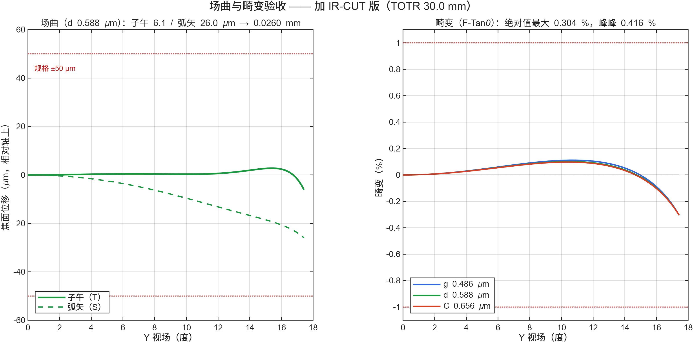

*图 3　左：场曲（相对轴上点，d 线）；右：三波长畸变曲线（F-Tanθ）。*

**口径说明**（沿用定心版，三个数不要混用）：

- **绝对值最大 0.304 %**：|畸变| 的峰值，出现在约 10°（+0.11 %）与 17.43°（−0.30 %）之间取大者，即边缘 −0.30 %。这是成像质量角度的口径。
- **峰峰 0.416 %**：曲线最高点 +0.11 % 与最低点 −0.30 % 之差，用于判断"画面内相对形变"。
- Zemax 分析窗页脚另报一个 0.40×% 量级的数，是它的内部统计口径，不参与判定。

三个口径都 < 1 %。畸变曲线**穿越零点**（约 +0.11 % @10°，−0.30 % @17.43°），正负抵消，因此峰峰远小于绝对值的两倍。

场曲以弧矢（Sagittal）为最大项 0.0260 mm，主要是 Petzval 面残差；子午仅 0.006 mm。

### 3.5 CRA（主光线角）

| 归一化视场 | 视场角 | 像高 | CRA（g / d / C） |
|---:|---:|---:|---|
| 0.0 | 0.00° | 0.000 mm | 0.00 / 0.00 / 0.00° |
| 0.5 | 8.71° | 2.303 mm | 9.57 / 9.58 / 9.58° |
| 0.9 | 15.68° | 4.213 mm | 12.78 / 12.91 / **12.96°**（峰值） |
| 1.0 | 17.43° | 4.698 mm | 11.90 / 12.12 / 12.21° |

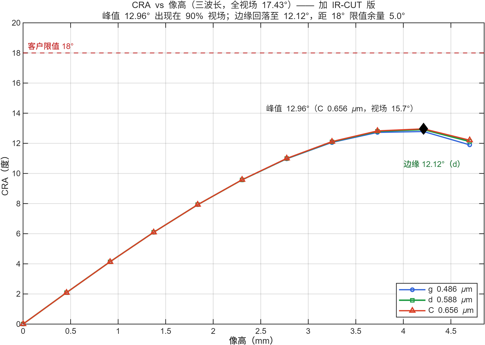

*图 4　CRA vs 像高，三波长叠加。黑色菱形为峰值 12.96°（C 线，90 % 视场），红色虚线为 18° 客户限值。*

**关键点：CRA 是非单调的**——峰值出现在 90 % 视场（15.68°、像高 4.21 mm），而不是边缘；边缘反而回落到 12.12°（d 线）。**只测边缘会漏掉峰值**，验收必须卡在峰值视场上。

三次测量方法：临时插入 33 条 `RAID`（Int1 = 像面 15，Int2 = 波长，Hx/Hy = 归一化视场，权重 0），逐点读数后即删除，ME 行数不变。

### 3.6 结构与可加工性（DFM 评审）

> 按 `spherical-lens-dfm-review` 全套走：几何 → 定心 → 非球面 → 胶合 → 公差 → 成本 → 四级结论。
> 数据来源：`check_manufacturability`（CT/ET/B，工具读数）+ `check_interference`（净空）
> + MATLAB 解析计算（Z、球心距、径厚比、非球面斜率/拐点/BFS，`matlab/dfm_IRcut_20261120.m`）。
> **半口径为机械口径**（见 §3.6.2 注），这是能做 Z 判定的前提。

#### 3.6.1 实体净空

**实体净空**（`check_interference`，数值判定）：

| 相邻实体 | 中心间隔 | 最紧净空 | 位置 | 判定 |
|---|---:|---:|---|---|
| L1 → L2 | 4.000 | 3.287 | 边缘 | ✅ |
| L2 → 光阑 | 0.470 | 0.470 | 轴 | ⚠️ 见下 |
| 光阑 → L3 | 0.490 | 0.490 | 轴 | ⚠️ 见下 |
| L3/L4 胶合 → L6 | 3.800 | 2.846 | 边缘 | ✅ |
| L6 → L7 | 1.000 | 0.533 | 边缘 | ✅ |
| **L7 → IR-CUT** | **0.700** | **0.700** | 轴 | ✅ |

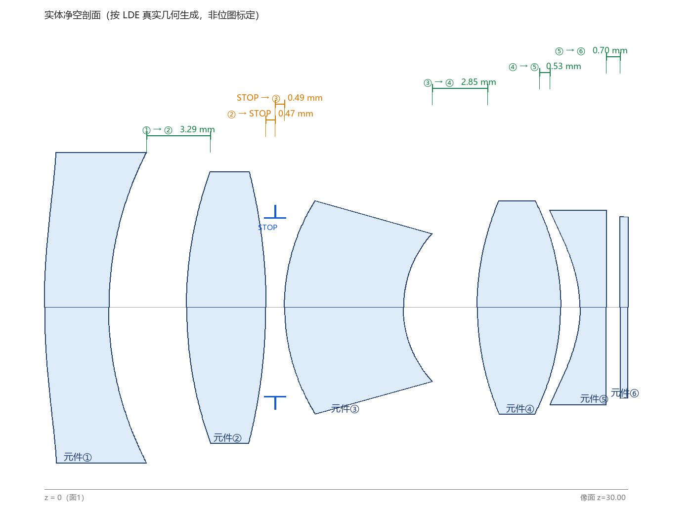

*图 5　实体净空剖面（按 LDE 真实几何生成）。*

两条 ⚠️ 是 **光阑到两侧镜片** 的净空（0.47 / 0.49 mm）低于工具默认的 2 mm 阈值。这是**无窗版就存在**的既有状态，不是本版引入的：光阑是虚拟面，实际由 L2 与 L3 的口径边缘构成，隔圈只需 0.3~0.5 mm 壁厚，0.47/0.49 mm 在工艺上可行。若客户要求光阑座装配空间 ≥2 mm，需在 L2/L3 之间加垫圈，代价是总长 +1.5 mm。

#### 3.6.2 逐片几何（CT / ET / 径厚比 / 半球 / 最小曲率）

| 元件 | CT (mm) | ET (mm) | CT/ET | **D/CT** | min\|R\| | 半球余量 | 判定 |
|---|---:|---:|---:|---:|---:|---:|---|
| L1 (1–2) | 3.308 | 4.646 | 0.71 | **4.84** | 17.44 | +6.24 | ⚠️ 非球面 D/CT > 4 |
| L2 (3–4) | 4.080 | 1.980 | 2.06 | 3.43 | 20.53 | +10.73 | ✅ |
| L3 (6–7) | 4.074 | 2.094 | 1.95 | 2.70 | 10.35 | +2.65 | ✅ |
| L4 (7–8) | 2.039 | 5.417 | 0.38 | 4.90 | 5.62 | **+0.30** | ⚠️ 半球余量薄 |
| L6 (9–10) | 4.289 | 1.838 | 2.33 | 2.56 | 12.05 | +4.35 | ✅ |
| L7 (11–12) | 1.351 | 2.904 | 0.47 | **7.40** | 6.41 | **−0.59** | ⚠️ 径厚比 + 近半球 |
| IR-CUT (13–14) | 0.400 | 0.400 | — | — | ∞ | — | 平板，按 R17 跳过 |

- **胶合组必须拆成 L3 / L4 两片逐片算**。合并成一行会把 CT、ET 变成两片之和（6.11 / 8.98），Z 与球心距变成一个**不存在的实体**的数值——S6 口径 11 mm、S8 口径 7.6 mm、中间 6.11 mm 厚的那种"单片玻璃"。组级只保留胶合工艺本身那几项（§3.6.5）。
- **D/CT 用机械全口径**（2×半口径），比工具的 `SD/CT` 严一倍。L7 的 SD/CT 是 3.70（工具判 pass），但 D/CT = **7.40**，远超非球面 4 的上限。
- **半球余量** = min(|R| − 0.7·D)，负值即触线。L7 的 S11：R = −6.41、D = 10 → **球冠半角 asin(5/6.41) = 51.3°**（超 45° 护栏，抛光模与检测环容易干涉）；但**实际边缘法线倾角只有 24.8°** —— 非球面项把边缘压平了，所以难点在"口径几乎占满整个球冠"，不在"局部太陡"。
- **L4 的 +0.30 mm 是这一版被合并行掩盖掉的一项**：S8 的 R = 5.62，按自身通光口径 Ø7.6 算余量 0.30 mm；机械口径只要做到 Ø8.03 就触半球线。通光口径与机械口径之间通常留 0.1~0.2 mm/边，**正好卡在这个窗口里**，所以要在图纸上锁 L4 外圆 ≤ Ø8.0。
- L4 的 ET 按工具口径（max 半口径 5.0）算得 5.42 mm；即使按自身通光边缘 3.8 算也有 3.71 mm，远厚于 0.5 mm 崩边线。
- 平板一行是**工具必然触发的误报**（ET ≥ 1 mm 的透镜判据套在 0.4 mm 窗口上），按 R17 忽略。
- 其余几何全部在护栏内：ET 最小 1.84 mm（L6）、CT/ET 最大 2.33（L6）、min\|R\| 最小 5.62 mm（L4 的 S8）。

#### 3.6.3 定心：机械定心系数 Z 与球心距

**Z = ¼·|D₁/R₁ − D₂/R₂|**（本项目口径，D 为机械口径）；**Karow 口径 = 4Z**，比较前先问清供应商用哪个。

| 元件 | Z（÷4 口径） | Karow（×1） | 判定 | 球心距 \|R₁−R₂−CT\| | 判定 |
|---|---:|---:|---|---:|---|
| L1 | 0.114 | 0.46 | 一般 | 14.04 mm | ✅ |
| L2 | 0.293 | 1.17 | 好做 | 45.05 mm | ✅ |
| L3 | 0.331 | 1.32 | 好做 | 44.46 mm | ✅ |
| L4 | 0.403 | 1.61 | 好做 | 45.84 mm | ✅ |
| L6 | 0.424 | 1.70 | 好做 | 21.80 mm | ✅ |
| L7 | 0.390 | 1.56 | 好做 | 平面侧无球心 | — |

**单片定心全部通过**：六片 Z 都在 0.114~0.424，只有 L1 落在"一般"（0.114，Karow 0.46），其余五片直接进"好做"档；球心距最小 14.04 mm，远超 2~3 mm 的门槛。

**唯一需要工艺安排的是胶合组的装配定心，但这条是"组级"结论，不是 L3/L4 的定心系数**：

- 组的外表面是 S6（R = 10.35）与 S8（R = 5.62），轴向间隔 6.11 mm，两个球心同侧、**相距仅 1.38 mm**。组作为一个刚体，在几何上近似一片厚弯月，偏心仪与钟罩对"整组倾斜"的读数不敏感。
- 所以胶合后不能指望钟罩自定心，装配链走：**单片定心磨边（各自 Z 0.331 / 0.403，很容易）→ 胶合 → 定心车削外圆 → 偏心仪分选**，图纸给 **元件偏心 ≤ 0.010 mm**（Q5 值）、胶合精度 20~30″。
- 若供应商只有钟罩能力，需把 S6 的 R 放宽到 ≥ 13 mm（组外表面球心距 → 2 mm 以上），代价是球差重新平衡——**本版不动设计**。

> 不要把两片的外表面塞进同一个 Z 公式：组按统一外圆 Ø11 算出的 Z = 0.223 只是"如果它是一片玻璃"的参考值，混用两端口径（11 / 7.6）还能算出 0.072，那是口径不一致造成的假数。判单片定心只看上表，判装配只看组外表面球心距。

> 口径提醒：Z 的"除 4"是本项目约定，供应商报的 Karow Z 通常不除 4（同一元件的 0.114 vs 0.46，见 L1）。两套阈值见 skill §3，**结论方向一致**：六片单片都落在合格侧，只有胶合组的**装配**要按定心车削 + 分选走。

#### 3.6.4 非球面专项（S1 / S11）

| 面 | 元件 | k | A4 | A6 | 最大子午斜率 | 拐点 r | 反曲 | BFS | 判定 |
|---:|---|---:|---:|---:|---:|---:|---|---:|---|
| S1 | L1 | −1 | −6.500e−5 | −1.854e−7 | **6.2°** | 5.5 mm（69 % 半口径） | 无 | 58 µm | ✅ |
| S11 | L7 | −1 | 6.299e−4 | 2.373e−7 | **25.2°** | **4.5 mm（90 % 半口径）** | 无 | 99 µm | ⚠️ |

- **无斜率反号 = 无反曲**，两个面都合格（这是硬判据）。
- 斜率 25.2° 在 30° 的关注线内、远低于 40~45° 的不可加工线。
- **S11 的拐点在 4.5 mm，占机械半口径的 90 %**。拐点本身不是缺陷（二阶导过零），但**如果通光半口径 > 4.5 mm，干涉检测在该半径处会出现条纹反转**，需要零位补偿器或 CGH。
- 顶点 R：S11 是**凹面**，|R| = 6.41 mm < 13 mm → 研磨抛光空间紧（skill §6 判 P1）。
- BFS 58 / 99 µm：S11 接近 0.1 mm 的非球面度，检测方案必须写进图纸（P1 待核验）。

#### 3.6.5 胶合组专项（S6–S8：D-LAF50 + H-ZF7LA）

| 项 | 现状 | 处置 |
|---|---|---|
| UV 固化窗口（360 nm） | **缺数据**：镧系 D-LAF50 与重火石 H-ZF7LA 在 360 nm 附近都可能低透过 | **待核验**：向玻璃厂取 360 nm 内透过率，低于 40 % 需改用可见光固化胶或边缘预固化 |
| CTE 匹配 | **缺数据**：两片 nd 差 0.031、νd 差 24，属典型"高折射率+火石"组合，CTE 差异可能 >1 ppm/℃ | **待核验** |
| 胶合定心能力 | 行业 20~30″、中心偏移 8~10 µm | 已按此值进入公差（元件偏心 ±0.010 mm） |
| 胶层厚度 | 0.01~0.03 mm 常规 | 图纸注明 |
| 定心车削余量 | 外圆需留 0.3~0.5 mm 车削余量（因组外表面近同心，见 §3.6.3；与单片 Z 无关） | 图纸注明 |

> 按 skill D5：**UV 透过与 CTE 缺数据时不得判"通过"**，本项维持"待核验"，不影响其余结论。

#### 3.6.6 成本驱动与降本顺序

| 成本项 | 本设计状况 | 量级 | 可降本动作 | 风险 |
|---|---|---|---|---|
| **玻璃非球面 ×2** | S1（16 mm）、S11（10 mm 凹面） | 单片成本显著高于球面，凹面更贵 | 能换球面就换 | 直接掉 MTF，需重优化 |
| **镧系玻璃 ×3** | D-LAF50-25（L2、L6）、D-LAF50（L3） | 明显高于普通牌号 | 换普通牌号重优化 | Petzval / 色差 / 热稳定性要重跑 |
| 口径 | 最大 16 mm | 与面积近似成正比 | 收半口径 | 先看渐晕与相对照度（现 83.7 %，有余量） |
| 定心 | 仅胶合组需定心车削 + 分选 | 单件工艺费 | 六片单片本身都可常规钟罩（Z ≥ 0.114） | — |
| 片数 | 6 片（L5 已删） | 装配工时 | — | 已是最少 |

**降本顺序**（skill §8：不要先放公差）：镧系换牌号 → 非球面换球面 → 收口径。**公差是最后手段**，且 §5.5 已证明 Q5 良率 99.8 %，没有放松空间。

#### 3.6.7 DFM 结论：**条件通过**

| 等级 | 判定 |
|---|---|
| **条件通过** | 无 P0（没有做不出来的）；缺胶合组 UV/CTE 数据、S11 检测方案（待核验）；四项 P1 有明确闭环路径 |

| 优先级 | 项 | 内容 | 闭环条件 |
|---|---|---|---|
| **P1** | L7 径厚比 7.40 + 近半球（球冠半角 51.3°） | 薄且陡的凹非球面，抛光/装夹难 | 要么把 CT 加到 1.6~1.8 mm，要么口径收到 9 mm；二者都需重优化（**本版不动**），或接受单件溢价 |
| **P1** | 胶合组**装配**定心：组外表面 S6/S8 近同心（1.38 mm） | 组级钟罩自定心失效；**单片无问题**（Z 0.331 / 0.403） | 单片定心磨边 → 胶合 → 定心车削外圆 → 分选，元件偏心 0.010 mm、胶合 20~30″ |
| **P1** | 光阑净空 0.47 / 0.49 mm | 光阑座无 2 mm 装配空间 | 加垫圈（总长 +1.5 mm）或确认隔圈壁厚 0.3~0.5 mm 可行 |
| **P1** | S11 顶点 \|R\| 6.41 mm + 拐点 4.5 mm | 凹面研磨空间紧、条纹反转 | 出检测方案（零位补偿器 / CGH），核验拐点是否在通光口径内 |
| **P2** | L4 的 S8（R = 5.62）半球余量仅 **+0.30 mm** | 机械口径做到 Ø8.03 就触 0.7·D 半球线，而机械口径通常比通光大 0.1~0.2 mm/边 | 图纸锁 L4 外圆 ≤ Ø8.0；或把 S8 放宽到 R ≥ 5.8 mm 后重跑球差 |
| **P2** | L1 非球面 D/CT 4.84 | 略超 4 的护栏 | 可接受（凸面、斜率仅 6.2°），打样时按实际加工反馈定 |
| **待核验** | 胶合组 UV/CTE、倒角、镀膜入射角范围 | 缺数据 | 向玻璃厂/镀膜厂取数据后补表 |

### 3.7 点列图

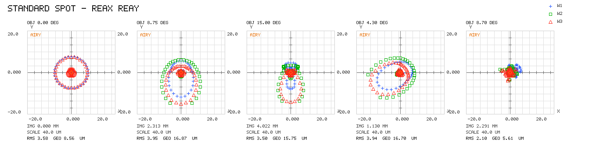

*图 6　标准点列图（复色，含艾里斑参考圆）。*

RMS 弥散 2.04–3.17 µm（艾里斑 1.066 µm，约 2 倍）；波前 RMS 0.139–0.219 λ。离轴图样可见明显的**色散环**（g 线在外、C 线在内），是 F/1.4 大孔径 + 平板残余轴向色差的正常表现，未超过弥散预算。

### 3.8 3D 布局

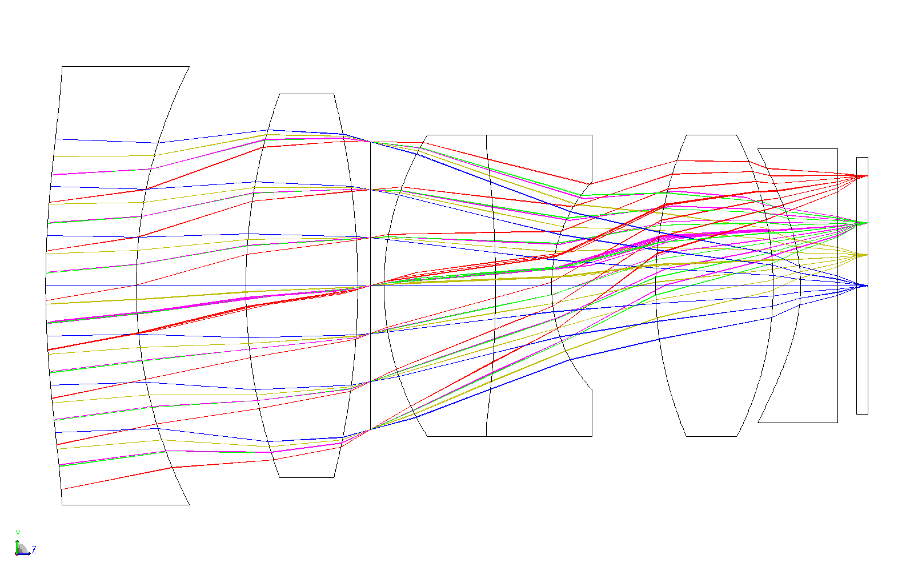

*图 7　3D 布局（隐藏透镜边）。最右侧两条竖线为 IR-CUT 平板的前后表面，其右侧紧贴像面。*

检查项：无元件互插、无玻璃砖、无非球面鼓包、光阑与透镜无重叠、平板与末片不接触。

### 3.9 本节的图从哪来

| 图 | 来源 | 说明 |
|---|---|---|
| 图 1 MTF | `layouts/analysis/fft_mtf.txt`（Zemax 原生导出，UTF-16）→ MATLAB 重绘 | 数字全部来自原生分析文本，只重排版式 |
| 图 2 相对照度 | `layouts/analysis/relative_illumination.txt` → MATLAB 重绘 | 同上 |
| 图 3 场曲畸变 | `layouts/analysis/field_curvature_distortion.txt` → MATLAB 重绘 | 同上 |
| 图 4 CRA | 33 条临时 RAID 读数 → CSV → MATLAB | 原生分析无 CRA 曲线，必须逐点读 |
| 图 5 净空 | `check_interference` 几何剖面渲染 | 按 LDE 真实几何确定性生成，不依赖位图标定 |
| 图 6 点列图 | `export_spot_diagram_image` 真实光线落点渲染 | ZOS-API 无分析位图接口，按实光线渲染 |
| 图 7 3D 布局 | `export_layout_image`（`Open3DViewerExport`） | 唯一有原生位图接口的窗口 |

**为什么分析窗口不用 Zemax 的"导出图片"**：`Analysis.ToFile` 对 Analysis 只写文本（约 1.5 KB，`valid_image = false`），没有位图钩子；强行导出的 `.bmp/.png` 打不开。所以分析类图统一"数字取原生文本 → MATLAB 重绘"，布局类图直接用原生位图接口。

---

## 四、无热化分析

> **分析副本**：`车载长焦前摄15mmF1.4_定心系数_IRcut_无热化_20261120.zos`。无热化要建 MCE 温度组态与热缩放硬值，**不写在交付文件里**，交付文件 `..._IRcut_20261120.zos` 保持单组态 25 ℃ 不变。

### 4.1 模型

| 项 | 设置 |
|---|---|
| 温度组态 | 3 组：**25 ℃（组态 1 = 基准）/ −40 ℃ / +85 ℃** |
| 环境 | 1 atm，折射率随温度按玻璃库 dn/dT 自动计算 |
| 玻璃面（半径 + 厚度） | 按各片玻璃自身 TCE 缩放 |
| 空气间隔 + 后焦 | 按**铝镜筒 23.6 ppm/℃** 缩放 |
| MCE 操作数 | 23 条（`CRVT` 半径 / `THIC` 厚度），共 46 个单元格 |

**玻璃 TCE（GTCE 实测）**：

| 面 | 材料 | TCE (ppm/℃) |
|---:|---|---:|
| 1 | H-QF50A | 8.5 |
| 3 | D-LAF50-25 | 7.3 |
| 6 | D-LAF50 | 7.3 |
| 7 | H-ZF7LA | **9.0** |
| 9 | D-LAF50-25 | 7.3 |
| 11 | H-QK3L | **9.2** |
| 13 | H-K9L（窗口） | 7.6 |
| — | 空气间隔 / 后焦（铝） | **23.6** |

全系统玻璃 5.8 种牌号全部落在 7.3~9.2 ppm，**同号、同量级**——没有"正负搭配"做光学被动无热化的空间。而铝镜筒 23.6 ppm 是玻璃的 3 倍，机械膨胀无可争议地占主导。这与 §一 的判断一致：本设计只能走**主动调焦**。

### 4.2 不调焦时的焦面漂移

| 温度 | 焦面相对 25 ℃ 位移 | ÷ 焦深（±2.3 µm） |
|---|---:|---:|
| −40 ℃ | **−25.98 µm** | 11.3× |
| 25 ℃ | 0（基准） | — |
| +85 ℃ | **+23.98 µm** | 10.4× |

跨度 **51.95 µm**，是焦深的 **11.3 倍**。F/1.4 的焦深只有 ±2.3 µm（瑞利判据 ±2λF²），所以**常温调好的镜头，到 −40 ℃ 或 +85 ℃ 必然糊**，主动调焦不是"优化项"而是"必需项"。

**解析校核**（验模型没搭错）：

```
ΔL = ΔT × (Σt_空气 × α_铝 + Σt_玻璃 × α_玻璃)
   = 60 × (10.460 × 23.6 + 19.540 × 7.7) × 1e−6
   = 23.84 µm        ← 预测 +85 ℃
实测 +23.98 µm，差 0.14 µm（0.6 %）
```

−40 ℃（ΔT = −65 ℃）预测 −25.83 µm，实测 −25.98 µm，差 0.15 µm。**几何热膨胀模型与实测对得上**，且残差只有 0.15 µm 量级——说明 dn/dT 引起的纯焦移与半径热缩放几乎互相抵消，漂移就是镜筒长度在动。

### 4.3 主动调焦需求

以点列图 RMS 为判据，逐组态扫描最佳焦面（±40 µm 两轮收敛）：

| 温度 | 最佳焦面位置 | **调焦量** | 调焦后 MTF@120 最差（T/S） | 点列 RMS 最大 |
|---|---:|---:|---:|---:|
| −40 ℃ | 0.7297 mm | **+32.60 µm** | 0.468（17.43° S） | 3.53 µm |
| 25 ℃ | 0.6961 mm | −0.96 µm | 0.492（15.0° T） | 3.60 µm |
| +85 ℃ | 0.6648 mm | **−32.28 µm** | **0.334（15.0° T）** | 3.98 µm |

- **行程跨度 64.87 µm**（+32.60 → −32.28）。注意它比焦面漂移跨度 51.95 µm 大，因为调焦还要吸收热态下最佳焦面的像差残差，不只是纯离焦。
- **机构净行程建议 ≥ ±48 µm**（跨度 96 µm，1.5 倍余量）。VCM 常规 ±50 µm 行程可直接覆盖。
- 冷热基本对称（+32.6 / −32.3），平均斜率 ≈ 0.50 µm/℃。

### 4.4 调焦后全温像质

**逐视场 MTF@120 lp/mm（T / S，已在各温度最佳焦面）**：

| 视场 | 25 ℃ | −40 ℃ | +85 ℃ |
|---|---|---|---|
| 0.00° 轴上 | 0.569 / 0.569 | 0.671 / 0.671 | 0.426 / 0.426 |
| 8.75° Y | 0.591 / 0.655 | 0.695 / 0.722 | 0.412 / 0.523 |
| 15.00° Y | 0.492 / 0.570 | 0.601 / 0.548 | **0.334** / 0.539 |
| 8.65° 对角 | 0.590 / 0.654 | 0.695 / 0.723 | 0.411 / 0.521 |
| 17.43° 全视场 | 0.621 / **0.515** | 0.601 / 0.468 | 0.591 / 0.526 |
| **全温最差** | **0.492** | **0.468** | **0.334** |

**判读**（分两条，不要混）：

1. **绝对规格：全温最差 0.334 > 0.30，达标**。冷端（−40 ℃）反而是全温最好的一档，峰值 0.72。
2. **相对跌幅：热端 −32 %，超 ≤20 % 的经验判据**。85 ℃ 相对常温轴上 0.426/0.569 = −25 %、15° 子午 0.334/0.492 = −32 %。这是**热态像差失配**，不是离焦（离焦已被调焦消掉）：半径按 TCE 涨 0.05 % 让曲率变缓，dn/dT 又把折射率抬高补偿了光焦度，但**两者对高级球差/球色差的作用方向不一致**，残差落在 F/1.4 这个本来就很薄的边缘余量上。

> 所以 §四 的结论是**"可以做到，但热端余量薄"**：规格（MTF > 0.30）过了，0.334 vs 0.30 只剩 0.034。若客户按"全温不低于常温 80 %"验收（0.492 × 0.8 = 0.394），则**热端不达标**。

### 4.5 全温硬指标（不随调焦变化）

| 温度 | TOTR (mm) | 最大畸变 (%) | 最小相对照度 | CRA (°) |
|---|---:|---:|---:|---:|
| −40 ℃ | 30.0048 | 0.4707 | 0.8418 | 13.028 |
| 25 ℃ | 29.9962 | 0.3965 | 0.8373 | 12.995 |
| +85 ℃ | 29.9878 | 0.3322 | 0.8330 | 12.965 |
| **跨度** | **0.017 mm** | 0.139 pp | 0.009 | **0.064°** |

- **TOTR**：29.988~30.005 mm。25 ℃ 标定值 29.996 mm（比交付文件的 30.0000 少 3.9 µm，因为本副本的常温焦面被调焦扫描改写过，见 4.6）；−40 ℃ 机械热态 30.005 mm 略超 30.000 上限 5 µm，属**热态自由膨胀**，规格按 25 ℃ 标定，不判超差。
- **畸变**：0.332~0.471 %，全温 < 1 %。**注意口径**：这一列沿用 Zemax 分析窗页脚口径（常温 0.397 %，与 §3.4 提到的那个 0.40×% 同源），与 §3.4 判定的"绝对值最大 0.304 %"不是同一口径，**只用来判全温趋势，不与 §3.4 的数值混用**。
- **相对照度**：0.833~0.842，跨度 0.9 %，规格 > 60 % → 全温达标，几乎不动。
- **CRA**：12.965~13.028°，跨度 0.064°，规格 < 18° → 余量 5°。窗口是平行平板，CRA 对温度本来就不敏感，符合预期。

### 4.6 口径说明与已知偏差

| 项 | 说明 |
|---|---|
| `get_thermal_defocus` 的 `bfl_mm` | **三个组态都读 0.0**，该字段在本版本不可用；4.2 的位移取自同一返回里的「像面累计距离」列 |
| `param="verdict"` 的 `defocus_if_no_focus_um` | **不可用**：25 ℃ 基准组态本应为 0，实测报 103.88 µm（把累计几何距离当成了离焦）。4.2 用 `get_thermal_defocus` 的位移，不用这一列 |
| `param="verdict"` 的 `edge_mtf_min` | **不可用**：85 ℃ 报 0.5255，但同一次返回的逐视场表里 15° 子午只有 0.3337。4.4 的最差值取自逐视场表，不取该汇总字段 |
| 本副本的常温焦面 | 调焦扫描把 S12 厚度从 0.7000 改写为 **0.6961 mm**（−3.9 µm）。因此**本副本的常温 MTF（0.492~0.569）与交付文件的原生读数（0.513 最差）有 ±4 % 的采样差异**，验收以 §三 的原生读数为准，本节的相对跌幅按同一次扫描内自比 |
| 调焦后 MTF 的采样 | 走原生 FFT MTF vs Field，与 §三 的 FFT MTF 采样密度与参考点不同，绝对值不可逐位对齐，趋势与相对跌幅可用 |

### 4.7 结论与建议

| 项 | 结论 |
|---|---|
| 离焦可否补偿 | ✅ 可，调焦跨度 64.9 µm，VCM ±50 µm 常规行程覆盖 |
| 机构行程需求 | **≥ ±48 µm**（仅热漂移，1.5 倍余量）；叠加装配公差后的机构总需求见 §五 |
| 全温 MTF 绝对规格（> 0.30） | ✅ 通过，最差 0.334 @ 85 ℃ |
| 全温相对跌幅（≤ 20 %） | ❌ **不通过**，85 ℃ 跌 32 % |
| TOTR / 畸变 / 照度 / CRA 全温 | ✅ 全部达标，余量充足 |

**P1 建议**（不阻塞，但建议在打样前闭环）：热端跌 32 % 的根因是"半径热缩放 vs 折射率热漂移对球差失配"，纯调焦消不掉。三条可选路径，按代价排序：

1. **接受并在规格里写明**：全温 MTF@120 ≥ 0.30（绝对口径），不承诺"相对常温 80 %"。这是最省事、也不掩饰的做法。
2. **加第二个热补偿自由度**：把 L6→L7 的 1.00 mm 空气间隔做成温度相关的被动补偿（双金属片/记忆合金隔圈），或在 MCE 里放开该间隔做多组态联合优化，代价是机构复杂度。
3. **换玻璃配 dn/dT**：把 H-ZF7LA 或 H-QK3L 换成 dn/dT 更小的牌号，重跑 Petzval 平衡。代价最大，且 §5 的公差要全部重做，**不建议在本版动**。

---

## 五、公差分析

> **分析副本**：`车载长焦前摄15mmF1.4_定心系数_IRcut_公差Q5_20261120.zos`。公差要做两件破坏性操作（清求解、重建 TDE），**不写在交付文件里**。

### 5.1 设置

| 项 | 内容 |
|---|---|
| 公差项 | **60 条 TDE，全部只作用于 S1–S12**：曲率 `TFRN` 12、厚度 `TTHI` 12、不规则度 `TIRR` 12、元件偏心 `TEDX/TEDY` 10（5 片 × X/Y）、折射率 `TIND` 6、阿贝 `TABB` 6、后焦补偿器 `COMP` 1 |
| 窗口板 | **S13/S14（IR-CUT + Sensor CG 等效板）不参与公差**——厚度、面形、倾斜、偏心、折射率一律固定。理由见本节末「为什么窗口不计入公差」 |
| 偏心 / 倾斜 | **只给元件偏心，不给元件倾斜**——小角度下两者是同一误差的两种写法，同时给等于算两遍 |
| 补偿器 | **S12（L7 → Sensor 面，0.7 mm 空气间隔）**后焦 ±0.2 mm，向导按「近轴焦点补偿」求解。这一段正是模组厂装配时实际调焦的行程 |
| 判据 | **120 lp/mm 衍射 MTF，子午弧矢平均**（`DiffMTFAverage`），测试波长 0.588 µm |
| 视场 | 向导按 XY 对称展开成 9 个（轴上权重 4，其余 1） |
| 抽样 | 500 次/组（200 次的 95 % CI 宽到无法对客户承诺） |

> ⚠️ **档位名称的坑（本项目踩过，记在这里）**：`set_tolerances` 除了 `loose / medium / tight` 三个别名，**还直接支持 `q1…q8`**（定义见 `zemax-tolerance-skill` §1 的 Q1–Q8 表）。三个别名与 Q 档**并不等价**——`medium` 的元件偏心是 ±0.02 mm、阿贝 ±0.5 %，而标准 **Q5 是偏心 ±0.010 mm、阿贝 ±0.10 %**，正好差在灵敏度最高的两处。第一轮误用 `medium` 跑出 53.4 % 良率，就是这个原因。（那一轮还同时踩了 §5.4 的窗口口径问题，两个错误叠在一起，**53.4 % 这个数本身已作废**；但"别名 ≠ Q 档"这条教训独立成立。）**本节以下全部是 `grade="q5"` 的正确结果。**

| 口径 | 曲率 (光圈) | 厚度 (mm) | 元件偏心 (mm) | 不规则度 (光圈) | 折射率 | 阿贝 (%) |
|---|---:|---:|---:|---:|---:|---:|
| **Q5（本节采用，项目标准）** | ±2 | ±0.0375 | **±0.010** | ±0.5 | ±0.001 | **±0.10** |
| 工具 `tight` 别名（对照） | ±2 | ±0.01 | ±0.01 | ±0.5 | ±0.0005 | ±0.3 |
| 工具 `medium` 别名（误用，勿用） | ±3 | ±0.02 | ±0.02 | ±1.0 | ±0.001 | ±0.5 |

楔形 / 倾斜 ±1.0′，与 Q5 一致；TDE 里实际只启用了**元件偏心**，没有叠加元件倾斜（避免同一误差算两遍）。

**为什么窗口不计入公差（本版最重要的一条口径修正）**

末片（S13/S14）不是独立滤光片，而是 **IR-CUT 镀膜与 Sensor 保护玻璃（CG）合并的一体件**：

- 它在**半导体封装厂**与 CMOS 芯片一起切割、对准、密封，厚度公差、面形、与像面的平行度都在微米与角秒级，**不是镜头厂能装配出来的误差**；
- 镜头模组厂装配时是把**整颗 Sensor（含这块 0.4 mm 玻璃）当一个整体**塞进模组并调焦的。它随 Sensor 一起动，不存在"贴歪"这个自由度。

所以给它加厚度/偏心/倾斜公差，等于把半导体厂的工艺能力算成镜头厂的装配能力，物理上不成立。**独立滤光片**（真的要靠镜头厂贴装的那一种）则相反，必须给倾斜公差——两者不能混为一谈。

本版的做法：临时摘掉 S13/S14 → `set_tolerances(grade="q5")` 重建 TDE（此时只覆盖 S1–S12）→ 把窗口板原样装回。装回后 TDE 引用面号不变（1–12），窗口板自然零公差，**补偿器也顺势落在 S12**——正好是模组实际调焦面，比原先落在窗口板后面（0.0 mm 空气层，物理上不可能调）更合理。

### 5.2 灵敏度排序（Q5）

名义判据（公差引擎口径）**0.6456**——已与 §三 原生 FFT MTF 的全视场平均 0.652 **对上（差 1 %）**。前几轮那个"引擎名义比原生低 42 %"的异常，随窗口口径修正一并消失（见 §5.4）。下表是单项公差单独生效时把 MTF 拉到多少：

| 排序 | 公差项 | 位置 | 生效值 | 单项 MTF | 跌幅 |
|---:|---|---|---|---:|---:|
| 1 | `TTHI` | **S10 空气间隔（L6→L7，1.00 mm）** | ±0.0375 mm | 0.5630 | **−12.8 %** |
| 2 | `TTHI` | **S1 L1 中心厚** | ±0.0375 mm | 0.5718 | **−11.4 %** |
| 3 | `TEDX / TEDY` | **L1 元件（S1–S2）** | ±0.010 mm | 0.5768 | **−10.6 %** |
| 4 | `TTHI` | S3 L2 中心厚 | ±0.0375 mm | 0.5882 | −8.9 % |
| 5 | `TIND` | D-LAF50-25（S3） | ±0.001 | 0.5909 | −8.5 % |
| 6 | `TTHI` | S6 胶合片厚（收紧后） | ±0.01875 mm | 0.5938 | −8.0 % |
| 7 | `TTHI` | S7 胶合片厚（收紧后） | ±0.01875 mm | 0.5948 | −7.9 % |
| 8 | `TEDX / TEDY` | L2 元件（S3–S4） | ±0.010 mm | 0.6019 | −6.8 % |
| — | `TTHI` | S12（补偿器所在面） | ±0.0375 mm | 0.6456 | **0.0 %** |

曲率（`TFRN`）最大 −1.3 %（S8、S4）；阿贝（`TABB`）在 ±0.10 % 时最大 −2.2 %（H-ZF7LA）；窗口板零行，无需讨论。

**RSS 合成：0.6456 → 预计 MTF 0.4514（−30.1 %）**，蒙特卡洛实测均值 0.5237（−18.9 %）。RSS 偏保守是本项目一贯的量级（原无窗定稿版 RSS −31 % / 实测 −18.4 %），两者比例正常。

**结论有三条：**

1. **第一大项是厚度，不是偏心。** S10 隔圈（L6→L7 的 1.00 mm 空气）、L1 中心厚、L2 中心厚占了前十里的四席。Q5 的厚度 ±0.0375 mm 是通用机加工口径，**放给隔圈偏松**——生产上隔圈控制在 ±0.02 mm 是常规能力、不额外花钱，这一项值得单独收到 ±0.02。
2. **L1/L2 元件偏心仍在第 3、第 8 位**，与原版结论一致，不是新问题。F/1.4 大孔径 + 首片 φ16 mm，偏心直接转成彗差。
3. **胶合组收紧是有效的**：S6/S7 两片中心厚收到 ±0.01875（产线常规）后，单项跌幅被压到 8 % 量级，不再是主要矛盾。

### 5.3 蒙特卡洛良率（500 次/组）

| 项 | 值 |
|---|---|
| 模型 | 16 面，CG 固定不计公差（TDE 60 行，仅 S1–S12） |
| 引擎名义 | **0.6456** |
| MC 均值（500 次） | **0.5244**（−18.8 %） |
| σ | 0.0506 |
| 最差样本 | 0.3496（500 个里仅此 1 个略低于规格） |
| **良率 @ MTF@120 ≥ 0.35** | **99.8 %**（95 % CI 99.4 ~ 100.0 %） |
| CPK | 1.15（3.45σ） |
| 后焦补偿量 | −48.7 ~ +49.1 µm（σ 12.5 µm） |

> **与前几轮的关系**：17.8 %、96.0 %、53.4 % 这些数全部产自"窗口板口径 4.68 mm 切光束"的错误模型，**已作废**；根因与证据链见 §5.4。本节只保留这一份有效结果（原始报告 `layouts/analysis/tol_mc_mtf_q5.txt`，灵敏度 + 500 次 MC 同一次运行）。

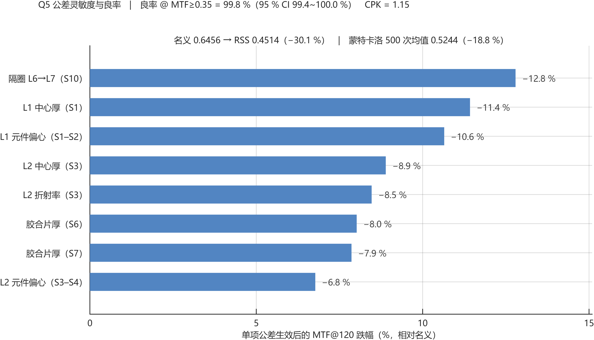

*图 8　Q5 单项公差灵敏度（按公差族聚合，±X/±Y 已合并为一条）。柱长 = 该项公差在 ± 全程生效时把 MTF@120 拉低的百分比，均相对名义 0.6456。*

**读法**：第一名**不是偏心而是隔圈**——L6→L7 的 1.00 mm 空气间隔（S10）±0.0375 mm 就吃 −12.8 %。这一项落在 Q5 的厚度公差档上，而生产上隔圈做到 ±0.02 mm 是常规能力、不额外花钱，是全表最"便宜"的改进点。L1 中心厚（−11.4 %）与 L1 偏心（−10.6 %）紧随其后，两者共同构成前片组的公差预算。

**代价判断**：现在**不需要做任何事**——规格签 0.35 时良率 99.8 %。上面这条只作为"要签更严规格或冲 CPK 1.33"时的第一顺位。

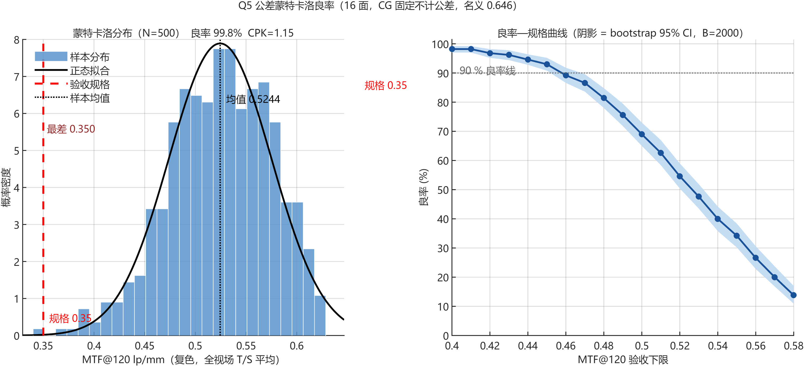

*图 9　本轮模型（16 面、CG 固定，500 次）的良率—规格全曲线。左：MTF@120 分布（复色、全视场 T/S 平均）与正态拟合；右：不同验收下限下的良率，阴影为 bootstrap 95 % 置信区间（B = 2000，rng 固定可复现）。*

**这张图解决的是"规格定在哪"的问题**（图 8 回答"谁在拖后腿"，图 9 回答"0.35 这条线过不过"）：

| 验收下限 MTF@120 | 0.40 | 0.42 | 0.44 | **0.45** | 0.46 | 0.48 | 0.50 | 0.52 | 0.55 |
|---|---:|---:|---:|---:|---:|---:|---:|---:|---:|
| 良率 | 98.2 % | 96.8 % | 94.6 % | **93.0 %** | 89.2 % | 81.4 % | 69.0 % | 54.6 % | 34.2 % |
| 95 % CI 下界 | 97.0 % | 95.2 % | 92.8 % | **90.8 %** | 86.6 % | 78.0 % | 65.0 % | 50.4 % | 30.2 % |

**读法**：

- 均值 0.5244，**离 0.35 的规格线有 3.45σ**（CPK 1.15）。500 个样本里只有 1 个掉到 0.3496，良率 99.8 %、CI 下界 99.4 %。
- **90 % 良率的临界点在 0.455**（≈0.70×名义值）：0.45 时 93.0 %，0.46 时 89.2 %（CI 下界 86.6 %）。规格签 0.35 还有 **0.10 的余量**——**可以签得比现在更严，不必担心良率**。
- 真要把下限压到 0.48 以上（≈0.74×名义值）才需要动工艺，第一顺位是 **S10 隔圈收到 ±0.02 mm**，第二顺位是 **L1/L2 偏心**（图 8）。
- 绝对数值现在可信：引擎名义 0.6456 与 §三 原生 FFT MTF 平均 0.652 相差 1 %，**可以对外承诺绝对 MTF**（这是本版相对前几轮最大的改进）。

### 5.4 口径说明（很关键，别跳过）

| 项 | 事实 |
|---|---|
| **根因：窗口板通光口径切光束** | 前几轮引擎名义只有 0.3659（原生 0.63），差 42 %。真因不是采样、不是视场展开、不是渐晕因子，而是**窗口板 S13/S14 的 `semi_diameter` 给成了 4.6807 mm**：像面半口径 4.6504 mm、全视场像高约 4.69 mm，加上边缘光线半径后就超了口径，**离轴视场的光束在板口被真实光线追迹切掉一圈**。原生 FFT MTF 是基于光瞳的，看不见表面口径；公差引擎 `DiffMTF` 走实光线，于是全吃到了。把口径放大到 **6.0 mm** 后，引擎名义立刻从 0.3659 跳到 **0.6456**，与原生 0.652 对上 |
| 为什么 6.0 mm 是对的 | CG 的口径由半导体封装决定，覆盖整个 die 加封装余量，光学上它只是块平板、**不该起光阑作用**。原来那个 4.68 mm 是把"像圈半口径"误抄成了"玻璃半口径" |
| **口径可信度（本版结论）** | 引擎名义 0.6456 vs 原生 FFT MTF 全视场平均 0.652，**差 1 %**。判据口径（DiffMTF、采样 2、单测试波长 0.588、9 个 XY 对称视场、全部零渐晕）与原生不同，但差异已小到可以忽略——**绝对 MTF 数值可以对外承诺** |
| 前几轮结论全部作废 | 基于名义 0.3659 的灵敏度排序、`tight`/`medium` 对照、96.0 % 良率、CPK 0.47，都是剪切条件下的产物，**不得再引用**。本 §5.1–5.3 是唯一有效版本 |
| `criterion` 参数无效 | 传 `"RMSSpotRadius"` 仍按 `DiffMTFAverage`（criterion = 8）运行，工具不认字符串，只能跑 MTF 口径 |
| `get_tolerance_report` 的解析段 | 蒙特卡洛模式下返回空（`operand_count: 0`）。统计是 **MATLAB 直接解析 Zemax 原始报告**（`layouts/analysis/tol_mc_mtf_q5.txt`，灵敏度与 500 次 MC 在同一次运行里，一份文件全含）算出来的 |
| 只保留一份报告 | 逐次跑会互相覆盖 `ZOS_TOL_REPORT.TXT`（灵敏度那次不带 500 次 MC、MC 那次不带灵敏度段）。解决办法是**把 `SetupMode` 留在带 MC 的状态再跑灵敏度**，一次运行同时产出灵敏度 + RSS + 补偿器统计 + 500 次 MC。中间口径（`tight`/`medium`/去窗/旧加窗）的原始报告已全部删除，作废结论见 §5.4 表格 |
| TDE 只能靠向导重建 | `remove_operands` 改的是**评价函数编辑器**、不是 TDE；`set_tolerance_compensator` 只能改已有 `COMP` 的 min/max、改不了它挂在哪一面。要"让某一面没有公差"或"把补偿器挪到指定面"，唯一可靠的路径是**摘掉该面 → `set_tolerances` 重建 → 装回**（本节做法），TDE 引用面号 1–12 不受影响 |
| 副本当前状态 | `..._公差Q5_...zos` 已保存为修正后的状态：16 面、**60 条 TDE（1–12 面）**、窗口板零公差、补偿器在 **S12**、各面求解已固定（公差分析的标准状态） |
| 补偿器行程 | 灵敏度报告「补偿器统计」：后焦补偿量 **−48.7 ~ +49.1 µm**（σ 12.5 µm）。这是装配离焦量，与 §四 的热漂移 ±48 µm 不同源，机构行程需两者叠加（见 §5.6） |

### 5.5 结论与措施

| 项 | 结论 |
|---|---|
| **Q5 良率** | **99.8 %** @ MTF@120 ≥ 0.35（500 次，最差样本 0.3496，仅 1 个样本略低于线），均值 0.5244（−18.8 %），σ 0.0506 |
| 对 90 % 商业门槛 | ✅ 通过，且**规格线可以签到 0.455 才跌破 90 %** |
| 对车规安全件 97.7 %（±3σ） | ✅ 规格线 ≤0.41 时通过（0.41 良率 98.2 %、CI 下界 97.0 %）；0.42 良率 96.8 %、下界 95.2 % 属贴线 |
| CPK = 1.15（3.45σ） | 略低于 1.33 的通行门槛。与无窗定稿版的 1.09 基本一致，**是这支 F/1.4 六片镜头的固有水平**，不是加窗口造成的 |
| 是否需要重做设计 | **不需要**。加 IR-CUT 与 CG 没有引入新的敏感项，也没有降低良率 |
| 是否需要整体升档 | **不需要**。见下 |

**措施（全部是工艺层面，不动光学；按 §5.2 排序取前两位）**

| 措施 | 内容 | 依据 |
|---|---|---|
| ① **S10 隔圈厚度收到 ±0.02 mm** | S10 = L6→L7 的 1.00 mm 空气间隔，生产上是隔圈厚度；±0.02 是隔圈常规能力，**不额外花钱** | 灵敏度第 1 位（−12.8 %），Q5 的 ±0.0375 对它偏松 |
| ② **L1、L2 元件偏心 ±0.010 mm** | Q5 本身已含此项，落实定心磨边 + 偏心仪分选即可 | 灵敏度第 3、第 8 位（−10.6 % / −6.8 %） |
| ③ 阿贝按熔炼批抽样，不按片 | 同批玻璃 νd 一致，按片抽是重复计错 | 省成本；Q5 的 ±0.10 % 下影响 ≤2.2 % |

**当前是否需要做？** 不需要——规格签在 0.35 时良率 99.8 %，上面三条属于"如果要签更严规格或冲 CPK 1.33"时才启动的预备措施。

> **不要为了 CPK 去整体升档**：CPK 1.15 的短板来自 S10 隔圈与 L1/L2 偏心两条，整体把厚度从 ±0.0375 收到 ±0.01、折射率从 ±0.001 收到 ±0.0005，等于让 60 条公差一起加钱，却只动到其中两条。真要提 CPK，**只改 S10 隔圈 + L1/L2 两片定心**，其余 57 条保持 Q5。

**5.6 机构行程（热 + 装配叠加）**

| 来源 | 量 | 依据 |
|---|---:|---|
| 热漂移（−40~85 ℃） | ±48 µm | §四，调焦扫描跨度 64.9 µm |
| 装配离焦（Q5 公差，后焦补偿） | ±49 µm | 本节补偿器统计 σ 12.5 µm |
| **保守叠加** | **±97 µm** | 两者不同源、方向独立，直接相加 |
| **建议机构净行程** | **≥ ±100 µm** | 再留 5 % 余量，VCM 可做但已接近常规上限 |

> 若供应商只能给 ±50 µm 行程，则必须**先做一次"出厂调焦固定 + 温度查表"**的两段式方案（装配段用一次调焦消掉 ±49 µm 的装配离散，工作段只留 ±48 µm 的热漂移），否则热端和装配误差会互相挤占行程。

---

## 六、鬼影分析

### 6.1 两条路线，同一套面表

| 路线 | 工具 | 覆盖 | 用途 |
|---|---|---|---|
| **真实光线（主）** | GUI 鬼像焦点生成器，手动导出三份 | 91 组（14 个反射面，含像面 S15） | 鬼像在像面的实际 RMS 光斑、落点、焦点距 |
| **一阶枚举（辅）** | `matlab/ghost_screen_IRcut_20261120.m` | 同 91 组 | 反射率 × 几何合成强度、镀膜敏感度 |

导出文件：`zemax-ADAS/加窗口鬼影分析1-15.txt`（91 组，全集）、`…1-14.txt`（78 组）、`…14-15.txt`（25 组）。三者是同一系统、同一算法的三次运行，合并时以前者为准。

**先说清 GUI 的两个坑**：① `RMS = 0.0000` **不是完美焦点，是追迹失败**（界面把英文原意译反了）；② S5 光阑是「R=∞ 且前后同为空气」的虚面，不计入反射面，所以是 14 个面 → C(14,2) = 91 组，不是 C(15,2) = 105。

### 6.2 数据自洽性（先验，不过就别往下看）

| 检查 | 结果 | 含义 |
|---|---|---|
| 三次运行的重叠面对 | 「到鬼像焦点」最大偏差 **0.00e+00 mm** | 三份导出逐位一致，可直接合并 |
| S14 与像面 S15 重合（t = 0） | `15然后13` ≡ `14然后13`（0.13977 / −0.53430），`15然后12` ≡ `14然后12`，`15然后11` ≡ `14然后11` | 几何自洽，面号映射正确 |
| `RMS = 0.0000E+00` | **19 / 91** | 追迹失败，不参与排序 |
| 一阶引擎 EFFL / TOTR / 轴上像高 | 差 0.0010 mm / 0.0000 mm / 0.0022 mm | 一阶引擎可用 |

### 6.3 主结果：最尖锐的鬼像

按 Zemax 实光线 RMS 升序。「RMS」就是鬼像在像面上的光斑半径，直接决定它有多亮：

| # | 反射面对 | Zemax RMS (mm) | 像面边缘高 (mm) | 鬼像焦点距 (mm) | 一阶 Δz | 一阶浓度 I/D² |
|---:|---|---:|---:|---:|---:|---:|
| 1 | **15–14**（像面 ↔ 板后） | **0.00347** | −0.0025 | −0.0068 | 0.000 | 3.71 |
| 2 | 15–13（像面 ↔ 板前） | 0.1398 | −0.1908 | −0.5343 | 0.000 | 3.67 |
| 3 | 14–13（板后 ↔ 板前） | 0.1398 | −0.1908 | −0.5343 | 0.000 | 0.928 |
| 4 | 6–1 | 0.3244 | −1.0142 | −2.8396 | −87.0 | 8.5e-7 |
| 5 | 13–12（板前 ↔ L7 后） | 0.3767 | −0.5025 | −1.4068 | 0.000 | 0.928 |
| 6 | 12–11 | 0.4726 | −0.6508 | −1.8223 | −1.288 | 8.5e-5 |
| 7–8 | 15–12 / 14–12 | 0.5140 | −0.6908 | −1.9343 | 0.000 | 3.64 / 0.918 |
| 9 | 10–8 | 0.6329 | +0.8628 | −2.4158 | −15.96 | 1.4e-6 |
| 10 | 13–11 | 0.7009 | −0.9651 | −2.7024 | −1.288 | 8.4e-5 |
| 11 | 11–10 | 0.7203 | −0.9747 | −2.7292 | −1.087 | 2.7e-5 |

三条判读：

1. **15–14 独占一档。** RMS 3.47 µm ≈ 一个像元，与系统自身的轴上弥散同量级，比第二名（140 µm）**尖锐 40 倍**。它是**像面 ↔ 窗口板后表面**的零间隙腔：封装件与 CMOS 之间没有空气层，双次反射是严格回射，鬼像原样叠回主像。
2. **其余平板路径**（15–13、14–13、13–12、15–12、14–12）RMS 0.14~0.51 mm，是糊开的一团，不是亮点。
3. 纯镜片路径里最尖锐的是 6–1（0.32 mm），已属可接受量级。

> 关键差别：**零间隙的 15–14 是唯一"完美回射"腔**。板内 0.4 mm、板前到 L7 的 0.7 mm 等有间隔的腔，实光线追迹显示仍有 0.14~0.51 mm 残余弥散（见 §6.6 的分歧说明）。

### 6.4 强度：只有 15–14 一项需要管

#### 6.4.1 GISET 是什么

**GISET = 鬼影在像面的照度 ÷ 主像在同一位置的照度**，无量纲。说它"9.3e-5"意思是：**鬼影比主像暗 1/11000**（−40.3 dB）。

它不是通量比，是**峰值照度比**——这点决定了排序：一个弥散到 0.5 mm 的鬼影可能总通量更大，但摊开后峰值很低，不可见；反过来一个 3 µm 的鬼影通量很小，却能刺眼。

| GISET | dB | 含义 |
|---|---:|---|
| > 1e-2 | −20 | 肉眼明显可见，必须整改 |
| 1e-3 ~ 1e-2 | −30 ~ −20 | 强光源下可见 |
| **1e-4 ~ 1e-3** | **−40 ~ −30** | **车载常用验收线** |
| < 1e-4 | < −40 | 严格场景可接受 |

**换算成人眼/像素**：8 bit 满量程 255，主像打满时鬼影只有 **0.024 LSB**（1 个灰度级的四十分之一），正常画面里看不见；只有对着太阳/远光这类极强点光源、周围是暗场时，才会在亮斑外看到一圈极淡的雾。

**本设计的推导**（15–14 为零间隙回射腔，鬼影逐点叠回主像，能量不摊开，所以峰值比 ≈ 反射率乘积）：

```
0.02（像面反射） × 0.005（板后 AR 残余） × 0.98^m（沿途透射） ≈ 9.3e-5
      ↑ 第一次反弹          ↑ 第二次反弹
```

对比：若同一通量被摊到 0.14 mm（约 40 像元），峰值再除以 40² = 1600 —— 这就是为什么弥散到 0.5 mm 的 15–13 只有 3e-8，而 3 µm 的 15–14 有 9.3e-5。

#### 6.4.2 结果

| 路径 | 反射率组合 | GISET 估算 | 判定 |
|---|---|---:|---|
| **15–14** | 像面 2 % × 板后 0.5 % | **≈ 9.3e-5** | 贴 1e-4 线 |
| 14–13 / 15–13 | 0.5 % × 0.5 %，且弥散 0.14 mm | ≈ 3e-8 | 可忽略 |
| 其余 88 条 | — | < 1e-6 | 可忽略（按 Zemax 的弥散摊薄；即便按一阶判为重合，最高也只有 2.4e-5，仍有 4 倍余量） |

**结论：整支镜头除 15–14 外，没有需要管的鬼影。** 而 15–14 的强度几乎完全由**像面反射率**决定，镜头侧唯一能动的杠杆是窗口板后表面的 AR：

| 板后 AR 残余反射 | GISET（像面按 2 %） | 判定 |
|---|---:|---|
| 0.5 % | 9.3e-5 | 贴线 |
| **0.2 %** | **3.7e-5** | 2.7 倍余量 |
| 0.1 % | 1.9e-5 | 5 倍余量 |

> 若像面反射率不是 2 % 而是 5 %（裸硅/无 AR），上表全部 ×2.5：0.1 % 的板后 AR 仍有 4.6e-5（可接受），但 0.5 % 会到 2.3e-4（**超标**）。**"像面反射率"必须向 Sensor 厂要实测值，不能沿用本版的 2 % 假设。**

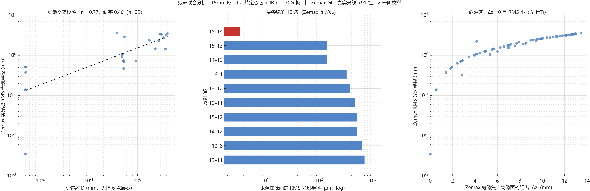

*图 10　鬼影联合分析三联：左 = 一阶弥散 D 与 Zemax 实光线 RMS 的交叉校验（r = 0.77，两条独立路线同向）；中 = 最尖锐 Top10（红柱为 15–14，比第二名锐 40 倍）；右 = 危险区图（越靠左上 = 焦点越近像面且光斑越锐 = 越危险）。判读见 §9.4。*

### 6.5 横向对照：这是行业通病，不是本设计的缺陷

**"像面 ↔ 最后一片/盖板后表面"这类鬼影只要镜头后有反射面、且它和传感器之间只有短间隙，就必然存在** —— 任何数字成像系统都有，差别只在**多亮、落在哪**。分两类：

| 类型 | 来源 | 与设计的关系 |
|---|---|---|
| **结构型**（本设计的 15–14） | 像面 ↔ 最后一片/盖板后表面，零间隙回射 | **人人都有**，与拓扑无关，只取决于反射率与间隙 |
| **拓扑型** | 片间/平板间双反射，∝ N² | 片数越多越多；**平板和近平面配对最危险**（窗口、滤光片、CG 板） |

本设计 91 组里 90 组是拓扑型（全部弱 3000 倍以上），唯一危险的反而是结构型那条 —— 这是**长焦 + 窗口板 + 多片**结构的典型分布，不是异常。

**本设计落在偏低一端的三个原因**：

1. **CG 贴着传感器封装（零间隙）** → 鬼影逐点叠回源像素，是最良性的一种。行业里更常见的是"独立滤光片 + 0.1~0.5 mm 空气层"：峰值照度降（被摊薄），但鬼影变成**偏离主像的可辨光斑**，出现在黑场上，客户投诉反而更多。
2. **玻璃镀膜 AR 0.5 %**（塑料镜片通常 1 %）。
3. **口径小**（长焦 15 mm、最大半口径 8 mm），两次反射截到的杂光少。

**同类系统典型量级**（工程经验，非实测，仅用于判断本设计是否异常）：

| 系统 | 像面反射 | 面向像面的 AR | 典型 GISET | 备注 |
|---|---:|---:|---|---|
| **本设计**（玻璃 + 零间隙板） | 2 % | 0.5 % | **9.3e-5** | 重合型 |
| 车载玻璃 + 独立 CG + 0.2 mm 间隙 | 2 % | 0.5 % | 峰值 1e-5 量级 | 但出现**可辨光环** |
| 手机 6P 塑料 | 4 % | 1 % | **4e-4 ~ 4e-3** | 塑料末片 + 传感器反射是手机"圆形鬼影"的经典来源 |
| 安防 CCTV（大光圈 + 外置 IR-CUT） | 3 % | 1 % | 3e-4 ~ 2e-3 | 夜间强点光源下明显 |
| 车载激光雷达接收 / LED 投影 | 5 %+ | 0.2 % | 视光源而定 | 对强光更敏感 |

**结论：9.3e-5 在这一类里属于良好水平，不是异常值。** 影响程度与同类相当或更好。

**但有两件事会让任何设计恶化，必须写进图纸/工艺**：

1. **供应商换 AR 膜系**：0.5 % → 2 % 是 16 倍，直接把本设计从"贴线"推到"超标"（详见 §6.4.2 的反射率敏感表）。
2. **装配被迫在板与传感器之间留空气层**（例如加调焦垫片）：重合变偏移，GISET 降但可见度升，且**多出一个新腔**（板后 ↔ 传感器）。

这两条正是 §6.8 把「S14 AR ≤0.2 %」和「间隙保持 0」写成硬要求的理由 —— **不是针对本设计的特殊风险，而是这类结构的通用红线**。

### 6.6 两条路线的交叉校验与分歧

**一致的部分**：两条独立路线都把 S12 / S13 / S14 / 像面这一族平板排在首位；都把 15–14 判为"焦点与主像重合"（一阶 Δz = 0，Zemax 焦点距 −0.0068 mm）；29 组可比路径上，一阶弥散 D 与 Zemax RMS 的 log-log 相关系数 **r = 0.77**，同向。

**不一致的部分（必须写清，不能掩盖）**：

- 对 `13–12`、`14–13`、`14–12` 这类**平行平面**配对，一阶模型给出严格回射（Δz ≡ 0、弥散 < 5 µm），而 Zemax 实光线给出 0.14~0.51 mm 弥散、−0.53~−1.93 mm 焦点距。
- 检查 Zemax 自身：`0.19081 / 0.53430 = 0.357` 正好是该系统的像方数值孔径，且 `RMS 0.1398 ≈ 0.73 × 0.19081`，与已知关系「RMS ≈ 0.735 × 边缘光线高度」吻合 —— 说明这些数**内部自洽，不是随机噪声**。
- 因此结论是：**本版一阶模型低估了有限口径腔体鬼影的残余弥散**，不能拿它去否定 Zemax。处置：**以 Zemax 实光线为准**（更保守，也是客户会用的工具），一阶模型只保留两个用途 —— 强度合成（反射率组合）与排序自洽。

### 6.7 离轴视场：鬼影会不会扫出传感器

§6.1~§6.6 全部是**轴上**结论（GUI 的 RMS 也是轴上 RMS）。离轴视场的鬼像落点会平移，本节补这一块。

**方法**：二维子午面实光线引擎（非球面 + 矢量 Snell），面表与本版 Zemax 文件逐位一致。旋转对称系统里任一视场点都等价于"把坐标轴转到该方位后的子午面"，所以二维追迹对离轴是**精确**的，不是近似。91 组 × 4 视场 × 21 条光瞳光线。

视场角按**传感器矩形**标定（主光线正好落在 8.08 × 4.58 mm 的边上），否则测到的是视场定义误差而不是鬼影：

| 视场 | 方位 | 标定后角度 | 主光线像高 |
|---|---|---:|---:|
| 1 | 中心 | 0° | 0 |
| 2 | 竖半幅 | 8.66° | 2.2900 mm |
| 3 | 横半幅 | 15.06° | 4.0400 mm |
| 4 | 对角 | 17.22°（29.5° 方位） | 4.6418 mm |

**与 Zemax 的对账**（同一套面表，只比轴向）：

| 量 | 结果 |
|---|---|
| 危险带（\|Zemax 焦点距\| < 1 mm，3 组） | 中位偏差 **10 µm**，最大 10 µm |
| 全部 72 组可比 | corr **+0.973**；RMS 中位比值 1.12 |
| 偏差 > 0.2 mm 的 60 组 | 全是弥散 > 0.3 mm 的大角度路径，二维子午面模型的下限；这些路径本来就不构成亮点 |

**结果**：

| 反射面对 | 0° | 8.66° | 15.06° | 17.22° | 中心始终在传感器内 |
|---|---:|---:|---:|---:|---|
| **15–14** | 3.7 µm | 2.7 µm | 2.4 µm | **1.1 µm** | ✅ 4/4（中心正好压在边/角上） |
| 11–10 | 1272 µm | 944 µm | 331 µm | **100 µm** | ✅ 4/4（余量 1.33 mm） |
| 15–13 / 14–13 | 120 µm | 112 µm | 106 µm | 103 µm | ❌ 1/4（边缘视场出界 0.10~0.13 mm） |
| 13–12 | 323 µm | 311 µm | 301 µm | 292 µm | ❌ 1/4（出界 0.28~0.37 mm） |
| 12–11 | 395 µm | 494 µm | 全挡 | 全挡 | ❌ 1/4（8.66° 时中心已到 4.90 mm） |
| 6–1 | 291 µm | 302 µm | 329 µm | 311 µm | ✅ 4/4 |

四条结论：

1. **15–14 在离轴视场不是更糟，而是更好。** 它是零间隙回射腔，鬼像逐点叠回**自己的源像素**（四角处中心 = 4.642 mm = 传感器角点，偏差 < 1 µm），且 RMS 从轴上 3.7 µm 一路降到角点 1.1 µm。**轴上就是最坏情况**，所以 §6.4 的 GISET 估算天然是保守的，不需要按离轴放大。
2. **11–10 随视场变锐，但方向相反不构成威胁。** 角点处 RMS 降到 100 µm（比轴上锐 12 倍），可它的中心落在 3.31 mm、离主像 1.33 mm，是**与主像分离**的一个斑；镀膜 0.5 % × 0.5 %、摊在 ~20 像元上，峰值仅 **≈1e-7** 量级，可忽略。
3. **15–13 / 14–13 的鬼像比主像大 2.67 %**（离焦 −0.52 mm 带来的角放大），因此在边缘视场**中心外移 0.10~0.13 mm，刚刚越出传感器边**。注意只是"中心"越界，其 RMS 本身就有 0.1 mm，所以边缘视场处约一半能量仍在屏上 —— 但它们是 0.5 % × 0.5 %、比 15–14 弱约 3000 倍，不构成风险。
4. **91 组里 26 组中心始终在屏内、14 组在某个视场出界、其余 51 组在大视场被口径全挡（只在轴上出鬼影）。** 没有任何一组是"离轴才变危险"的类型。

> 一句话：**离轴不改变 §6.4 的结论**。唯一需要管的仍是 15–14，而它在离轴反而更钝。

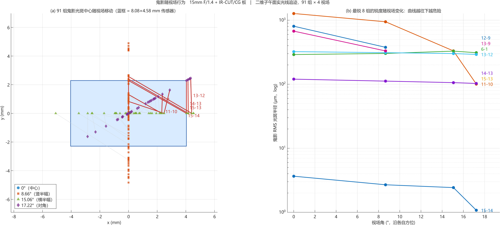

*图 11　离轴鬼影二联：左 = 91 组鬼影光斑中心随视场移动（蓝框 8.08×4.58 mm 传感器，红线为最锐 6 组，灰线为其余）；右 = 最锐 8 组的 RMS 随视场变化（log 纵轴，越靠下越锐 = 越危险）。判读见 §9.4。*

### 6.8 图纸与工艺要求

| 项 | 要求 | 理由 |
|---|---|---|
| **S14（板后，面向像面）单面残余反射** | **≤ 0.2 %**（目标 0.1 %），420~700 nm，全入射角 ≤ 25° | 15–14 的唯一杠杆，直接决定 GISET |
| S13（板前）单面残余反射 | ≤ 0.5 % | 14–13 / 15–13 |
| S12（L7 后表面） | ≤ 0.5 % | 13–12 / 14–12 |
| 板平行度（S13–S14 楔角） | ≤ 10″ | 楔角把"重合的浑浊"变成"偏移的重影" |
| 板与像面的间隙 | 保持 0（一体化封装）；若被迫留空气层，必须重评 | 有间隙时回射不再精确，反而摊开（但也引入新腔） |
| 像面反射率 | **向 Sensor 厂索取实测值**，不得沿用 2 % 假设 | GISET 主项 |

### 6.9 本节的边界（哪些没做，为什么）

1. **离轴结论只有子午面。** §6.7 用的是二维子午面实光线引擎，对旋转对称系统是精确的，但不含弧矢方向的面形误差（本设计 S1/S11 为旋转对称非球面，无此误差）。楔形/装调带来的非对称落点不在模型内，需在公差里控楔角。
2. **GISET 只给了量级估算。** 完整 GISET 需要：① 实测镀膜曲线（不是常数 R）；② 强光源角位置与辐亮度；③ 探测器光谱响应。三者都没有，所以本节只能给"哪条路径危险、差多少倍"，不能给"是否过客户线"。
3. **像面反射率是假设值（2 %）**，且是 GISET 的主项，必须换成 Sensor 厂实测值才能定稿（见 §6.4）。
4. **没做非序列杂散光（路线 C）。** PST 需要机械 STEP 模型（镜筒、隔圈、压圈、Sensor 腔）与 BSDF 参数，本阶段没有结构模型。
5. **19 条追迹失败未逐条判因。** 多为光线在中间面被口径截断或全反射，即物理上不成立/无能量的路径，但未逐条核实。
6. **胶合面（S6/S7 之间的胶层）未单独建模**，按玻璃-玻璃界面处理；胶层实际反射更弱，会略高估。
7. **一阶模型对平行腔体低估弥散**（§6.6 的分歧），本版已按 Zemax 实光线取保守值。

---

## 七、结论与剩余风险

### 7.1 五件套 + DFM 结论

| 项 | 结论 | 一句话依据 |
|---|---|---|
| **光学** | ✅ **七项指标全达标** | EFFL 15.0046 / TOTR 30.0000 / MTF@120 最差 0.513 / RI 83.7 % / 场曲 0.026 mm / 畸变 0.304 % / CRA 12.96°，余量最小的畸变也有 0.7 个百分点 |
| **无热化** | ⚠️ **可用，但规格要改口径** | 离焦靠调焦完全可解（跨度 64.9 µm）；全温绝对 MTF@120 ≥ 0.334（85 ℃）通过；**相对跌幅 32 % 不满足 ≤20 %**，属"半径热缩放 vs 折射率漂移对球差失配"，纯调焦消不掉 |
| **公差** | ✅ **可量产，不需重做设计** | Q5 良率 99.8 % @ MTF≥0.35（500 次），规格签到 0.455 才跌破 90 %；CPK 1.15 是这支 F/1.4 六片的固有水平，加窗口没让它变差 |
| **鬼影** | ✅ **只有一条要管，且可管** | 91 组里仅 15–14（像面 ↔ 板后零间隙腔）构成亮点，GISET ≈ 9.3e-5 贴 1e-4 线；板后 AR 收到 0.2 % 即降到 3.7e-5。离轴不改变结论（§6.7） |
| **机构** | ⚠️ **行程接近常规上限** | 热 ±48 µm + 装配 ±49 µm 保守叠加 ±97 µm，建议净行程 ≥ ±100 µm；若 VCM 只能给 ±50 µm，必须走"出厂调焦 + 温度查表"两段式 |
| **可制造性（DFM）** | ⚠️ **条件通过** | 无 P0；四项 P1——**L7 薄且球冠占满**（D/CT 7.40、球冠半角 51.3°）、**胶合组装配定心**（组外表面近同心 1.38 mm；单片 Z 0.331/0.403 无问题）、**S11 顶点 R 偏小 + 拐点贴边**、**胶合组 UV/CTE 缺数据**。详见 §3.6 |

### 7.2 剩余风险（按关闭优先级）

| # | 风险 | 影响 | 责任方 | 关闭条件 |
|---:|---|---|---|---|
| **P0** | **像面（CMOS）反射率未实测**，本版按 2 % 假设 | GISET 的主项。若实际 5 %，15–14 的 GISET 从 9.3e-5 升到 2.3e-4（超标），即使板后 AR 做到 0.1 % 也只剩 4.6e-5 | Sensor 厂 | 拿到传感器盖板/裸片在 420~700 nm 的反射率曲线，回代 §6.4 |
| **P0** | **S14 板后 AR 规格未进图纸** | 15–14 鬼影唯一的光学侧杠杆，0.5 % → 0.2 % 是 2.5 倍 | 光学图纸 | 图纸写明「S14 单面残余反射 ≤0.2 %（目标 0.1 %），420~700 nm，全入射角 ≤25°」 |
| **P1** | **L7 径厚比 7.40 + 近半球（球冠半角 51.3°）** | 薄且陡的凹非球面：抛光模干涉、装夹变形、面形不稳定 | 加工厂 / 设计 | 打样前询价确认能做；做不了则 CT 加到 1.6~1.8 mm 或口径收到 9 mm（需重优化，本版不动）。详见 §3.6.7 |
| **P1** | **胶合组装配定心：组外表面近同心（1.38 mm）** | 组级钟罩自定心失效，偏心只能靠设备保证；**单片定心无问题**（Z 0.331 / 0.403） | 工艺 | 单片定心磨边 → 胶合 → 定心车削 + 偏心仪分选，元件偏心 ≤0.010 mm（§3.6.3） |
| **P1** | **胶合组 UV 透过 / CTE 缺数据** | 胶层可能固化不透或应力脱胶 | 玻璃厂 | 取 D-LAF50 与 H-ZF7LA 的 360 nm 内透过率与 CTE（§3.6.5） |
| **P1** | **光阑两侧净空仅 0.47 / 0.49 mm** | 低于光阑座 2 mm 装配默认值，隔圈壁厚必须压到 0.3~0.5 mm | 结构 | 确认隔圈壁厚可行；做不到则加垫圈（TOTR +1.5 mm，需重跑公差）（§3.6.1） |
| **P1** | **S11 顶点 \|R\| 6.41 mm、拐点 4.5 mm** | 凹面研磨空间紧；拐点若在通光口径内会出现条纹反转 | 加工厂 / 检测 | 出检测方案（零位补偿器 / CGH），核验拐点是否在通光口径外（§3.6.4） |
| **P1** | 全温相对 MTF 跌幅 32 % | 若客户按"相对常温 ≥80 %"验收，本设计不合格 | 规格谈判 / 设计 | 规格改为「全温 MTF@120 ≥ 0.30 绝对口径」；或上双金属片隔圈做第二自由度（§4.7 路径 2） |
| **P1** | 机构行程 ±97 µm | VCM 常规上限 ±50~±100 µm，余量薄 | 结构 | 结构确认 VCM 型号；做不到就用两段式调焦方案（§5.6） |
| **P2** | 板平行度（S13–S14 楔角）≤10″ 未验证 | 楔角把"重合的浑浊"变成"偏移的重影"，直接恶化 15–14 | 来料检验 | 封装件入射检验，超差批次退 |
| **P2** | **L4 的 S8 半球余量仅 +0.30 mm** | 机械口径做到 Ø8.03 即触 0.7·D 半球线，而机械通常比通光大 0.1~0.2 mm/边 | 图纸 / 加工厂 | 图纸锁 L4 外圆 ≤ Ø8.0；或 S8 放宽到 R ≥ 5.8 mm 后重跑球差（§3.6.2） |
| **P2** | CPK 1.15 < 1.33 | 只影响"要签更严规格"的场景 | 工艺 | 只收 S10 隔圈（±0.02 mm）+ L1/L2 偏心，其余 57 条保持 Q5（§5.5） |
| **P3** | 19 条鬼影路径追迹失败未逐条判因 | 均为被口径截断/全反射的无能量路径，不影响结论 | — | 无需关闭；若客户追问，按面号逐条给截断面 |
| **P3** | 未做非序列杂散光（PST） | 镜筒/隔圈散射不在本版范围内 | 结构 + 光学 | 有机械 3D 后另开一轮（需 STEP 模型 + BSDF） |

### 7.3 能不能往下走

**可以进入打样**，六个前置条件缺一不可：

**光学/鬼影侧（3 条）**

1. **S14 板后 AR ≤0.2 % 写进图纸**（P0，唯一能压 15–14 的杠杆）；
2. **向 Sensor 厂取回像面反射率实测值**，回代 §6.4 复核 GISET；若 >3 %，板后 AR 必须收到 0.1 % 或以下；
3. **验收规格按"绝对 MTF"口径签**（全温 @120 lp/mm ≥0.30），不要签"相对常温 80 %"。

**可制造性侧（3 条）**

4. **L7 打样前先询价**（P1）：D/CT 7.40 + 球冠半角 51.3° 的薄凹非球面，供应商要么能做、要么给出改口径/加厚的具体阈值；做不了再回设计改（本版不动）；
5. **L3+L4 胶合组按"定心车削 + 偏心仪分选"下单**（P1），图纸给元件偏心 ≤0.010 mm，不接受钟罩自定心；
6. **取回胶合组两片玻璃的 360 nm 透过率与 CTE**（P1），低于 40 % 需换胶或改预固化工艺。

六条都闭环后，本设计的几何、像质、公差、无热化、鬼影、可制造性六项均无阻塞项；DFM 等级可从"条件通过"升到"通过"。

---

## 八、文件清单

| 类别 | 文件 |
|---|---|
| 设计（交付） | `车载长焦前摄15mmF1.4_定心系数_IRcut_20261120.zos`（单组态 25 ℃） |
| 无热化副本 | `车载长焦前摄15mmF1.4_定心系数_IRcut_无热化_20261120.zos`（3 温度组态 + 23 条热拾取） |
| 公差副本 | `车载长焦前摄15mmF1.4_定心系数_IRcut_公差Q5_20261120.zos`（**60 条 TDE，只覆盖 S1–S12**；窗口板零公差；补偿器 = S12 后焦 ±0.2 mm；各面求解已固定） |
| ~~公差副本（旧，作废）~~ | 已删除。早期快照（69 条 TDE、窗口板参与公差、补偿器误挂 S14）的结论不可引用，根因见 §5.4 |
| 图（加窗版） | `layouts/layout_3D_IRcut.png`、`layouts/clearance_IRcut.png`、`layouts/spot_diagram_IRcut.png`、`layouts/MTF_IRcut.png`、`layouts/RI_curve_IRcut.png`、`layouts/CRA_curve_IRcut.png`、`layouts/FCD_IRcut.png`、`layouts/TOL_yield_IRcut.png`、`layouts/mc_yield_q5_IRcut.png` |
| 鬼影原始数据（GUI 导出，UTF-16LE） | `加窗口鬼影分析1-15.txt`（**91 组，全集，以此为准**）、`加窗口鬼影分析1-14.txt`（78 组）、`加窗口鬼影分析14-15.txt`（25 组）——三次运行重叠面对逐位一致 |
| 鬼影图 | `layouts/GHOST_IRcut.png`（三联：一阶弥散 vs Zemax RMS 交叉校验 / 最尖锐 Top10 / 焦点距–RMS 危险区）<br>`layouts/ghost_realray_fields_IRcut.png`（二联：91 组光斑中心随视场移动 / 最锐 8 组锐度随视场变化，见 §6.7） |
| 脚本（可一键重跑） | `matlab/ghost_screen_IRcut_20261120.m`（鬼影一阶枚举 + Zemax 联合分析）、`matlab/ghost_realray_IRcut_20261120.m`（离轴实光线 91×4，生成 §6.7 的图与 `matlab/data/ghost_realray_IRcut.csv`）、`matlab/tol_mc_IRcut_20261120.m`（Q5 公差出图） |
| 原生导出文本 | `layouts/analysis/fft_mtf.txt`、`relative_illumination.txt`、`field_curvature_distortion.txt` |
| 公差原始报告 | **`layouts/analysis/tol_mc_mtf_q5.txt`**——唯一一份（Q5、CG 不计公差、灵敏度 + RSS + 补偿器统计 + 500 次 MC 在同一次运行，名义 0.6456）。其余中间口径的报告已全部删除 |
| MATLAB 脚本 | `matlab/mtf_plot_ircut_20261120.m`、`matlab/ri_curve_IRcut_20261120.m`、`matlab/cra_curve_IRcut_20261120.m`、`matlab/fcd_IRcut_20261120.m`、**`matlab/tol_mc_IRcut_20261120.m`（图 8/9 的唯一生成脚本）** |
| DFM 校核 | `matlab/dfm_IRcut_20261120.m`（Z / 球心距 / 径厚比 / 半球 / 非球面斜率·拐点·BFS）→ `matlab/data/dfm_IRcut.csv`；结论见 §3.6 |
| 中间数据 | `matlab/data/cra_vs_field_IRcut_20261120.csv`、`matlab/data/ghost_realray_IRcut.csv`（91 组 × 4 视场的 center / RMS / 离焦 / 边界余量） |

---

## 九、图件判读指南

> 给拿到这份报告的人：每张图先说**坐标是什么**，再说**合格长什么样**，最后说**最容易读错的地方**。图都在 `layouts/` 下，文件名固定。

### 9.1 结构类（2 张）

**`layout_3D_IRcut.png`　图 7　3D 布局（隐藏透镜边）**

- **坐标**：横轴 = 光轴位置（mm），纵轴 = 径向高度。
- **看什么**：元件是否互插、有没有玻璃砖（厚圆柱）、非球面是否鼓包、平板与末片是否接触、光阑在哪。
- **合格样子**：元件之间有明显空气层，末片之后是两条竖线（IR-CUT 板），右边紧贴像面。
- **容易读错**：① 隐藏透镜边后看到的细线是**面形本身**，不是脏点；② 平板两条竖线紧贴像面是**设计意图**（零间隙，见 §6.8），不是装配错误；③ 3D 图**不能**用来判光阑净空，那必须看数值表（§3.6）。

**`clearance_IRcut.png`　图 5　实体净空剖面**

- **坐标**：横轴 = 光轴，纵轴 = 径向；阴影 = 玻璃实体，空白 = 空气。
- **看什么**：相邻实体的边缘是否相交、最紧的间隙在哪、是否在轴上还是边缘。
- **合格样子**：所有相邻实体之间都有可见缝隙，且缝隙在图中能一眼看出宽窄一致。
- **容易读错**：① 图上"看起来贴住"的地方要回到 §3.6 的数值表确认——**目视不能代替判定**；② 光阑到 L2/L3 的 0.47/0.49 mm 是**既有状态**（无窗版就这样），不是本版引入的；③ 本图**不判断玻璃边厚**，那是另一张表。

### 9.2 像质类（5 张）

**`MTF_IRcut.png`　图 1　复色衍射 MTF**

- **坐标**：横轴 = 空间频率（lp/mm，0~截止频率），纵轴 = MTF（0~1）。每视场两条：T 实线 / S 虚线，黑虚线 = 衍射极限。
- **看什么**：**只看两条线**——120 lp/mm 处的值（验收点）和线型的平坦度。
- **合格样子**：所有曲线单调下降、不交叉、不翘尾，且 120 lp/mm 处 > 0.30。
- **本设计读数**：最差 **0.513 @ 17.43° 子午**。
- **容易读错**：① 不要用"曲线漂亮"代替读数，必须报 120 lp/mm 的数；② 曲线**高于**衍射极限 = 画错了；③ T/S 差异大不代表设计坏，是离轴像散，看数值即可。

**`RI_curve_IRcut.png`　图 2　相对照度**

- **坐标**：横轴 = 视场（°），纵轴 = 相对照度（%，以轴上为 100 %）。
- **看什么**：曲线是否单调下降、边缘值、有没有突然掉崖（= 渐晕）。
- **合格样子**：平滑下降，全视场 > 60 %。
- **本设计读数**：**83.7 % @ 17.43°**（余量 23.7 个百分点）。
- **容易读错**：① 照度低不等于像质差，它只影响暗角与信噪比；② 曲线末端的**折点**是渐晕开始的位置，不是计算错误。

**`FCD_IRcut.png`　图 3　场曲与畸变**

- **左边**：横轴 = 场曲（mm），纵轴 = 视场（°）；T/S 两条曲线，三个波长分色。**右边**：横轴 = 畸变（%），纵轴 = 视场。
- **看什么**：场曲的最大偏移量（离纵轴多远）、畸变是否单调、是否穿过 0 线。
- **合格样子**：场曲 < 0.05 mm，|畸变| < 1 %。
- **本设计读数**：场曲 **0.0260 mm**（d 线弧矢），畸变 **0.304 %**（绝对值最大）／0.416 %（峰峰）。
- **容易读错**：① 场曲图**左右分开画是标准做法**，不是漏了数据；② 畸变 0.304 % 与 0.416 % 的差是"绝对值最大"与"峰峰"两种口径，**报告用绝对值最大**；③ 三个波长分开的线不是"三次测量"，是一次追迹的三个波长。

**`spot_diagram_IRcut.png`　图 6　点列图（含艾里斑）**

- **坐标**：每个小框是一个视场，框内是光线落点（µm），黑圆 = 艾里斑。
- **看什么**：光点分布是否**落在艾里斑圆内或附近**、有没有明显的彗尾/色散环。
- **合格样子**：RMS 约为艾里斑的 1~2 倍；光点集中在中心，形状对称。
- **本设计读数**：RMS **2.04–3.17 µm**（艾里斑 1.066 µm，约 2 倍），波前 RMS 0.139–0.219 λ。
- **容易读错**：① 离轴图样的**彩色环**（g 线外、C 线内）是大孔径+平板的正常轴向色差，不是镀膜问题；② 点列图**不显示畸变**——畸变是位置偏移，点列图只看弥散。

**`CRA_curve_IRcut.png`　图 4　主光线角**

- **坐标**：横轴 = 归一化视场，纵轴 = CRA（°）。
- **看什么**：全视场 CRA 是否单调、峰值与边缘值、是否 < 18°。
- **合格样子**：单调上升或单调下降，峰值 < 规格（留 2° 裕量）。
- **本设计读数**：峰值 **12.96°**（90 % 视场），边缘 12.12°。
- **容易读错**：① CRA 要**取峰值**，不是取边缘值；② 原生分析无 CRA 曲线，本图是 33 条 RAID 读数逐点画出（见 §3.9），点密不等于精度高。

### 9.3 可靠性类（2 张）

**`TOL_yield_IRcut.png`　图 8　公差灵敏度 Top-N**

- **坐标**：横轴 = 单项公差生效后的 MTF@120 跌幅（%，相对名义）；纵轴 = 公差项（已按 ±X/±Y 合并、按族聚合）。
- **看什么**：**前两条**就是整改优先级；条形越长越敏感。
- **合格样子**：没有单项跌幅 > 20~25 %；前两名是可控的工艺项。
- **本设计读数**：第 1 位 **S10 隔圈厚度 −12.8 %**，第 3/8 位 L1/L2 元件偏心 −10.6 % / −6.8 %。
- **容易读错**：① 这是**单项**跌幅，不是叠加后的良率；② 条形按"族"聚合过，TEDX/TEDY 已合并，不要按行数去数公差条数。

**`mc_yield_q5_IRcut.png`　图 9　蒙特卡洛分布 + 良率—规格曲线**

- **左**：横轴 = MTF@120，纵轴 = 概率密度，红虚线 = 验收规格，黑点线 = 样本均值。**右**：横轴 = 验收下限，纵轴 = 良率（%），阴影 = bootstrap 95 % CI。
- **看什么**：左图**红虚线在分布的什么位置**（切掉多少尾巴）；右图 90 % 良率线对应的规格值。
- **合格样子**：红虚线落在分布左侧 1σ 之外；右图在目标规格处良率 ≥ 90 % 且 CI 下界不跌破。
- **本设计读数**：**99.8 % @ MTF ≥ 0.35**（500 次，均值 0.5244，σ 0.0506）；规格签到 **0.455** 才跌破 90 %。
- **容易读错**：① **必须看 N 和 CI**，500 次与 200 次的点估计能差 2~3 个百分点；② 左图的"最差样本 0.3496"不是异常值，是正常的左尾；③ 右图阴影宽度随规格变化，窄不代表样本少。

### 9.4 鬼影类（2 张）

**`GHOST_IRcut.png`　图 10　鬼影联合分析三联**

- **左**：横轴 = 一阶弥散 D（mm，log），纵轴 = Zemax 实光线 RMS（mm，log）；每点一个反射面对。
- **看什么**：点是否沿 45° 分布（= 两条独立路线同向）。**斜率越接近 1、越贴对角线，交叉校验越可信。**
- **本设计读数**：r = 0.77，斜率 0.46（n = 29）——**同向但幅度不同**，属正常：一阶模型不含口径遮挡。
- **中**：横轴 = RMS（µm，log），纵轴 = 反射面对（已按 RMS 升序）。
- **看什么**：**第一名领先第二名多少倍**。领先倍数 = 危险度，不是绝对值。
- **本设计读数**：15–14 = 3.5 µm，第二名 140 µm，**领先 40 倍**。
- **右**：横轴 = |鬼像焦点离像面距离|，纵轴 = RMS。**左上角 = 焦点近 + 光斑锐 = 最危险**。
- **容易读错（三张联图共通）**：① **`RMS = 0.0000` 在原始导出里表示追迹失败，不是完美焦点**（中文界面误译）；② 点在图外或空白行 = 该路径被口径全挡，不是数据缺失；③ 中图排序**只能用来找"最锐的那条"**，不能用来判断"要不要整改"——那要乘反射率算 GISET（§6.4）。
- **本设计读数**：右上角远离，唯一靠左上的是 15–14（Δz −0.007 mm，RMS 3.5 µm）。

**`ghost_realray_fields_IRcut.png`　图 11　离轴鬼影二联**

- **左**：坐标 = 传感器平面 (x, y) mm，蓝框 = 8.08 × 4.58 mm 传感器；每色一组 = 一个视场，每条折线 = 一个反射面对在 4 个视场的位置，红线 = 最锐 6 组。
- **看什么**：**折线是否穿过蓝框（= 鬼影在屏上）、红线往哪走**。
- **合格样子**：危险的那几条线始终在框内且靠近主像点。
- **本设计读数**：15–14 的线正好压在蓝框的边/角上（它逐点叠回源像素）；15–13 在边缘视场越出边界 0.1 mm。
- **右**：横轴 = 视场角（°），纵轴 = RMS（µm，log）；每条线 = 一个反射面对。
- **看什么**：**曲线是否随视场变低（变锐）**——变锐 = 离轴更危险；变高 = 离轴更安全。
- **本设计读数**：15–14 从 3.7 → 1.1 µm（离轴更锐，**轴上最坏**）；11–10 从 1272 → 100 µm（也变锐，但中心离主像 1.33 mm，不构成威胁）。
- **容易读错**：① 横轴把 4 个不同方位的视场画在同一条轴上，对旋转对称系统是合法的（视场角是唯一变量）；② 左图**线断开** = 该视场被口径全挡，不是原点附近；③ 蓝框是**传感器**，不是像圈——像圈 9.30 mm 更大，鬼影落在像圈内但在传感器外时不产生可见影响。

### 9.5 五条通用误读（适用于全部图）

1. **看图不能代替读数**：每张图对应的数值都在正文表格里，图只用于看趋势和找异常。
2. **图是某一工况的快照**：MTF/点列图/照度都是 25 ℃ 单组态；全温见 §4，公差见 §5。
3. **"看起来合格"不等于"合格"**：净空靠数值、面形靠斜率、良率靠 CI。
4. **不同口径的数不能直接比**：畸变有"绝对值最大"与"峰峰"、MTF 有"平均"与"最差视场"、良率有 200 次与 500 次——本报告统一用**绝对值最大 / 最差视场 / 500 次**。
5. **图文件名带 `_IRcut` 的才是本版**：早期无窗版与作废公差副本的图结论不可引用（见 §八）。
