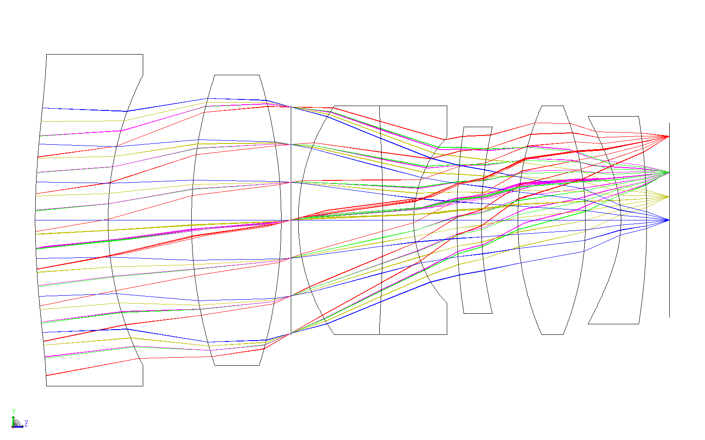
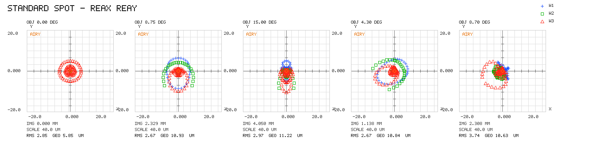

# 车载长焦前摄 15 mm F/1.4 设计报告

**版本**：2026-11-04（定稿，含无热化与 Q5 公差分析）
**设计文件**：`车载长焦前摄15mmF1.4_最终设计.zos`
**公差文件**：`车载长焦前摄15mmF1.4_公差定稿.zos`
**软件**：Ansys Zemax OpticStudio 2024 R1，交互扩展模式

---

## 1. 设计任务与达成情况

### 1.1 指标对照

| 项目 | 要求 | 实测 | 判定 |
|---|---|---|---|
| 相对孔径 | F/1.4 | F/1.400（EPD 10.799 mm） | ✅ |
| 焦距 | 15 ± 5 %（14.25~15.75） | **15.118 mm** | ✅ |
| 总长 TOTR | 30 ± 2 %（29.4~30.6） | **30.499 mm** | ✅ |
| 视场 | 2ω 35°（水平 30°） | ±17.43° → **2ω = 34.85°** | ✅ |
| 相对照度 | ≥ 78 % | **82.96 %**（全视场） | ✅ |
| 光学畸变 | ≈1 % | **0.394 %**（F-Tanθ） | ✅ |
| MTF @120 lp/mm | > 0.5 | 轴上 0.597 / 0.5 场 0.670 / 0.86 场 0.562 / **全视场 0.447** | ⚠️ 边缘未达 |
| 场曲 | < 0.05 mm | **0.032 mm**（全视场） | ✅ |
| 像圈 | > 9.25 mm | **9.46 mm**（像高 4.732 mm） | ✅ |
| 非球面数量 | ≤ 2 | **2**（S1、S13，均为偶次非球面） | ✅ |
| 玻璃材料 | 成都光明 CDGM | 7 片全部 CDGM | ✅ |
| 可加工性 | pass | pass（\|B\| ≤ 4.43，ET ≥ 1.04 mm） | ✅ |
| 评价函数 | — | 0.010930 | — |

**唯一未达标项**：全视场 MTF@120 为 0.447（目标 0.5）。根因是 Petzval 场曲——7 片玻璃的 Σ(φ/n) 已无优化空间，属结构固有弱项，前序版本已用 MTFT/MTFS 约束、RMS 波前、Hammer 全局搜索逐一验证无效，最终接受。

### 1.2 架构

结构形式为**双高斯演化**，**6 个元件 / 7 片玻璃**（第 3、4 片为胶合双胶合），光阑置于第 4、5 片之间，整体近对称。首片与末片前表面为偶次非球面，承担主要像差校正。

---

## 2. 系统参数

### 2.1 孔径、视场、波长

| 项 | 设置 |
|---|---|
| 孔径类型 | 入瞳直径 EPD = **10.799 mm**（对应 F/1.4） |
| 视场（角度，X/Y） | (0, 0) 权重 3；(0, 8.75) 权重 2；(0, 15.0) 权重 2；(7.5, 4.3) 权重 2；(15.1, 8.7) 权重 5 |
| 最大视场 | 17.427°（对角） |
| 波长 | 0.486 µm 权重 3 / **0.588 µm（主）** 权重 1 / 0.656 µm 权重 5 |

### 2.2 面型数据

| 面 | 注释 | 类型 | 半径 R (mm) | 厚度 (mm) | 玻璃 | 半口径 (mm) |
|---|---|---|---|---|---|---|
| 0 | OBJ | 标准 | ∞ | ∞ | — | — |
| 1 | S1 L1 前 | 偶次非球面 | 35.3292 | 3.5056 | QF50 | 8.00 |
| 2 | S2 L1 后 | 标准 | 15.4283 | 4.0127 | — | 7.00 |
| 3 | S3 L2 前 | 标准 | 22.4310 | 4.3128 | D-LAF50-25 | 7.00 |
| 4 | S4 L2 后 | 标准 | −23.6905 | 0.4707 | — | 7.00 |
| 5 | 光阑 | 标准 | ∞ | 0.3519 | — | 5.50 |
| 6 | S5 L3 前 | 标准 | 9.6357 | 4.0618 | D-LAF50 | 5.50 |
| 7 | S6 L4 前（胶合面） | 标准 | −85.7528 | 1.4846 | H-ZF7LA | 5.00 |
| 8 | S7 L4 后 | 标准 | 5.7740 | 2.0837 | — | 4.00 |
| 9 | S8 L5 前 | 标准 | 30.4732 | 1.1724 | ZF7 | 4.50 |
| 10 | S9 L5 后 | 标准 | 19.2411 | 1.7557 | — | 4.50 |
| 11 | S10 L6 前 | 标准 | 13.8112 | 3.2586 | D-LAF50-25 | 5.50 |
| 12 | S11 L6 后 | 标准 | −14.6088 | 1.7010 | — | 5.50 |
| 13 | S12 L7 前 | 偶次非球面 | −6.5470 | 1.2458 | H-QK3L | 5.00 |
| 14 | S13 L7 后 | 标准 | −32.2061 | 1.0822 | — | 5.00 |
| 15 | 像面 | 标准 | ∞ | — | — | 4.68 |

### 2.3 非球面系数（偶次非球面，k = −1 双曲面）

| 面 | k | A4 | A6 | A8 及以上 |
|---|---|---|---|---|
| S1（L1 前） | −1.000 | −7.4326e−05 | −2.2196e−07 | 0 |
| S13（L7 前） | −1.000 | +5.1558e−04 | +7.9652e−07 | 0 |

**面型可制造性复核（解析求导，6000 点采样）**

| 项 | S1 | S13 | 判定 |
|---|---|---|---|
| 边缘斜率角 | 1.75° | 26.15° | < 60° ✅ |
| 最大斜率角 | 5.73° | 26.24° | < 60° ✅ |
| 斜率反曲 z′=0 | 8.485 mm（半口径 8.00 → 口径外） | 口径内无 | ✅ 无内反曲 |
| 曲率反号 z″=0 | 5.147 mm（通光 6.56 内） | 4.764 mm（通光 2.95 外） | S1 有拐点，需工艺对策 |
| 边缘厚度 ET | 4.82 mm | 3.18 mm | ≥ 0.6 ✅ |

> S1 的 z″=0 落在通光内（5.147 mm），意味着局部曲率在这一点由凸转凹，抛光模要跨过"曲率半径无穷"的环带，易留中频环带。斜率并未变号（不是反曲，光线追迹正常），但图纸上应注明允许该环带，或改用小磨头/气囊抛光。

### 2.4 玻璃与热常数

| 元件 | 面 | 玻璃（CDGM） | nd | νd | TCE (ppm/℃) |
|---|---|---|---|---|---|
| L1 | 1–2 | QF50 | 1.5814 | 40.9 | 9.0 |
| L2 | 3–4 | D-LAF50-25 | 1.7729 | 49.5 | 7.3 |
| L3 | 6–7 | D-LAF50 | 1.7740 | 49.6 | 7.3 |
| L4 | 7–8 | H-ZF7LA | 1.8052 | 25.5 | 9.0 |
| L5 | 9–10 | ZF7 | 1.8063 | 25.4 | 7.9 |
| L6 | 11–12 | D-LAF50-25 | 1.7729 | 49.5 | 7.3 |
| L7 | 13–14 | H-QK3L | 1.4875 | 70.4 | 9.2 |

> nd/νd 取自 `CDGM.AGF` 原始记录（`NM <牌号> <序号> <六码> <nd> <νd>`），非估算值。
> 注意 QF50 是**轻火石**（νd 40.9）而非冕牌，L2/L6 的 D-LAF50-25 与 L3 的 D-LAF50 几乎同牌号（νd 49.5 vs 49.6）。

镜筒/隔圈：**6061 铝合金，TCE = 23.6 ppm/℃**（与玻璃 7.3~9.2 相差 2.5~3 倍，是无热化设计的核心矛盾）。

### 2.5 元件可加工性

| 元件 | 面 | R1 / R2 (mm) | CT (mm) | ET (mm) | 弯曲因子 B | 判定 |
|---|---|---|---:|---:|---:|---|
| L1 | 1–2 | 35.329 / 15.428 | 3.506 | 4.824 | −2.551 | pass |
| L2 | 3–4 | 22.431 / −23.691 | 4.313 | 2.135 | 0.027 | pass |
| L3+L4（胶合） | 6–8 | 9.636 / 5.774 | 5.546 | 7.839 | −3.990 | pass |
| L5 | 9–10 | 30.473 / 19.241 | 1.172 | 1.372 | −4.426 | pass |
| L6 | 11–12 | 13.811 / −14.609 | 3.259 | 1.041 | 0.028 | pass |
| L7 | 13–14 | −6.547 / −32.206 | 1.246 | 3.176 | 1.510 | pass |

全部 6 个元件通过：无极端弯月（|B| ≤ 5）、无刀口边（ET ≥ 1.04 mm）、SD/|R| ≤ 0.45。

---

## 3. 成像性能

### 3.1 MTF @120 lp/mm（复色 0.486~0.656 µm）

| 视场 | 子午 T | 弧矢 S | 平均 |
|---|---:|---:|---:|
| 轴上 0° | 0.597 | 0.597 | 0.597 |
| 0.5 场 8.75° | 0.628 | 0.712 | 0.670 |
| 0.86 场 15.0° | 0.545 | 0.578 | 0.562 |
| 全视场 17.43° | 0.485 | 0.447 | 0.466 |

### 3.2 点列图 RMS 半径（复色）

| 视场 | 1 (0°) | 2 (8.75°) | 3 (15°) | 4 (7.5,4.3) | 5 (17.43°) |
|---|---:|---:|---:|---:|---:|
| RMS (µm) | 2.854 | 2.673 | 2.975 | 2.671 | **3.740** |
| GEO (µm) | 5.845 | 10.933 | 11.223 | 10.836 | 10.635 |

全部 < 5 µm ✅（艾里半径 1.004 µm = 0.61·λ/NA，RMS 为艾里半径的 2.7~3.7 倍）。

### 3.3 三维布局与点列图

6 个元件、光线通畅，无穿插与异常遮挡，结构近对称（光阑居中）。

### 3.4 畸变、照度、CRA

| 项 | 常温实测 | 规格 | 判定 |
|---|---|---|---|
| 最大畸变（F-Tanθ，全视场） | 0.394 % | ≈1 % | ✅ |
| 相对照度（17.43°） | 0.8296 | ≥ 0.78 | ✅ |
| CRA（y15° 取最大值） | 12.427° | < 18° | ✅ |
| 像圈 | 9.46 mm | > 9.25 mm | ✅ |
| 场曲（全视场，0.588 µm） | 0.032 mm | < 0.05 mm | ✅ |

---

## 4. 无热化分析

### 4.1 模型设置

- **10 个温度组态**：25（参考）/ −40 / −10 / 5 / 45 / 65 / 85 / 100 / 115 / 125 ℃
- **热模型**：MCE 27 条操作数、243 个单元格。玻璃的 `CRVT`/`THIC` 用各自 TCE；7 段空气间隔与像面用铝 23.6 ppm/℃。
- 全部逐格 read_back 校验，0 失败。

### 4.2 不调焦时的像面位移

| 温度 ℃ | −40 | −10 | 5 | 25 | 45 | 65 | 85 | 100 | 115 | 125 |
|---|---:|---:|---:|---:|---:|---:|---:|---:|---:|---:|
| 像面位移 µm | **−27.36** | −14.73 | −8.42 | 0 | +8.42 | +16.84 | +25.26 | +31.57 | +37.89 | **+42.10** |

- 全温跨度 **69.46 µm**，斜率约 0.42 µm/℃。
- F/1.4、λ=0.588 µm 的瑞利焦深 ±2.3 µm → 最坏处为焦深的 **18.3 倍**，**被动无解**。

### 4.3 主动调焦需求

> 工具的 `focus` 扫描行程固定 ±40 µm，125 ℃ 的最优点撞在 −37.4 µm 边界上，读数失真。下表的调焦量由三点抛物线外推得到（RMS 判据）。

| 温度 ℃ | −40 | −10 | 5 | 25 | 45 | 65 | 85 | 100 | 115 | 125 |
|---|---:|---:|---:|---:|---:|---:|---:|---:|---:|---:|
| 调焦量 µm | **+35.8** | +19.0 | +10.6 | −0.6 | −11.9 | −23.1 | −34.4 | −42.8 | −51.3 | **−56.9** |
| 调焦后 RMS µm | 2.82 | 2.86 | 2.91 | 3.00 | 3.12 | 3.26 | 3.42 | 3.56 | 3.70 | 3.80 |

- 行程跨度 **92.6 µm** → 机构净行程按 **±70 µm** 设计（1.5 倍余量）。
- 斜率 0.55~0.57 µm/℃，冷热对称，高度线性。
- 125 ℃ + 调焦 −56.9 µm 实测：复色 MTF@120 全视场最差方向 **0.446**，与常温 0.442 基本持平，说明主动调焦可把热离焦完全补偿掉。

### 4.4 全温硬指标（10 组态实测）

| 温度 ℃ | −40 | 25 | 125 | 全温跨度 | 规格 | 判定 |
|---|---:|---:|---:|---|---|---|
| 最大畸变 % | 0.3839 | 0.3940 | 0.4099 | 0.026 pp | < 1 % | ✅ |
| 相对照度 | 0.8341 | 0.8296 | 0.8226 | 0.0114 | ≥ 0.78 | ✅ |
| CRA ° | 12.4555 | 12.4269 | 12.3822 | 0.0733 | < 18 | ✅ |
| TOTR mm | 30.4721 | 30.4995 | 30.5416 | 69.5 µm | 30 ± 2 % | ✅ |

### 4.5 结论

1. **必须做主动调焦**。7 片玻璃的 dn/dT 与 TCE 同号，光学被动补偿凑不出抵消项；铝镜筒的 23.6 ppm 与玻璃 7.3~9.2 ppm 相差 3 倍，热离焦量级由镜筒主导。
2. 机构要求：**净行程 ±70 µm、重复精度优于 5 µm**，全温像质可拉回常温水平。
3. 畸变、照度、CRA、总长在全温下几乎不动，无需为温度牺牲任何已达标的光学指标。
4. 玻璃替代（QF50 / ZF7 等同族牌号）对热离焦影响仅 0.045 µm，**无热化瓶颈在机械补偿，不在玻璃选择**。

---

## 5. 公差分析（Q5）

### 5.1 设置

| 项 | 设置 |
|---|---|
| 等级 | **Q5**（车载 Tier-1 主力档） |
| 分析副本 | 单组态、25 ℃（MCE 热模型临时清除，否则半径/厚度公差被硬值覆盖） |
| 判据 | **复色（0.486~0.656 µm）ITO 衍射 MTF @120 lp/mm，子午弧矢平均** |
| 补偿器 | 后焦（S14 厚度），实测后焦漂移 −0.111 ~ +0.103 mm |
| 抽样 | 蒙特卡洛 **500 次**，正态分布 |
| TDE 条目 | 69 条 |

| 公差项 | Q5 值 | 操作数 | 施加范围 |
|---|---|---|---|
| 曲率 | ±2 光圈 | TFRN | 14 个面 |
| 中心/空气厚度 | ±0.0375 mm（**胶合组 ±0.01875**） | TTHI | 14 处 |
| 不规则度 | ±0.5 光圈 | TIRR | 14 个面 |
| 元件偏心 X/Y | ±0.010 mm | TEDX/TEDY | 6 个元件 |
| 折射率 | ±0.001 | TIND | 7 片玻璃 |
| 阿贝数 | ±0.10 % | TABB | 7 片玻璃 |

> 偏心与倾斜只保留偏心（可测量），倾斜由装配基准保证——两者在小于 1′ 等效（θ≈d/f），同时给会把同一误差算两遍。

### 5.2 灵敏度（单项劣化）

| 排名 | 项 | 面 | 公差 | RMS 劣化 (µm) | MTF 劣化 |
|---|---|---|---:|---:|---:|
| 1 | TTHI | S6 胶合前片厚 | ±0.0375 | 1.444 | −0.166 |
| 2 | TTHI | S7 胶合后片厚 | ±0.0375 | 1.395 | −0.161 |
| 3 | TIND | S3 (D-LAF50-25) | ±0.001 | 0.814 | −0.106 |
| 4 | TTHI | S1 (L1 中心厚) | ±0.0375 | 0.789 | −0.086 |
| 5 | TTHI | S3 (L2 中心厚) | ±0.0375 | 0.623 | −0.070 |
| 6 | TEDX/TEDY | L1 | ±0.010 | 0.533 | −0.054 |
| 7 | TTHI | S12 (L6 后间隔) | ±0.0375 | 0.457 | −0.036 |

**预算构成（RSS 占比）**：厚度 85.4 % · 折射率 37.7 % · 偏心 X/Y 各 23.4 % · 曲率 11.5 % · 不规则度 6.2 % · 阿贝 3.1 %。

胶合双胶合两片的中心厚单独占 **70.7 %**，是唯一的"投钱就见效"的位置。

### 5.3 蒙特卡洛结果

> 定稿口径统一为 **500 次抽样**（200 次抽样的 95 % 置信区间太宽，不足以对客户承诺良率）。纯 Q5 与"胶合组收起"的 200 次早期结果仍保留作对照。

**A. 复色 MTF@120 > 0.35 为判据**

| | 纯 Q5（200 次） | 定稿：胶合 ±0.01875（**500 次**） | 放宽：胶合 ±0.025 = Q4（500 次） |
|---|---|---|---|
| 名义 | 0.570 | 0.570 | 0.570 |
| 均值 | 0.436 | **0.481** | 0.464 |
| 标准差 | 0.0686 | **0.055** | 0.060 |
| P10 | 0.338 | **0.409** | 0.382 |
| 最差样本 | 0.225 | 0.304 | 0.241 |
| **良率（> 0.35）** | **86.5 %** | **99.0 %**（5/500 失败） | 96.2 %（19/500 失败） |
| 95 % 置信区间 | — | **[97.7 %, 99.6 %]** | [94.1 %, 97.6 %] |

**B. RMS 光斑 ≤ 5 µm 为判据**

| | 纯 Q5（200 次） | 定稿：胶合 ±0.01875（**500 次**） |
|---|---|---|
| 名义 | 2.13 µm | 2.13 µm |
| 均值 | 3.43 µm | **3.03 µm** |
| 标准差 | 0.86 µm | **0.60 µm** |
| P90 | 4.59 µm | 3.87 µm |
| 最差样本 | 7.09 µm | 5.17 µm |
| **良率（≤ 5 µm）** | **93.4 %** | **99.6 %**（2/500 失败） |

### 5.4 结论与措施

1. **RMS < 5 µm：达标**，即使 Q5 原样也有 93.4 % 良率（P90 = 4.59 µm，余量充足）；定稿 99.6 %。
2. **复色 MTF > 0.35：Q5 原样不达标（86.5 %）**，差 3.5 个百分点——P10 = 0.338，刚好压在门限下。
3. **唯一必要措施**：把胶合双胶合两片（S6、S7）的中心厚从 ±0.0375 收到 **±0.01875**（双胶合产线常规做法），其余 67 条公差一条不动。良率 86.5 % → **99.0 %**，RMS 良率同时升到 99.6 %。
4. **不放宽到 Q4（±0.025）**：良率掉到 96.2 %，均值仍高于 95 %，但 **95 % 置信下界 94.1 % 已贴破 95 %**，无法承诺 ≥97 %；而 ±0.019 与 ±0.025 在加工上同属一档，成本差远小于 2.8 pp 报废代价。
5. 可选低成本措施（按性价比排序）：
   - 折射率改按**熔炼批**抽样（当前按片独立，偏保守），预计再提升 3~5 个百分点；
   - 不规则度 0.5 光圈仅贡献 0.18 µm，量产可放宽到 1 光圈以降低抛光成本；
   - 最后才考虑胶合组厚度。
6. **MTF 判据比 RMS 判据严格得多**：同一组公差，86.5 % vs 93.4 %（200 次口径）。客户规格写 MTF 时不能用 RMS 良率交差。

### 5.5 口径说明

- MTF 判据取的是 **9 视场、子午/弧矢平均**（Zemax `DiffMTFAverage` 定义）。若客户按**最差视场、最差方向**验收，余量会显著变小——常温复色全视场最差方向仅 0.447，离 0.35 只有 0.09。需要该口径时应改用 `DiffMTFSag` 单独复算。
- 报告头打印的"测试波长 0.5880"只是主波长，公差分析实际按复色计算（已用 FFT MTF 加权平均交叉验证：复色 0.5754 / 单色 0.6306 / 公差名义 0.5705）。

---

## 6. 遗留问题与后续建议

| 项 | 状态 | 建议 |
|---|---|---|
| 全视场 MTF@120 = 0.447（< 0.5） | 已接受 | Petzval 固有；如需改进加第 8 片弱负平场镜，或放宽 TOTR 到 31~32 mm 重新平衡 |
| S1 在 5.147 mm 处 z″=0 | 工艺提示 | 图纸注明允许中频环带，或采用小磨头/气囊抛光 |
| 半口径偏大（S1 8.0 vs 通光 6.56） | 建议优化 | 收到 6.7~6.8 可降低非球面度与边缘斜率，零成本 |
| 公差副本 EFFL = 15.118 | 已知 | 玻璃 Substitute 求解固定所致，仍满足 15±5 %；定稿应用显式牌号重建 |
| 主动调焦机构 | 待设计 | 净行程 ±70 µm、重复精度 ≤ 5 µm |
| 镀膜 / 杂散光 | 未分析 | 车载需评估鬼像与 MTF 退化 |

---

## 7. 文件清单

| 文件 | 说明 |
|---|---|
| `车载长焦前摄15mmF1.4_最终设计.zos` | **设计基准（定稿）**：10 温度组态 + 27 条热模型 + 全 CDGM 玻璃 |
| `车载长焦前摄15mmF1.4_公差定稿.zos` | **公差基准（定稿）**：单组态 25 ℃、69 条 TDE、胶合组 ±0.01875 |
| `车载长焦前摄15mmF1.4_工程总结.md` | **对外交付总结**（光学指标 / 像质 / 热差与公差 / 杂散光鬼影） |
| `公差报告_MTF_胶合01875_500次.md` | 定稿 MTF 良率原始报告（500 次） |
| `公差报告_MTF_胶合Q4_500次.md` | 胶合组放宽到 Q4 的对比报告（500 次） |
| `公差报告_RMS_定稿500次.md` | 定稿 RMS 良率原始报告（500 次） |
| `公差报告_灵敏度_胶合Q4.md` | 灵敏度明细（78 项逐项劣化）+ 补偿器统计 |
| `鬼影分析_一阶_20261104.md` | 91 组面组合鬼影清单、两种镀膜假设对比 |
| `车载长焦前摄15mmF1.4_无热化基准.zos` | 定稿设计文件的源文件（内容与 `_最终设计.zos` 逐位一致） |
| `layouts/layout_3D.png` / `layouts/spot_diagram.png` | 三维布局图 / 点列图 |
| `backups/` | 自动备份（`open_file` 生成） |

---

*报告生成：2026-11-04。数值均取自 Zemax 原生分析或 MCP 工具回读，未经手工调整。*
